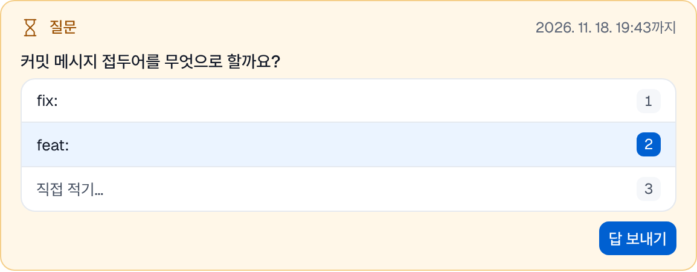
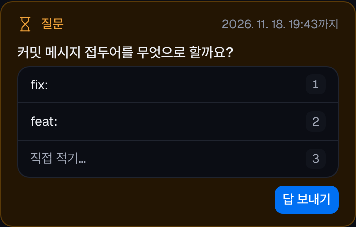
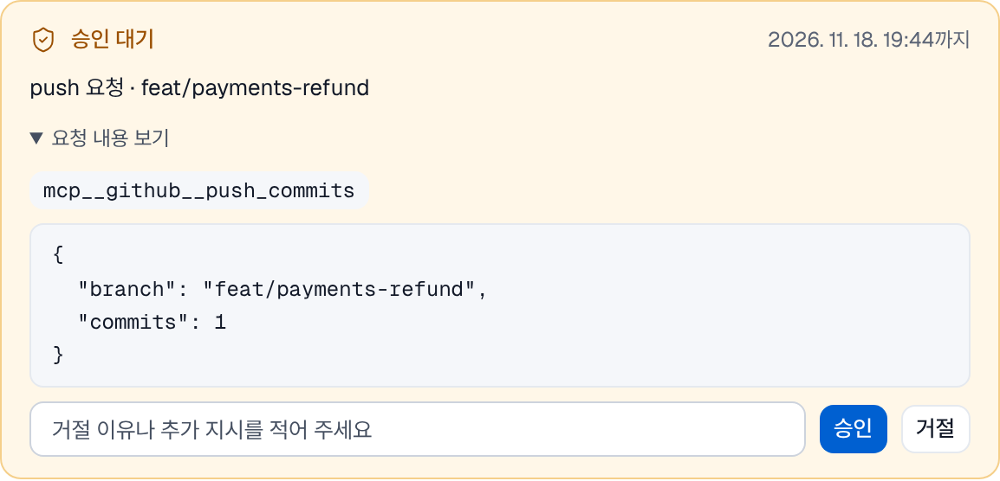

# 세션 상세: 질문 카드·승인 카드 전후 비교

데모 모드와 목 fixture로 찍었습니다. PC는 1280px, 모바일은 390px입니다. "직전 버전"은 이번 피드백을 반영하기 전의 PR 화면입니다.

## 화면 전체

| 화면 | 직전 버전 | 변경 후 |
|---|---|---|
| PC |  |  |
| 모바일 |  |  |

## 질문 카드

| 고른 상태 (PC) | 다크 모드 (모바일) |
|---|---|
|  |  |

- 선택지는 구분선으로 나뉜 목록의 한 줄입니다. 왼쪽에 선택지 글, 오른쪽에 번호가 있습니다. 라디오·체크박스 동그라미는 보이지 않고, 고른 줄은 연한 파란 배경에 번호가 채워집니다.
- 숫자 키로 그 번호의 줄을 고릅니다. 마지막 번호는 "직접 적기…" 줄로 포커스를 옮깁니다. 입력란에 쓰는 숫자는 글로 들어갑니다.
- "직접 적기"는 접기 버튼 없이 목록의 마지막 줄에서 바로 입력합니다.
- "답 보내기" 버튼은 승인 카드처럼 오른쪽 끝에 둡니다.

## 승인 카드: 요청 내용을 펼친 상태

- 도구 이름(`mcp__github__push_commits`)을 "요청 내용 보기" 안으로 옮겼습니다. 접혀 있을 때는 요약 한 줄과 "요청 내용 보기"만 보입니다.
