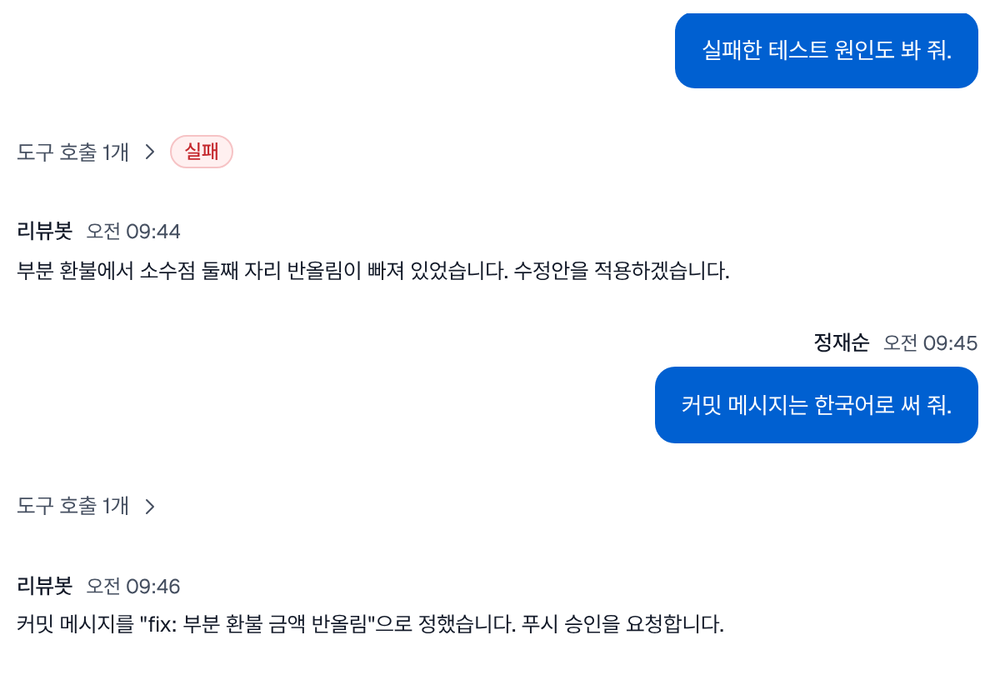
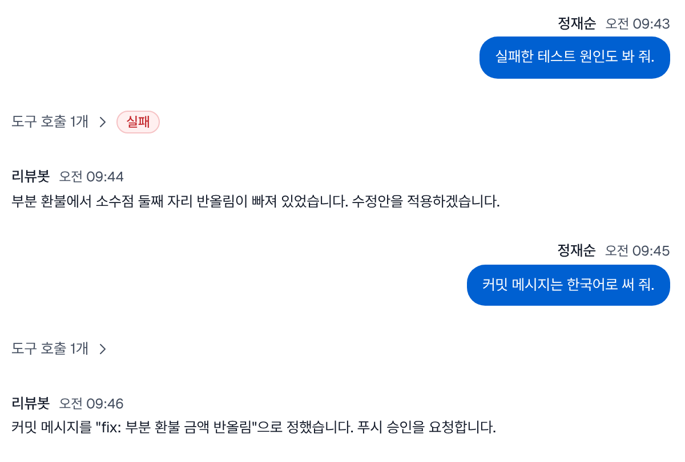
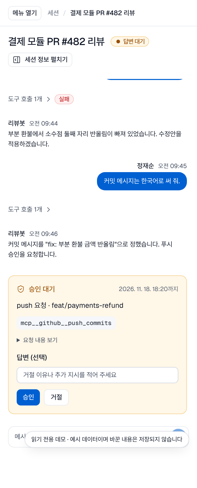
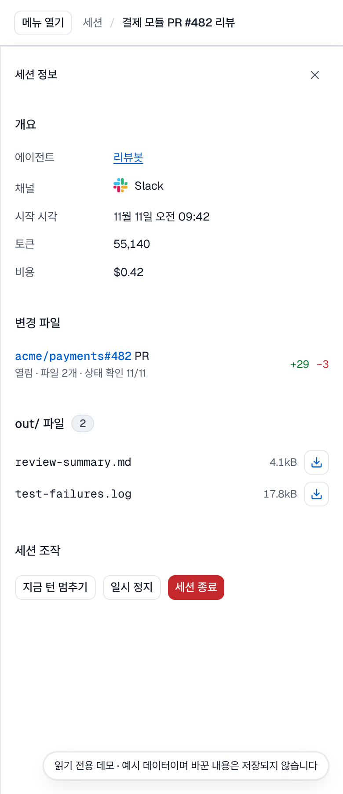
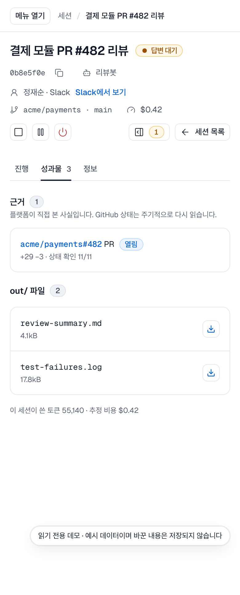
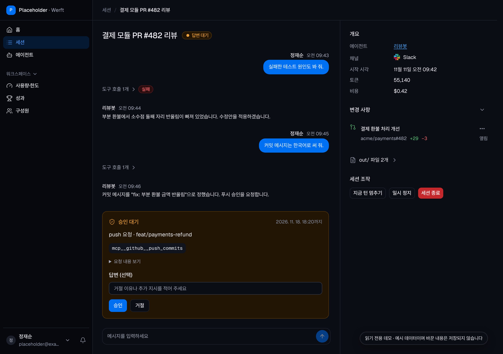

# 세션 상세: 전후 비교

데모 모드와 목 fixture로 찍었습니다. PC는 1280px, 모바일은 390px입니다.

## 피드백 반영: 직전 PR 버전과 비교

### 사람 메시지 말풍선

| 화면 | 직전 버전 | 변경 후 |
|---|---|---|
| PC |  |  |
| 모바일 |  |  |

말풍선 높이가 46px에서 37px로 줄었습니다. 위아래 패딩 8px, 좌우 14px, 모서리 16px, 글자 크기는 AI 글과 같은 13px, 최대 폭은 채팅 열의 70%입니다.

### 사이드바 전체와 변경 사항 카드

| 화면 | 직전 버전 | 변경 후 |
|---|---|---|
| PC |  |  |
| 모바일 |  |  |

- 첫 제목 위 여백을 좌우와 같은 24px로 맞췄습니다. 개요 행 사이는 8px, 섹션 사이는 24px입니다. 높이를 고정한 곳은 없었습니다. 섹션 제목 상자의 최소 높이 32px가 위쪽 여백을 6px 늘리고 있었습니다.
- 변경 사항은 접을 수 있는 카드입니다. PR 한 건이 한 줄이고, 아이콘, 제목, 번호와 +/− 줄 수, 상태, ⋯ 메뉴(GitHub에서 열기) 순입니다. 파일은 나열하지 않습니다.
- out/ 파일은 "out/ 파일 N개" 한 줄로 접고, 누르면 파일과 내려받기 버튼이 펼쳐집니다.

## 처음 상태(탭)와 비교

| 화면 | 변경 전 | 변경 후 |
|---|---|---|
| 진행 탭 → 채팅 (PC) |  |  |
| 진행 탭 → 채팅 (모바일, 패널 접힘) |  |  |
| 성과물 탭 → 레일 (PC) |  |  |
| 성과물 탭 → 레일 (모바일) |  |  |
| 정보 탭 → 레일 개요 (PC) |  |  |
| 정보 탭 → 레일 개요 (모바일) |  |  |

PC에서는 레일이 늘 보입니다. 접힌 상태는 390px에만 있고, 모바일 채팅 캡처가 그 상태입니다.

## 다크 모드

| PC | 모바일 |
|---|---|
|  |  |
