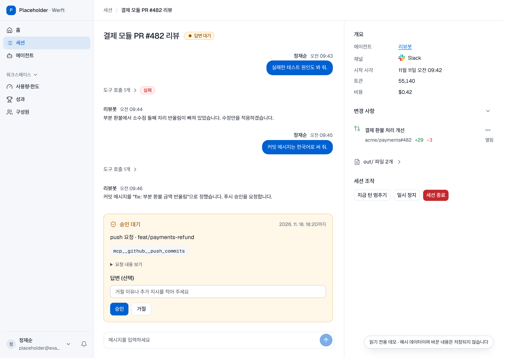
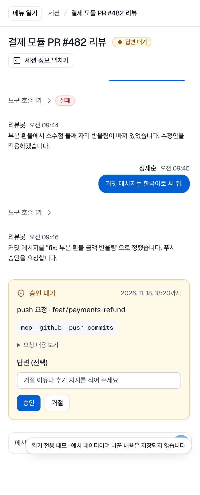
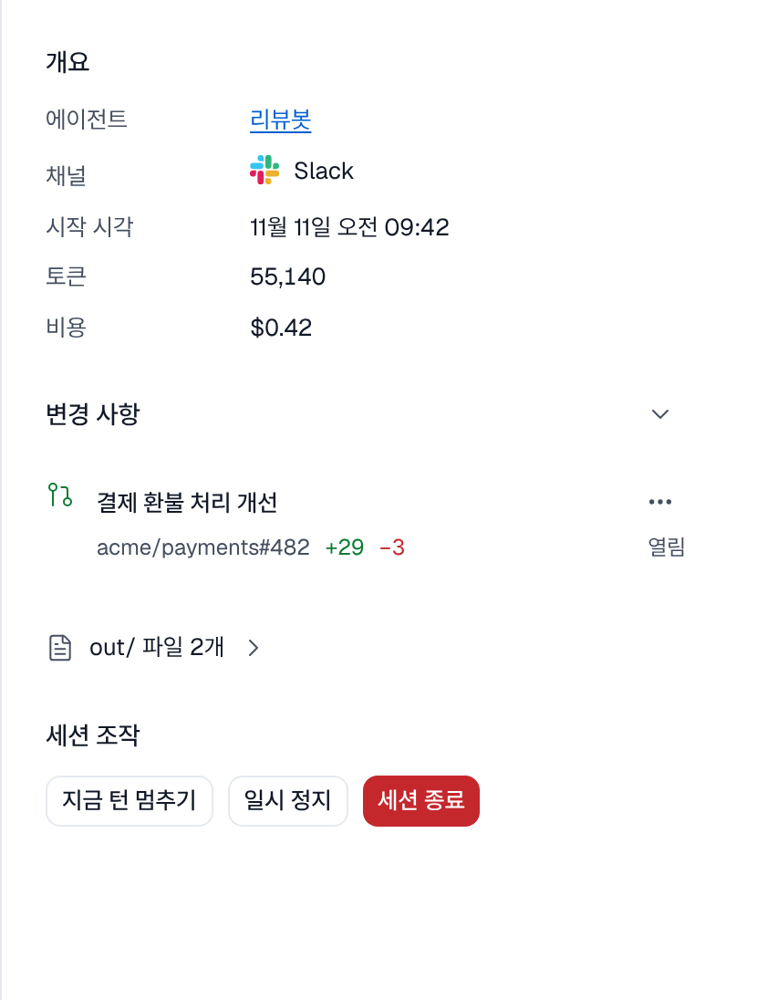
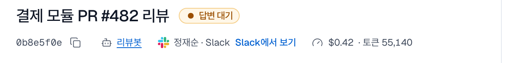
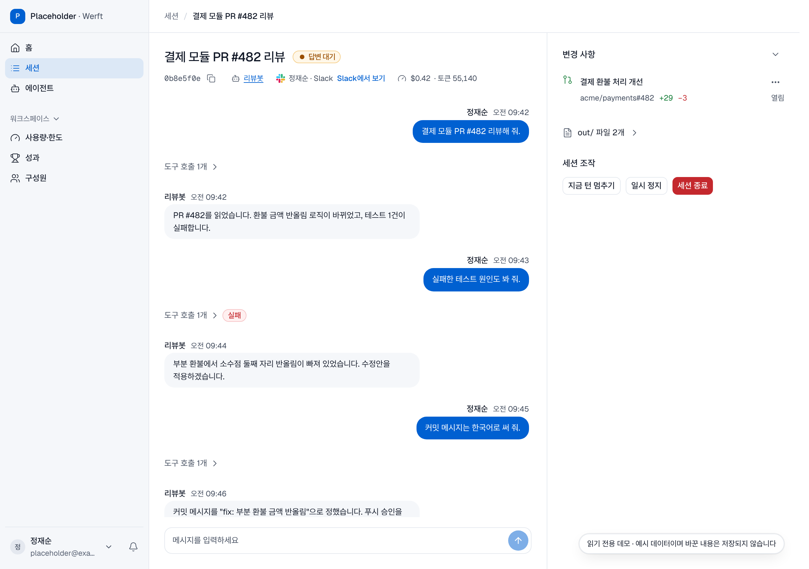
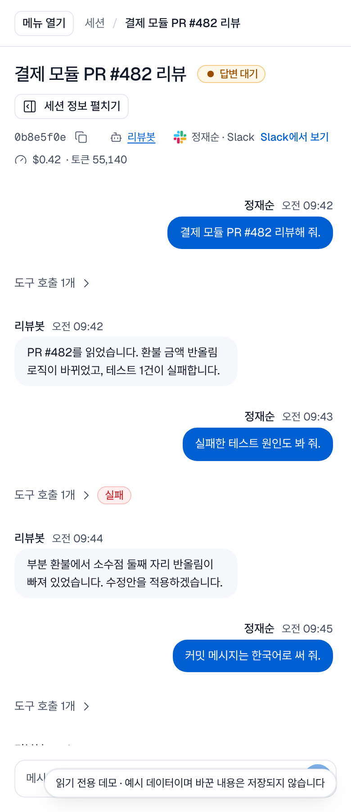
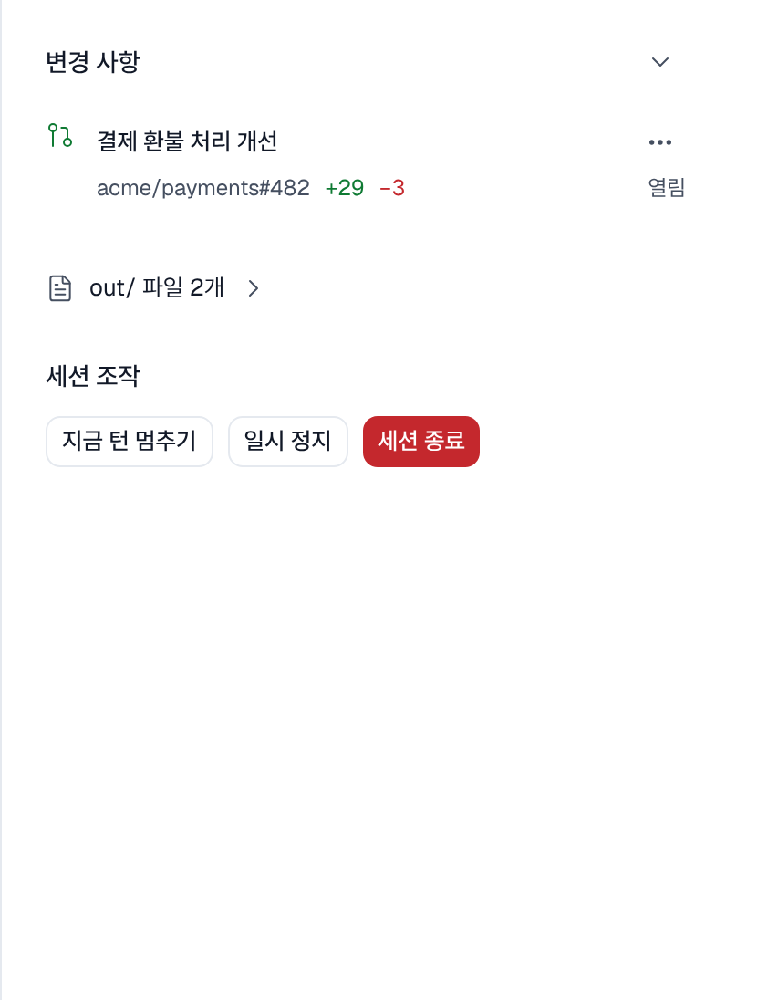
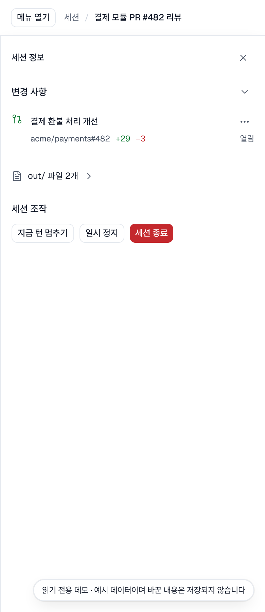
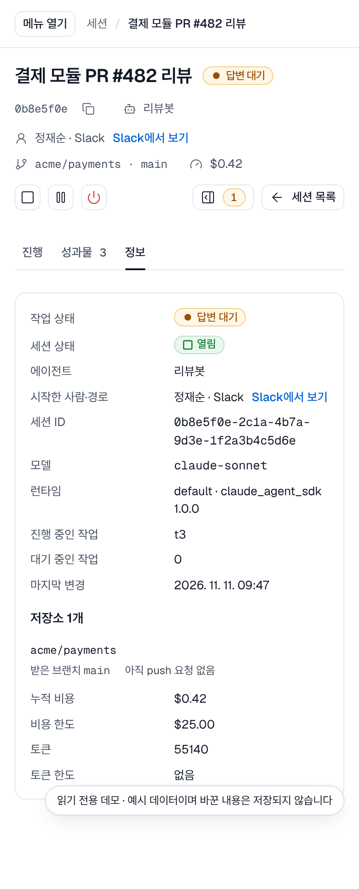
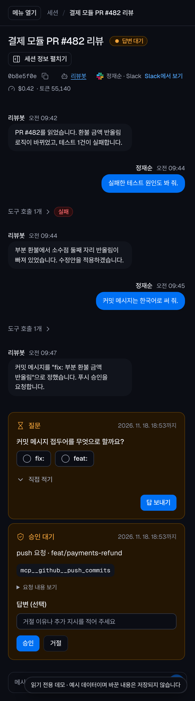

# 세션 상세: 전후 비교

데모 모드와 목 fixture로 찍었습니다. PC는 1280px, 모바일은 390px입니다. "직전 버전"은 이번 피드백을 반영하기 전의 PR 화면입니다.

## 질문 카드와 승인 카드

| 화면 | 직전 버전 | 변경 후 |
|---|---|---|
| PC |  |  |
| 모바일 |  |  |

두 카드가 같은 외곽(RequestCard)을 씁니다. 왼쪽 정렬, 최대 폭 512px이고, 패딩·테두리·모서리와 제목 줄(아이콘, 제목, 오른쪽 기한)이 같습니다. 직전 버전에는 질문 카드가 없고, 승인 카드는 채팅 열 전체 폭을 썼습니다.

## 머리의 메타 줄

| 화면 | 직전 버전 | 변경 후 |
|---|---|---|
| PC |  (레일의 개요) |  |
| 모바일 |  |  |

레일의 개요를 없애고, 제목 아래 한 줄에 다음을 둡니다.
- 세션 ID와 복사 버튼
- 에이전트(로봇 아이콘, 에이전트 상세 링크)
- 호출한 사람과 채널(Slack 로고, "정재순 · Slack", Slack에서 보기)
- 비용과 토큰("$0.42 · 토큰 55,140")

시작 시각은 채널 항목에 마우스를 올리면 보입니다. 390px에서는 줄바꿈되고 가로로 넘치지 않습니다.

## 말풍선 대화

| 화면 | 직전 버전 | 변경 후 |
|---|---|---|
| PC |  |  |
| 모바일 |  |  |

에이전트 메시지도 사람과 같은 크기의 말풍선입니다. 위아래 8px, 좌우 14px, 모서리 16px, 13px 글자, 최대 폭 70%입니다. 사람 메시지는 오른쪽 파랑, 에이전트 메시지는 왼쪽 연회색입니다. 도구 호출 줄은 말풍선 밖에 둡니다.

## 레일(변경 사항과 세션 조작)

| 화면 | 직전 버전 | 변경 후 |
|---|---|---|
| PC |  |  |
| 모바일 (시트를 연 상태) |  |  |

레일에는 변경 사항과 세션 조작만 남습니다. 첫 제목 위 여백은 좌우와 같은 24px입니다.

## 처음 상태(탭)와 비교

| 화면 | 변경 전 | 변경 후 |
|---|---|---|
| 진행 탭 → 채팅 (PC) |  |  |
| 진행 탭 → 채팅 (모바일, 패널 접힘) |  |  |
| 성과물 탭 → 레일 (PC) |  |  |
| 성과물 탭 → 레일 (모바일) |  |  |
| 정보 탭 → 메타 줄 (PC) |  |  |
| 정보 탭 → 메타 줄 (모바일) |  |  |

PC에서는 레일이 늘 보입니다. 접힌 상태는 390px에만 있고, 모바일 채팅 캡처가 그 상태입니다.

## 다크 모드

| PC | 모바일 |
|---|---|
|  |  |
