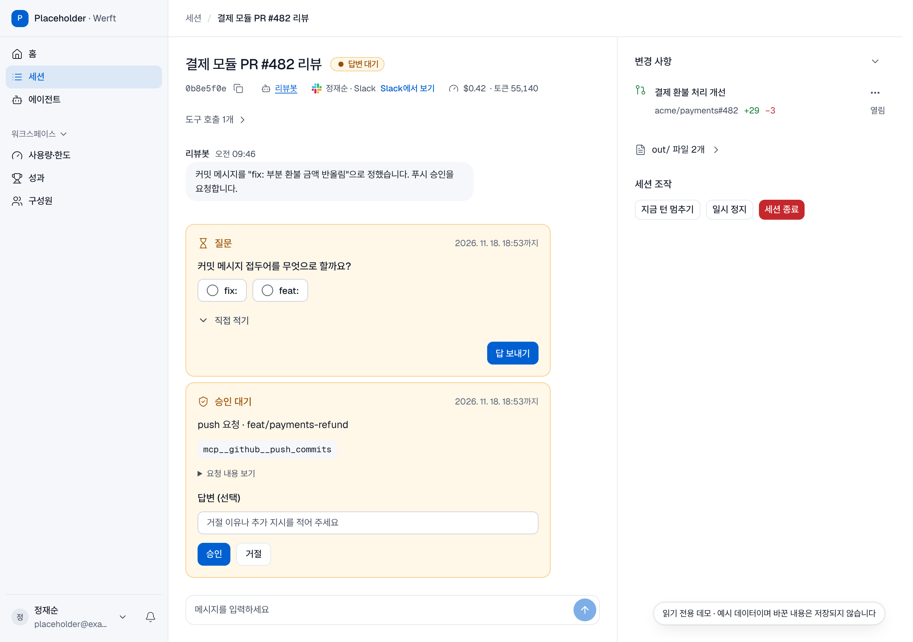
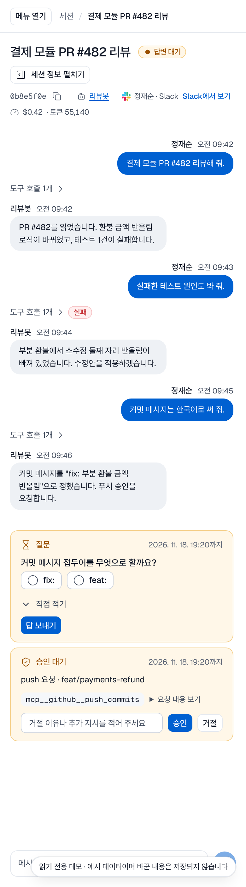
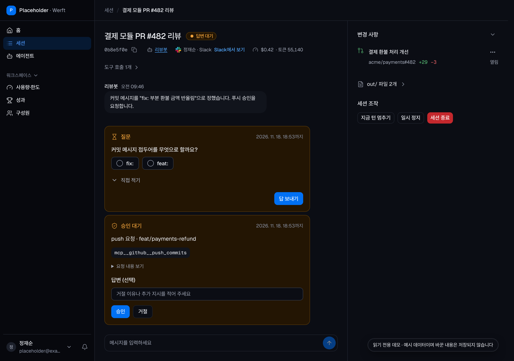
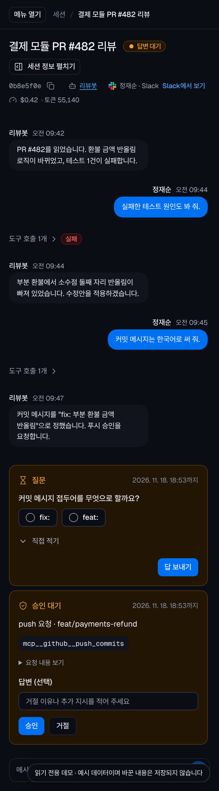

# 세션 상세: 요청 카드·입력창·다크 모드 말풍선 전후 비교

데모 모드와 목 fixture로 찍었습니다. PC는 1280px, 모바일은 390px입니다. "직전 버전"은 이번 피드백을 반영하기 전의 PR 화면입니다.

## 질문 카드·승인 카드와 입력창 (라이트)

| 화면 | 직전 버전 | 변경 후 |
|---|---|---|
| PC |  |  |
| 모바일 |  |  |

- **요청 카드**: 두 카드가 채팅 열 폭을 꽉 채웁니다. 패딩은 위아래 12px·좌우 16px, 글자는 13px로 줄여 같은 모양으로 맞췄습니다.
  - 승인 카드는 도구 이름 칩과 "요청 내용 보기"를 한 줄에, 답변 입력과 승인·거절 버튼을 한 줄에 둡니다.
  - 질문 카드는 선택지와 "답 보내기" 버튼을 작은 크기로 맞추고 왼쪽에 둡니다.
- **도구 호출**: 메시지 사이 간격은 16px이고, "도구 호출 N개" 줄 위아래는 그보다 좁습니다.
- **입력창**: 전송 버튼을 입력창 밖 오른쪽으로 뺐습니다. 화면 아래 여백은 24px에서 16px로 줄여, 왼쪽 사이드바 아래 사용자 줄과 높이를 맞춘 것처럼 보이지 않게 했습니다.

## 다크 모드: 에이전트 말풍선

| 화면 | 직전 버전 | 변경 후 |
|---|---|---|
| PC |  |  |
| 모바일 |  |  |

에이전트 말풍선 배경을 페이지 배경과 거의 같던 #11141c에서 중립 톤 #1a1e28로 바꿨습니다. 라이트 모드에서는 #eef1f5입니다.
