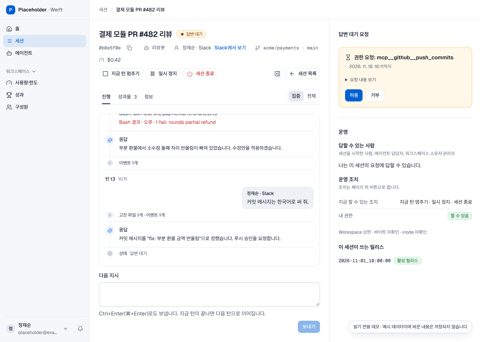
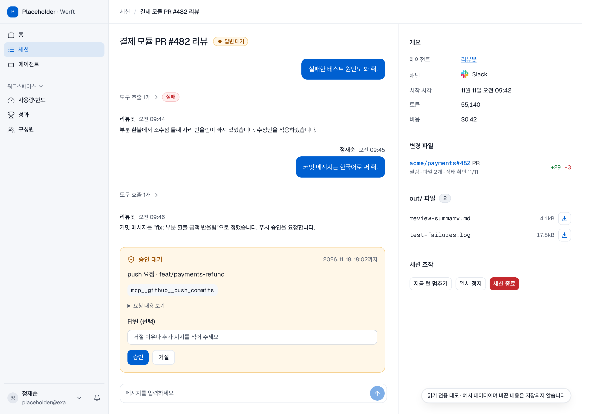
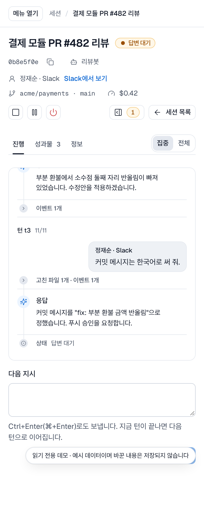
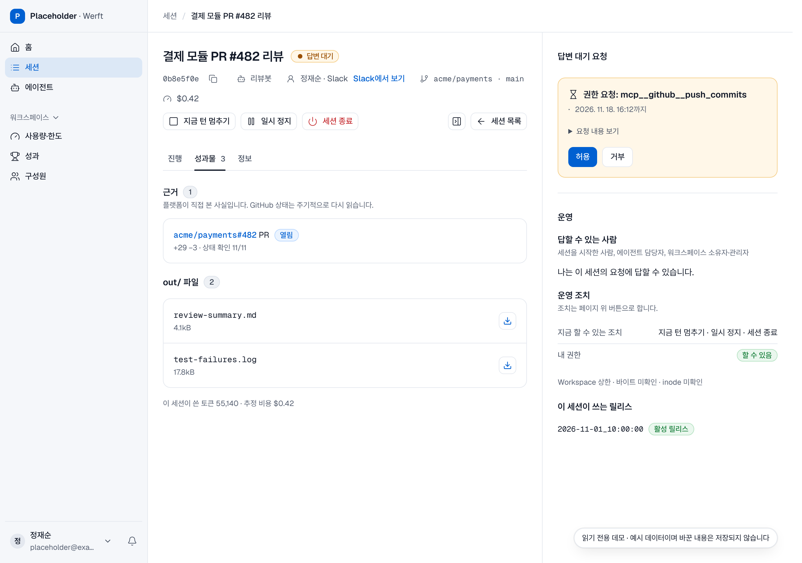
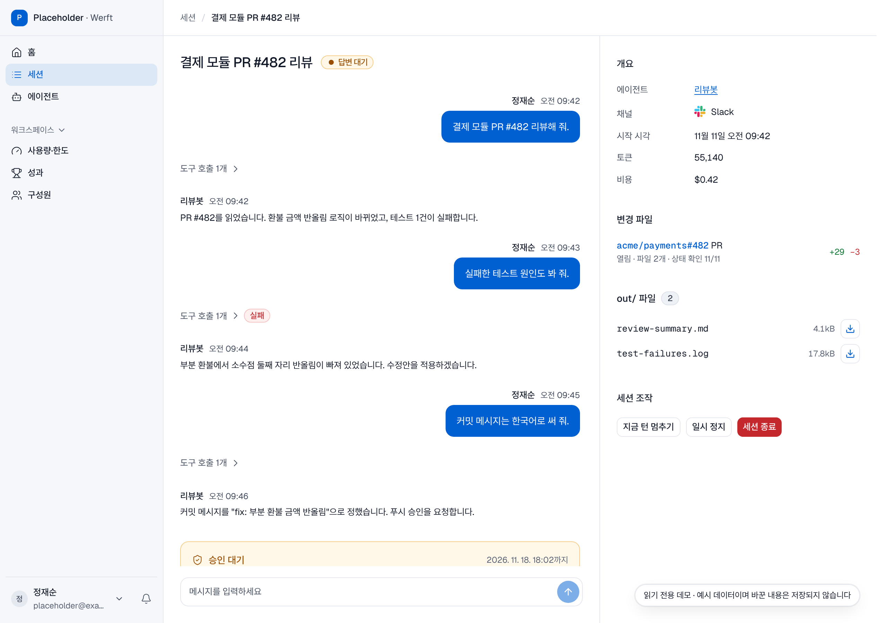
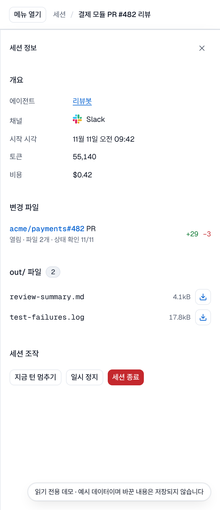
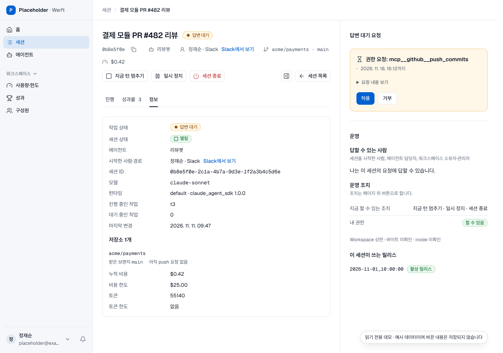
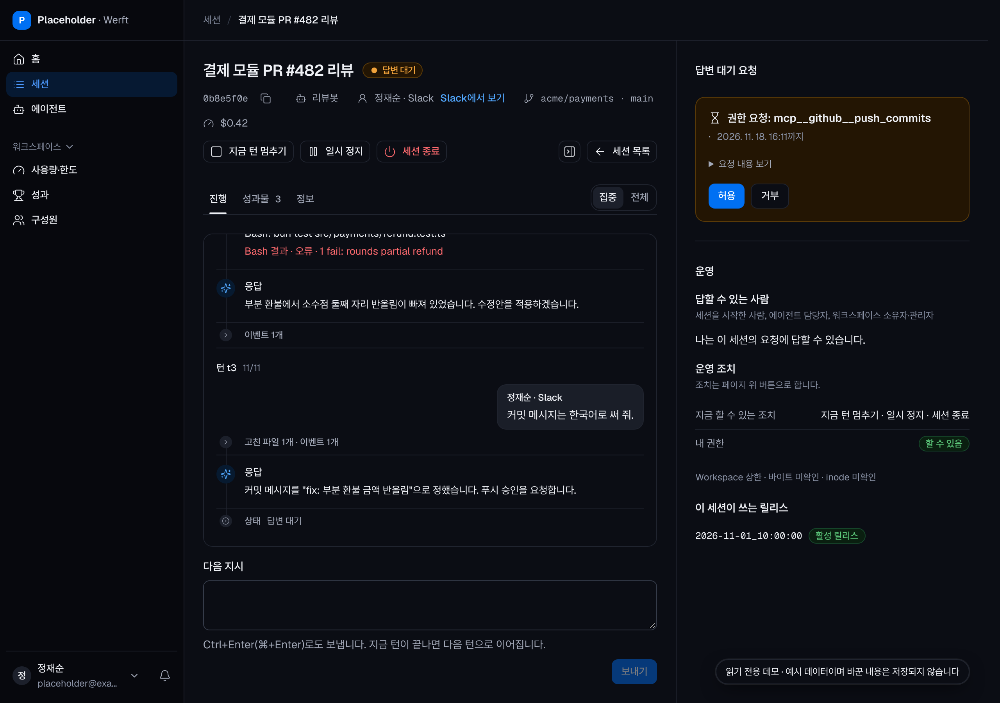
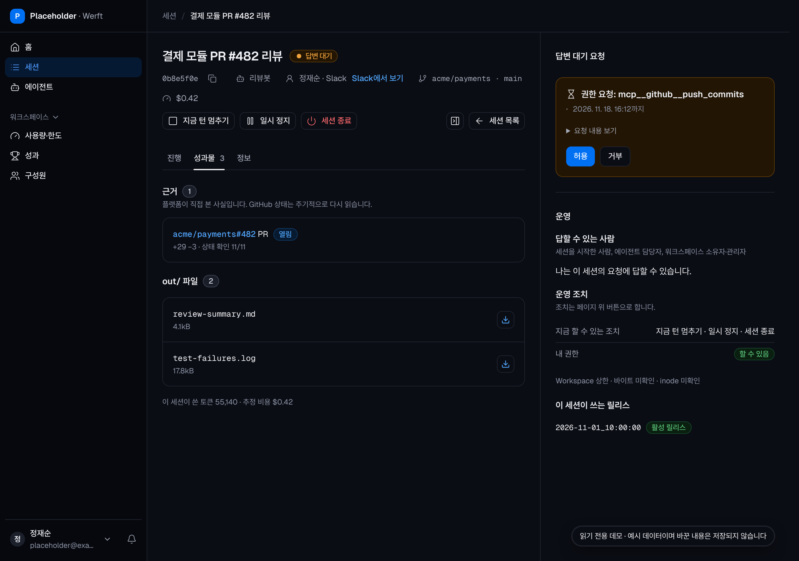
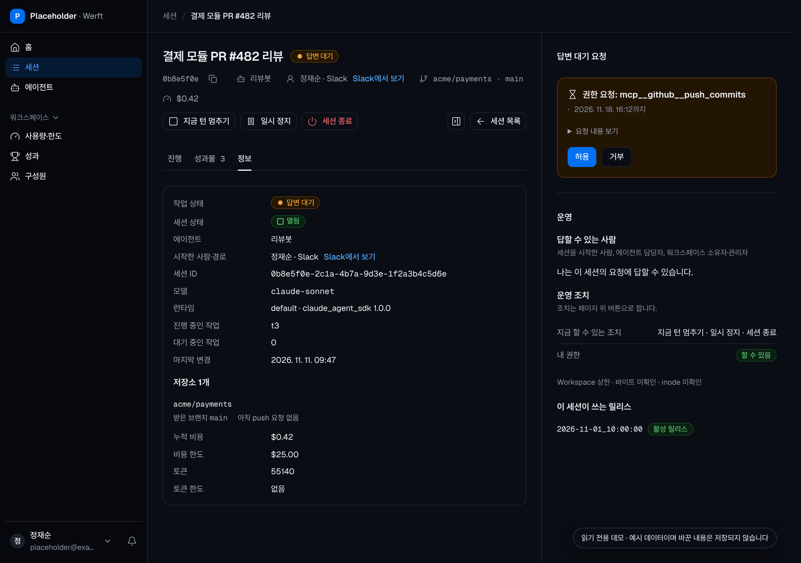

# 세션 상세: 전후 비교

데모 모드와 목 fixture로 찍었습니다. PC는 1280px, 모바일은 390px입니다.

## 진행 탭 → 채팅

| 화면 | 변경 전 | 변경 후 |
|---|---|---|
| PC |  |  |
| 모바일 |  |  |

사람은 오른쪽 파란 말풍선, 에이전트는 왼쪽 글로 보입니다. 이어진 도구 호출은 "도구 호출 N개" 한 줄로 접힙니다. 승인 대기는 채팅 끝의 카드로 답합니다.

## 성과물 탭 → 오른쪽 레일

| 화면 | 변경 전 | 변경 후 |
|---|---|---|
| PC |  |  |
| 모바일 |  |  |

PR, out/ 파일, 성과, GitHub 거절을 레일 섹션으로 옮겼습니다. 390px에서는 '세션 정보 펼치기'로 시트를 엽니다.

## 정보 탭 → 레일의 개요

| 화면 | 변경 전 | 변경 후 |
|---|---|---|
| PC |  |  |
| 모바일 |  |  |

개요에는 에이전트, 채널, 시작 시각, 토큰, 비용만 둡니다.

## 사이드 패널을 접은 상태

PC에서는 레일이 늘 보입니다. 접힌 상태는 390px에만 있고, 위 "진행 탭 → 채팅"의 모바일 변경 후 캡처가 그 상태입니다.

## 다크 모드

| 화면 | 변경 전 | 변경 후 |
|---|---|---|
| PC 진행 |  |  |
| PC 성과물 |  | |
| PC 정보 |  | |
| 모바일 | |  |
