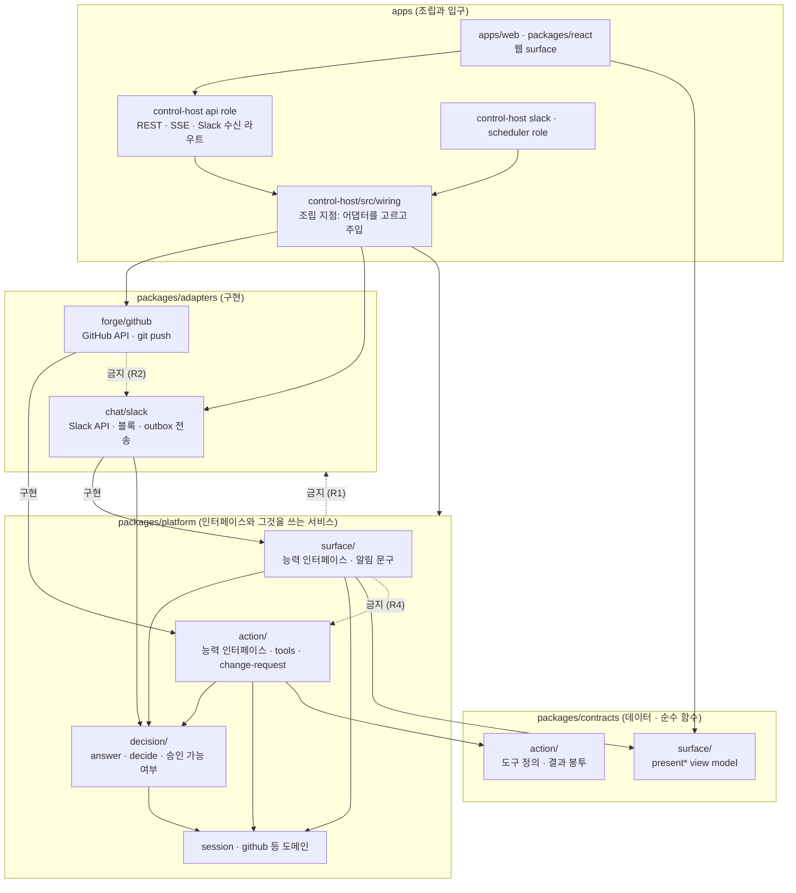
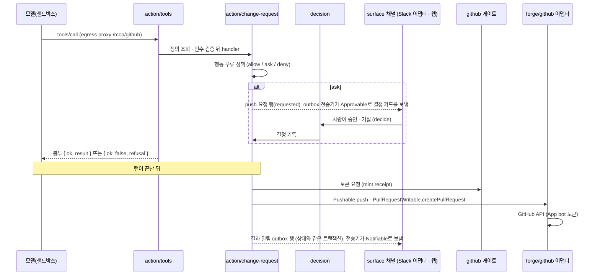
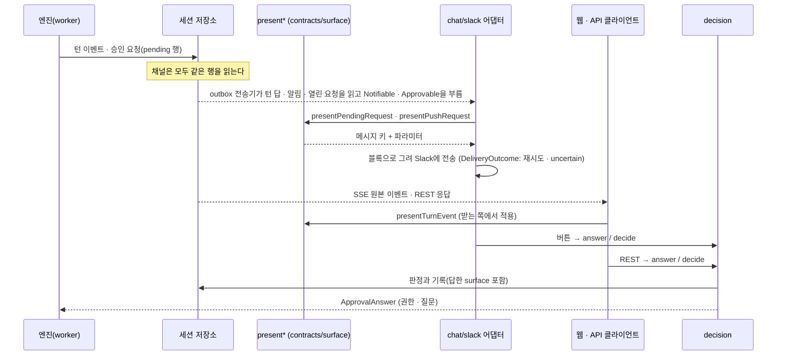

# 결정(설계): surface·action 모듈, 어댑터, 시험 피라미드

- 후속(2026-11-11): 실행 프로필은 통째로 지웠다(migration `0264_remove_profiles`, 기존 데이터는 이전하지 않고 지움). 이 문서의 프로필·상한·롤아웃 언급은 그때의 기록이다. 지금은 에이전트 release가 provider 연결과 카드 모델로 실행 spec(런타임·도구·권한 모드)을 고정하고, 묻기·막기 규칙은 워크스페이스와 에이전트의 실행 규칙(`workspace_engine_settings`, `agent_engine_settings`)이 정한다.
- 상태: 설계. 이 문서가 머지된 뒤 이행 단계 U1~U9([10절](#10-이행-순서))를 단계마다 별도 카드와 PR로 진행한다. 이 PR은 코드를 옮기지 않고 시험을 지우지 않는다.
- 기준 커밋: `origin/main` `1ad2a092a`. `파일:줄`과 파일 수는 이 커밋에서 직접 읽고 센 값이다. 시험 수와 시간은 `d8b318c6f`의 CI 실행 `42781937238`의 job 로그에서 읽었다([9.1절](#91-지금-수치)).
- 선행 문서: [에이전트 행동 도구 카탈로그](action-broker.md), [Musterrolle 모듈 경계](musterrolle-boundary.md), [패키지 구조화 설계](package-structure.md)(아래에서 **구조화 설계**). 포트의 도메인 디렉터리, 의존 규칙 A1~A5, 이행 단계 S0~S8은 구조화 설계가 정했고 여기서 다시 정하지 않는다. 이 문서가 그 설계와 다르게 정하는 것은 [11절](#11-구조화-설계와-달라지는-것)에 모았다.
- 오너 원문(2026-11-10): "Slack, web, github, api, sse 등 잘 구조화, (oop 를 고려하는게 낫나? ) 해서 surface 를 별도로 나눠서 코드를 배치해줘", "코드에서 딱 봤을대도 action layer, surface layer (layer 라는 명칭이 맞나?) 로 딱 나눠져있고 거기에 어떤게 있는지도 잘 정리되어잇는게 좋을거 같아", "github, slack 등등 각 외부 시스템 연계되는건 ~able이나 ~ible 같은 인터페이스로써 github 에서 가능한것 slack 에서 가능한것 같은 느낌으로 정리", "테스트 피라미드 관점에서 unit test 등도 지울거 지우고 다시 구성", "oop, solid, 의존성 역전같은 기본 설계원칙에 벗어나지 않고 잘 구조화해서 만들어줘", "미리 추상화 해둘수 있다면 해두고 싶네 그래야 나중에 이상한 코드가 안늘어날거 아니야".
- 정정(2026-11-10, 오너 확정): 이 문서의 첫 판은 능력 이름을 역할 명사로 바꾸고 `Notifiable`·`Approvable`을 인터페이스에서 뺐다. 오너가 이렇게 되돌렸다. "이름은 인터페이스가 되는거라 able 이 좋지 않냐고 한건데 인터페이스가 아니게 된걸까? 슬랙이나 웹에 통지나 승인이 잇는데 왜 쓰는곳이 없어", "그걸보고 사용안한다고 구현안한다고 한거야?", "추천대로 하는게 통일성잇을거 같튼데 아닐까 너무 과해?". 결론은 넷이다: ① 능력 인터페이스 이름은 `-able`로 통일한다. ② `Notifiable`은 `SlackNoticeSink`를 채널 중립 포트로 일반화한 것이다. ③ `Approvable`을 만든다. ④ 구현 채널이 없는 능력은 인터페이스를 만들지 않고 [예정 능력 표](#63-예정-능력)에만 둔다. 고친 곳과 근거는 [12절](#12-받은-방향에서-바꾼-것과-이유)과 [15절](#15-검토-기록)이다.

## 요약

| 항목 | 결론 |
|---|---|
| 세 묶음 | **모듈**(surface, action)이 능력 인터페이스를 정의한다. **어댑터**(GitHub, Slack)가 자기가 할 수 있는 능력만 구현한다. 사람의 답은 채널이 무엇이든 **결정 서비스** 두 입구로 들어간다 |
| 이름 | "layer"가 아니라 **모듈**이다. surface와 action은 서로를 쓰지 않고 같은 층에 나란히 있다([1절](#1-용어)) |
| 코드 배치 | `packages/contracts/src/{surface,action}/`(view model, 도구 정의), `packages/platform/src/{surface,action,decision}/`(능력 인터페이스와 그것을 쓰는 서비스), `packages/adapters/{forge/github,chat/slack}/`(구현), `apps/control-host/src/wiring/`(조립 지점 한 곳). 웹은 `apps/web`·`packages/react`에 남는다 |
| 채널 판정 | Slack은 surface이자 action 출구, 웹과 API·SSE는 surface, GitHub는 action이다([2절](#2-surface와-action의-경계)) |
| 원칙 | 의존성 역전, 인터페이스 분리, 단일 책임, 개방·폐쇄, 리스코프를 원칙마다 지금 코드의 예와 강제 방법으로 적었다([5절](#5-설계-원칙)). 상속 계층은 만들지 않는다 |
| 이름 | 능력 인터페이스는 `-able`로 통일한다: `Pushable`, `PullRequestReadable`, `Commentable`, `Notifiable`, `Approvable`, `AgentWelcomable` 등([6.5절](#65-이름-관례)). 역할 명사(`…er`, `…Sink`, `…Reader`)는 능력 인터페이스 이름으로 쓰지 않는다 |
| 밀어 보내는 능력 | 결과 알림은 `Notifiable`, 결정 요청 표시는 `Approvable`이다. outbox 전송기가 부르고 Slack 어댑터가 구현한다. 결정 응답은 결정 서비스 하나로 유지한다([6.2절](#62-능력-인터페이스)) |
| 미리 정하는 것 | 능력 인터페이스, 계약 시험, 어댑터 폴더 골격, 조립 지점, 의존 방향 규칙은 채널 수와 상관없이 지금 정한다. 구현 채널이 없는 능력은 인터페이스도 어댑터 폴더도 만들지 않고 [예정 능력 표](#63-예정-능력)에만 둔다 |
| 받은 방향에서 바꾼 것 | 네 가지를 코드 근거로 바꿨다: 인터페이스 위치, API·SSE 어댑터 패키지, "platform은 어댑터 이름을 모른다"의 강제 방식, Slack 저장소 포트의 자리. 이름 관례와 `Notifiable`·`Approvable`은 첫 판에서 바꿨다가 오너 확정으로 받은 방향대로 되돌렸다([12절](#12-받은-방향에서-바꾼-것과-이유)) |
| 시험 | 지울 후보는 적다(조건이 붙은 4건). 문제는 이름과 층이 어긋난 것이다. 층을 "무엇을 여는가"로 정하고, 어댑터 계약 시험 층을 더한다([9절](#9-시험-피라미드)) |
| 검토 | Codex 반론을 받아 고쳤다. 고친 곳은 [15절](#15-검토-기록)이다 |

## 1. 용어

| 말 | 뜻 | 이미 쓰는 곳 |
|---|---|---|
| surface | 에이전트 이벤트를 사람에게 보여 주고 사람의 답을 결정 서비스로 돌려보내는 채널 | 계약의 `SURFACE_KIND_VALUES = ["web", "slack", "api"]`(`packages/contracts/src/kollegium/surfaces.ts:20`), 답을 기록하는 `answerSurface`(`packages/db/src/pending-requests.ts:1036`) |
| action | 모델의 도구 호출 하나가 바깥 시스템에 내는 효과와 그 실행 경로 | [행동 도구 카탈로그](action-broker.md) 1절의 모듈 이름 action-broker |
| 결정 서비스 | 사람의 답(허용·거절·선택, push 승인·거절)을 받아 판정하고 기록하는 서비스 | `PendingRequestService.answer`, `PushRequestService.decide` |
| 능력(capability) | 바깥 시스템 하나가 할 수 있는 일 한 가지를 나타내는 작은 인터페이스. 이름은 `-able`로 짓는다 | 지금 `GitPusher`(`packages/platform/src/ports/git-push.ts:66`), U3 뒤 `Pushable` |
| 어댑터 | 능력 인터페이스를 바깥 시스템의 API로 구현한 패키지 | `packages/adapters/execution/{local-docker,kubernetes}` |
| view model | 채널이 그리기 전에 이벤트·요청을 채널과 무관한 모양(메시지 키와 파라미터)으로 바꾼 값 | `presentTurnEvent`(`packages/contracts/src/api/present-turn-event.ts:315`) |

**"layer"라는 이름은 맞지 않는다.** 이 저장소에서 층은 패키지 사이의 의존 순서다(`contracts` → `platform` → 어댑터·`db` → `apps`). surface와 action은 같은 층 안에 나란히 있고 서로를 import하지 않는다. 위아래가 없는 둘을 층이라 부르면 "surface가 action 위에 있다"는 틀린 그림이 생긴다. [행동 도구 카탈로그](action-broker.md)도 action-broker를 "모듈 이름이고 레이어 이름이 아니다"라고 적었다.

| 후보 | 판단 |
|---|---|
| layer | 버린다. 의존 순서를 뜻하는 말인데 둘 사이에 순서가 없다 |
| boundary(경계) | 버린다. 이 저장소에서 경계는 "누가 무엇을 import할 수 있는가"의 규칙 묶음이다([Musterrolle 모듈 경계](musterrolle-boundary.md)). 모듈마다 경계가 하나씩 있다 |
| **module(모듈)** | **쓴다.** [구조](../architecture.md)가 Musterrolle·Kollegium·Lotse·Kiel을 모듈이라 부르고 action-broker도 모듈이다. surface 모듈은 그 문서가 Kollegium에 둔 "에이전트를 부르는 웹·Slack·API 채널"의 코드 위치다 |

문서에서는 "surface 모듈", "action 모듈"이라 쓰고, 디렉터리 이름은 `surface/`, `action/`이다.

## 2. surface와 action의 경계

판정 질문은 둘이다. ① 사람에게 보여 줄 문구·모양을 만드는 코드가 있는가. ② 사람의 답이 결정 서비스로 돌아오는 길이 있는가. 둘 다 있으면 **채널**(묻고 답을 받는 surface)이다. ①만 있으면 채널이 아니라 어느 채널의 **표시 화면**이다(작업 기록 화면이 웹의 일부인 것처럼). 모델의 도구 호출이 바깥에 효과를 내는 길이면 action이다.

| 채널·연동 | ① 보여 주는 코드 | ② 답이 돌아오는 길 | 판정 |
|---|---|---|---|
| Slack 스레드 | 턴 답 `enqueueSlackTurnAnswers`(`packages/platform/src/musterrolle/slack-outbox.ts:328`), 결정 카드 `slackPromptMessage`(`slack-prompts.ts:556`), 스레드 상태 `writeSlackThreadStatuses`(`slack-session-status.ts:160`), 결과 알림 `actionNoticeText`(`action-notice.ts:111`) | 버튼·모달이 `deps.pending.answer`(`slack-interactions.ts:396`)와 `deps.pushes.decide`(`:485`)를 부른다. 지시는 `slack-session-handler.ts`가 세션으로 잇는다 | **surface IN.** 동시에 action의 출구다(카탈로그 T1 메시지, T3 결정 폼) |
| 웹 콘솔 | `presentTurnEvent`를 그리는 타임라인(`packages/react/src/blocks/session-timeline.tsx:226`), `ApprovalCard`·`QuestionCard`(`packages/react/src/components/session/`), push 승인 화면(`apps/web/src/routes/session-github-work.tsx`) | REST `service.answer`(`apps/control-host/src/api/routes/pending.ts:36`), `service.decide`(`routes/push-requests.ts:68`) | **surface IN.** 코드는 옮기지 않는다 |
| 공개 API·SSE | SSE는 이벤트를 가공하지 않고 그대로 쓴다(`apps/control-host/src/api/routes/events.ts:300-306`). view model은 받는 쪽이 적용한다. pending·push 응답에는 표시용 필드가 붙는다(JeongJaeSoon/werft#1496의 `summary`, `approvability`) | 웹과 같은 REST 라우트. SDK 예제가 이 길로 승인한다(`examples/sdk-approver`) | **surface IN.** `api`는 이미 surface 종류다. 서버에서 문구를 만들지 않는 지금 모양을 유지한다 |
| GitHub: push·PR 생성·닫기·리뷰·workflow | 해당 없음 | 해당 없음 | **action.** 모델의 도구 호출이 `packages/platform/src/sessions/github-mcp-server.ts:501-731`의 분기를 지나 서비스와 게이트로 간다 |
| GitHub: PR 본문·코멘트 표시 | `renderPullRequestBody`(`packages/platform/src/sessions/pull-request-body.ts:249`)가 사람이 읽을 본문을 만든다 | **없다.** GitHub App은 webhook 없이 만든다(`packages/platform/src/musterrolle/github-app-service.ts:141`). PR 리뷰 코멘트가 세션으로 돌아오는 코드가 없다 | **OUT(action에 남긴다).** 본문은 `open_pull_request`라는 action의 내용물이다. **LATER**: PR 코멘트·리뷰가 세션 입력이 되는 경로(webhook 수신)가 생기면 GitHub 어댑터가 surface 능력도 구현한다 |
| GitHub: check run | 코드 없음(`check_run`·`check-runs` 검색 0건) | 없음 | **OUT.** [예정 능력 표](#63-예정-능력)에 둔다 |
| CLI | key 발급 CLI(`apps/control-host/src/api/keys.ts`)는 운영 도구다. 세션 이벤트를 그리지 않는다 | 없음 | **OUT** |
| 이메일·다른 메신저 알림 | 코드와 계약이 없다 | 없음 | **LATER.** `Notifiable`의 두 번째 구현이다. [예정 능력 표](#63-예정-능력)에 둔다 |
| 작업 기록(receipt) 화면 | 웹이 receipt 행을 읽어 그린다(`packages/react/src/components/receipt/`, `routes/receipts.ts`) | 없음(읽기 전용) | **surface IN(웹의 일부).** 별도 채널이 아니다 |

읽을 점:

- **사람의 답이 들어가는 곳은 이미 두 함수다.** 제품 코드에서 `PendingRequestService.answer`와 `PushRequestService.decide`를 부르는 곳은 위 네 줄뿐이다(Slack 둘, REST 둘). 이름이 같은 다른 호출(저장소의 `store.decide`, 성과 판정의 `decisions.decide`)은 이 두 서비스가 아니다. 이 문서는 이 모양을 규칙으로 고정한다([8절](#8-의존-방향-규칙) R5).
- **action이 사람에게 알릴 때 Slack 코드를 부르지 않는다.** push·PR의 결과 알림은 상태를 쓰는 같은 트랜잭션에서 outbox 행으로 들어간다(`packages/db/src/action-notices.ts:30`, `packages/db/src/pull-request-drain.ts:72`). 상태와 알림이 함께 commit되거나 함께 버려지므로, 이 이음매는 함수 호출로 바꾸지 않는다.
- **surface는 승인 가능 여부를 스스로 판정하지 않는다.** Slack 카드와 스레드 상태는 `pushApprovability`를 읽는다(`slack-outbox.ts:22`, `slack-session-status.ts:5`). JeongJaeSoon/werft#1496이 웹에도 같은 답을 싣는다. 이 계산과 `Approvable`(채널이 결정 요청을 사람 앞에 놓는 능력)은 다른 것이다([6.5절](#65-이름-관례)의 용어 한 줄).

## 3. 전체 그림

의존 방향 규칙의 정본은 `tests/architecture.test.ts`다. 아래 그림과 시험이 다르면 시험이 맞고, 그림을 고친다.



실선은 허용된 import, 점선은 금지다. `db`는 구조화 설계 5절 그대로 platform의 저장소 포트를 구현한다. 이 그림에서는 뺐다.

다이어그램은 Mermaid 코드 블록으로 문서 안에 둔다. 저장소에 Mermaid를 쓴 문서가 없어 이 문서가 첫 관례다. `docs/contributing/decisions/`는 문서 사이트의 페이지가 아니라 저장소 문서라서 GitHub가 그리는 것으로 충분하다. 그림만 바꾸는 PR은 없다. 규칙이 바뀌면 시험과 그림을 같은 PR에서 고친다.

## 4. 목표 트리

### 4.1 트리와 색인

```text
packages/contracts/src/
  surface/                    # 순수 코드만
    present-turn-event.ts     # 턴 이벤트 → 메시지 키
    present-action.ts         # 도구 요청 요약, push 승인 가능 여부 (#1496)
  action/
    action-broker.ts          # 결과 봉투 ActionResult · ActionRefusal (지금 api/action-broker.ts)
    github-mcp.ts             # 내장 서버 github의 도구 정의 표 (지금 api/github-mcp.ts)

packages/platform/src/
  surface/
    ports/                    # surface 능력 인터페이스 다섯(6.2절: AgentWelcomable, ChannelJoinable, ChannelKindReadable, Notifiable, Approvable) + db가 구현하는 Slack 저장소 포트 여섯(4.4절)
    action-notice.ts  model-cut-notice.ts  model-move-notice.ts   # 채널과 무관한 알림 문구
  action/
    ports/                    # action 능력 인터페이스: git-push.ts, forge.ts, GitHubApi와 능력 별칭
    refusal.ts                # 서비스 오류 → 봉투 (지금 action-broker/refusal.ts)
    tools/                    # 공통 dispatch: 정의 조회 → 인수 검증 → handler → 봉투
    github/                   # 내장 서버 github의 handler: github-mcp-server.ts, github-work-service.ts
    change-request/           # push-* · pull-request-* (요청, 실행, PR 본문과 템플릿)
  decision/
    pending-service.ts        # answer: 권한 · 질문의 답
    push-approvability.ts     # 지금 이 push를 사람이 승인할 수 있는가
    index.ts                  # 채널이 부를 수 있는 두 입구의 타입

packages/adapters/
  execution/  runtimes/       # 그대로
  forge/github/               # @werft-ai/forge-github
    src/index.ts              # 이 어댑터가 구현한 능력을 export
    src/forge-github.ts  src/git-push.ts
  chat/slack/                 # @werft-ai/chat-slack
    src/index.ts              # 이 어댑터가 구현한 능력을 export
    src/slack-*.ts            # 지금 platform/src/musterrolle/slack-*.ts 27개

apps/control-host/src/
  wiring/                     # 조립 지점. 어댑터 패키지를 import하는 유일한 곳
  api/routes/surface/         # events · pending · push-requests · slack-events · slack-interactions
```

| 디렉터리 | 무엇이 있나 | 무엇이 없나 |
|---|---|---|
| `contracts/src/surface/` | view model 함수와 타입 | zod 스키마(REST 계약은 `api/`), 문구, 시각, I/O, 인터페이스의 메서드 타입([12절](#12-받은-방향에서-바꾼-것과-이유)) |
| `contracts/src/action/` | 도구 정의(이름·입력·출력·행동 부류·거절 코드), 결과 봉투 | 실행 코드. REST 계약 `push-request.ts`·`pull-request.ts`는 사람도 쓰므로 `api/`에 남는다 |
| `platform/src/surface/` | surface 능력 인터페이스, 채널과 무관한 알림 문구 | 블록·mrkdwn 같은 채널 모양, 바깥 API 호출 |
| `platform/src/action/` | action 능력 인터페이스, 도구 호출 경로, push·PR 서비스 | Octokit, git 실행. 인가·토큰 발급·receipt는 구조화 설계대로 `github/` 도메인의 게이트가 소유한다 |
| `platform/src/decision/` | 사람의 답을 판정하는 입구와 그 판정에 쓰는 순수 함수 | 채널별 코드 |
| `adapters/forge/github/` | `GitHubApi`와 `Pushable`(지금 `GitPusher`)의 구현 | 정책, receipt, 서비스 로직 |
| `adapters/chat/slack/` | Slack Web API 클라이언트, 블록·mrkdwn 렌더, 버튼·이벤트 해석, outbox 전송과 재시도 분류, 스레드 상태, 앱 설치·시크릿·설정 | 결정 판정(`decision/`을 부른다), 저장소 구현(`db`) |
| `control-host/src/wiring/` | 환경에서 어댑터를 만들고 platform 서비스에 주입하는 코드 | 서비스 로직, 라우트 |

### 4.2 현재 경로 → 목표 경로

| 현재 | 목표 | 메모 |
|---|---|---|
| `contracts/src/api/present-turn-event.ts`, `present-action.ts` | `contracts/src/surface/` | `present-action.ts`는 JeongJaeSoon/werft#1496 머지 뒤 |
| `contracts/src/api/action-broker.ts`, `github-mcp.ts` | `contracts/src/action/` | 도구 표 `GITHUB_MCP_TOOLS`(`github-mcp.ts:431`)가 여기 있다 |
| `platform/src/musterrolle/slack-*.ts`(27개)와 시험 | `adapters/chat/slack/src/` 같은 이름 | [Musterrolle 모듈 경계](musterrolle-boundary.md)가 "어디에 둘지는 나중에 정한다"고 미룬 Slack 파일의 자리다. musterrolle에는 신원·권한만 남는다 |
| `platform/src/testing/slack-fakes.ts` | `adapters/chat/slack/src/testing/` | 패키지의 `./testing/*` export |
| `platform/src/musterrolle/action-notice.ts`, `model-cut-notice.ts`, `model-move-notice.ts` | `platform/src/surface/` | 블록이 아닌 평문 문구이고 `db`가 트랜잭션 안에서 부른다(`packages/db/src/action-notices.ts:3-8`). 어댑터로 보내면 `db`가 어댑터를 import하게 된다 |
| `platform/src/ports/slack-{app,config-token,inbound-event,install,outbox}-store.ts`, `surface-binding-store.ts` | `platform/src/surface/ports/` | `db`가 구현하는 여섯 개다([4.4절](#44-slack-저장소-포트는-platform에-남는다)) |
| `platform/src/ports/slack-notice-sink.ts`의 `SlackNoticeSink` | `platform/src/surface/ports/notifiable.ts`의 `Notifiable` | Slack 이름을 떼고 채널 중립 포트로 일반화한다([6.2절](#62-능력-인터페이스)). 호출자는 outbox 전송기, 구현은 Slack 어댑터다. 거절 안내 행을 넣는 함수는 포트 없이 어댑터 안쪽에 남는다([6.2절](#62-능력-인터페이스)). 이름이 `slack`이 아니게 되므로 R8 기준선에 들어가지 않는다 |
| (새 파일) | `platform/src/surface/ports/approvable.ts`의 `Approvable` | 결정 요청 카드 전송 포트. 지금은 `slack-outbox.ts`의 결정 요청 행 분기가 Slack 렌더·전송을 직접 부른다. 결정 응답 쪽(`decision/`)은 건드리지 않는다 |
| `musterrolle/slack-welcome.ts`의 `SlackWelcome`, `slack-channel-join.ts`의 `SlackChannelJoiner`, `surface-binding-service.ts`의 `SlackChannelKinds` 타입 | `platform/src/surface/ports/`의 `AgentWelcomable`, `ChannelJoinable`, `ChannelKindReadable` | platform 서비스가 쓰는 타입이다. 구현은 어댑터로 가고 타입은 쓰는 쪽에 남는다([6.2절](#62-능력-인터페이스)) |
| `platform/src/ports/git-push.ts`, `forge.ts`, `ports/github-gate.ts`의 `GitHubApi` | `platform/src/action/ports/` | `github-gate.ts`의 나머지(게이트, grant, receipt 타입)는 구조화 설계의 `github/ports/`. `GitPusher`는 `Pushable`로, 나머지 능력 타입은 [6.2절](#62-능력-인터페이스)의 이름으로 새로 만든다 |
| `platform/src/action-broker/refusal.ts` | `platform/src/action/refusal.ts` | [7.2절](#72-약속과-실제의-차이-그리고-정정) |
| `platform/src/sessions/github-mcp-server.ts`, `github-work-service.ts` | `platform/src/action/github/` | 구조화 설계의 `github/tools/` |
| `platform/src/sessions/push-*.ts`, `pull-request-*.ts` | `platform/src/action/change-request/` | 구조화 설계의 `change-request/`. `push-approvability.ts`만 `decision/` |
| `platform/src/sessions/pending-service.ts` | `platform/src/decision/` | |
| `apps/control-host/src/api/forge-github.ts`, `git-push.ts`와 시험 | `adapters/forge/github/src/` | `@octokit/*` 의존성이 control-host에서 이 패키지로 옮겨 간다 |
| `apps/control-host/src/api/server.ts`의 어댑터 생성(`:508` Slack 클라이언트, `:1043` git pusher), `slack/main.ts`의 `:230`, `:347` | `apps/control-host/src/wiring/` | 지금은 role마다 따로 만든다. `createSlackBotApi`를 세 곳에서 부른다. 게이트 조립(`server.ts:903`의 `createGitHubGate`)은 platform 서비스의 조립이라 어댑터 생성이 아니다. forge 구현을 게이트에 넣는 줄만 `wiring/`으로 간다 |

파일 이름은 바꾸지 않는다(구조화 설계 7절). `packages/db/src/`는 구조화 설계 4.4절대로 platform과 같은 디렉터리 이름을 따라간다.

### 4.3 옮기지 않는 것

- **웹.** `packages/react`는 패키지 전체가 웹 surface이고 `apps/web`은 그것을 조합한다. `tests/architecture.test.ts:1651`이 웹의 import를 이미 고정한다.
- **API·SSE.** 어댑터 패키지로 만들지 않고 `apps/control-host/src/api/routes/surface/`로 묶는다([12절](#12-받은-방향에서-바꾼-것과-이유)).
- **`contracts/src/kollegium/surfaces.ts`.** 채널 연결(binding)의 저장 계약이다. view model이 아니다.
- **GitHub 연동 서비스와 게이트.** `github-gate.ts`, `github-{app,packages,repository,settings}-service.ts`는 구조화 설계의 `platform/src/github/`로 간다. 이 가운데 바깥 HTTP를 직접 부르는 곳(`musterrolle/github-packages-service.ts:217`)은 [8절](#8-의존-방향-규칙) R7의 기준선에 남는다.

### 4.4 Slack 저장소 포트는 platform에 남는다

`platform/src/ports/`의 Slack 관련 파일은 일곱 개이고 그중 여섯 개가 저장소 포트다: `slack-app-store.ts`, `slack-config-token-store.ts`, `slack-inbound-event-store.ts`, `slack-install-store.ts`, `slack-outbox-store.ts`, `surface-binding-store.ts`. 이 여섯은 `db`가 구현한다(`packages/db/src/slack-outbox.ts:11-23`, `slack-config-tokens.ts:2-8`, `surface-bindings.ts:7-14` 등). `db`가 의존하는 워크스페이스 패키지는 `contracts`·`observability`·`platform`·`system`뿐이다(`packages/db/package.json:25-28`). 포트를 Slack 어댑터로 옮기면 `db`가 어댑터 패키지를 import해야 한다. 그래서 여섯 포트는 `platform/src/surface/ports/`에 둔다.

일곱째 `slack-notice-sink.ts`는 다르다. `SlackNoticeSink`의 구현은 `db`가 아니라 Slack 파일에 있다(`musterrolle/slack-outbox.ts:292`, `slack-notice-log.ts:8`). 저장소 포트가 아니므로 `db`에 묶이지 않고, 이름에서 `Slack`을 뗀 채널 중립 능력 인터페이스 `Notifiable`이 되어 `platform/src/surface/ports/`로 간다([6.2절](#62-능력-인터페이스)). 구현은 Slack 어댑터에 남는다. 이 파일이 가는 곳이 달라졌을 뿐 platform에 `slack`이라는 이름이 남는 파일은 늘지 않는다.

platform에 Slack이라는 이름이 남는 곳은 이 여섯 포트 파일과 그 타입 이름, 그리고 알림 문구 세 파일이 받는 값뿐이다. [8절](#8-의존-방향-규칙) R8이 파일 이름과 export 이름의 기준선을 각각 고정한다.

포트를 채널 중립 이름(`OutboxStore`)으로 일반화하는 것은 하지 않는다. 열 구성이 Slack 고유이고(팀, 채널, 스레드 ts, 블록), 테이블 `slack_outbox`를 바꾸는 일은 스키마 변경이다. 두 번째 push 채널이 실제로 생길 때 그 채널의 열을 보고 정한다.

## 5. 설계 원칙

원칙마다 **지금 코드에서 이미 지키는 예**, **어기는 곳**, **이 설계가 강제하는 방법**을 적는다.

### 5.1 의존성 역전(DIP)

인터페이스는 쓰는 쪽이 소유하고, 어댑터가 구현하고, 조립 지점이 넣는다.

- **이미 지키는 예.** `GitPusher`(U3 뒤 `Pushable`)는 platform이 선언하고(`packages/platform/src/ports/git-push.ts:66`), control-host가 구현하고(`apps/control-host/src/api/git-push.ts:34`), 조립할 때 넣는다(`apps/control-host/src/api/server.ts:1043`). push 실행기는 git을 모른다.
- **어기는 곳.** ① Slack이 아닌 서비스 둘이 Slack 파일의 타입을 import한다: `agents/agent-service.ts:51`(`SlackWelcome`), `musterrolle/surface-binding-service.ts:27-28`(`SlackChannelJoiner`, `SlackWelcome`). ② platform 포트 두 개가 Slack 클라이언트 파일의 타입을 import한다(`ports/slack-app-store.ts:10`, `ports/slack-config-token-store.ts:1`). ③ Slack Web API 클라이언트 `createSlackBotApi`가 platform 안에 있다(`musterrolle/slack-config-api.ts:573`).
- **강제.** platform은 어댑터 패키지를 import할 수 없다. 이미 `tests/architecture.test.ts:1057`("platform depends on contracts, runtime-core and zod only")이 막는다. ①은 그 타입들을 surface 능력 인터페이스로 `surface/ports/`에 옮겨서([6.2절](#62-능력-인터페이스)), ②는 타입을 포트 파일로 옮겨서, ③은 클라이언트를 어댑터로 옮겨서 푼다. 규칙 목록은 [8절](#8-의존-방향-규칙)이다.

```ts
// packages/platform/src/action/ports/git-push.ts — owned by the action module
// (the interface exists today as `GitPusher`; U3 renames it)
export interface Pushable {
  push(input: GitPushInput): Promise<GitPushResult>;
}

// packages/adapters/forge/github/src/index.ts — the adapter implements it
export function createGitPusher(options: GitPusherOptions): Pushable { /* git over storage */ }

// apps/control-host/src/wiring/adapters.ts — the one place that names the adapter
import { createGitPusher } from "@werft-ai/forge-github";
export const pushExecutor = createPushExecutor({ pusher: createGitPusher(options), /* stores */ });
```

### 5.2 인터페이스 분리(ISP)

큰 채널 인터페이스 하나가 아니라 능력 하나에 인터페이스 하나다.

- **이미 지키는 예.** Slack을 쓰는 코드는 `Pick<SlackBotApi, "setStatus">`처럼 필요한 메서드만 받는다(`slack-session-status.ts:162` 등 11곳). PR 템플릿을 읽는 코드도 읽기 메서드 넷만 받는다(`TemplateForge`, `sessions/pull-request-template.ts:71`).
- **어기는 곳.** `GitHubApi`는 값 하나와 메서드 17개짜리 인터페이스 하나다(`packages/platform/src/ports/github-gate.ts:91`). 게이트가 내주는 `grant.api`가 이 전체이고(`:194`), PR 서비스와 workflow·리뷰 서비스는 그것을 통째로 받는다. workflow만 쓰는 시험의 가짜도 전부를 채워야 한다.
- **강제.** 서비스는 자기가 부르는 메서드만 담은 능력 타입을 받는다([6.2절](#62-능력-인터페이스)). 구현은 하나로 남는다. **빈 구현과 "지원하지 않음" 예외를 금지한다.** 어댑터가 못 하는 능력은 구현하지 않고 export하지 않는다. 능력 인터페이스에는 선택 메서드(`method?:`)를 두지 않는다. 필요한 능력이 없는 조립은 컴파일 오류이거나, 그 기능을 켜지 않는 분기다(Slack 설치가 없으면 slack role이 뜨지 않는 지금 모양).

### 5.3 단일 책임(SRP)

렌더, 전송, 결정, 정책은 서로 다른 모듈이다.

| 책임 | 모듈 | 지금 파일 |
|---|---|---|
| 무엇을 보여 줄지(채널 중립) | `contracts/src/surface/` | `present-turn-event.ts`, `present-action.ts` |
| 어떤 모양으로 그릴지 | 어댑터의 렌더 파일 | `slack-prompts.ts`, `slack-mrkdwn.ts`, `slack-presentation.ts` |
| 보내고 다시 보낼지 | 지금은 어댑터의 전송 파일. 루프(lease, 결과 기록, 재시도 예약)와 응답 분류의 분리는 U9 ② | `slack-outbox.ts`의 `drainSlackOutbox`(`:848`), `slack-send-result.ts`. 보내는 이음매가 `Notifiable`·`Approvable`([6.2절](#62-능력-인터페이스)) |
| 답을 판정하고 기록 | `platform/src/decision/` | `pending-service.ts`, `push-request-service.ts`의 `decide` |
| 해도 되는가 | 정책 함수와 게이트 | `push-approvability.ts`, `github-gate.ts` |

- **어기는 곳.** `slack-outbox.ts`(1,159줄)에 넣기(`:328`), 그리기(`slackOutboxText` `:263`, `slackReplyBlocks` `:232`), 카드 정리(`:614`), 전송(`:848`)이 함께 있다. `push-request-service.ts`에는 요청 생성과 결정이 함께 있다.
- **강제.** 이동 단계에서는 파일을 쪼개지 않는다(구조화 설계의 "이동과 책임 분리는 별개"). 단 하나의 예외는 U5 ①의 포트 이음매다: Slack으로 보내는 줄의 구현을 `slack-notifiable.ts`·`slack-approvable.ts`로 뽑아 `Notifiable`·`Approvable`로 주입하는 일은 책임 분리가 아니라 포트를 세우는 일이라서 이동 PR 앞에 **별도 PR**로 먼저 낸다([10.1절](#101-slack-이동의-순서와-재수출)). 쪼개는 일은 이동이 끝난 뒤 파일마다 별도 PR이고, 이 문서는 그 순서만 정한다: `slack-outbox.ts`를 넣기·그리기·전송으로, `push-request-service.ts`에서 `decide`를 `decision/`으로.

### 5.4 개방·폐쇄(OCP)

이 설계가 지금 보장하는 것과 목표를 가른다.

- **지금 보장.** forge 구현이나 Slack 구현 **안쪽**을 고칠 때 platform의 서비스와 다른 어댑터를 고치지 않는다(R1, R2). 어떤 어댑터를 켤지는 `wiring/`만 고친다(R3).
- **목표(보장이 아니다).** 채널이나 forge를 더할 때 고치는 곳을 **어댑터 폴더와 조립 지점**으로 줄인다. 지금 설계만으로는 거기까지 가지 못한다. 예로 두 번째 메신저를 더하면:

- [ ] `packages/adapters/chat/<이름>/`을 만들고 루트 `package.json`의 workspace 목록에 `packages/adapters/chat/*`를 더한다
- [ ] 그 어댑터가 할 수 있는 능력만 구현해 `src/index.ts`에서 export한다
- [ ] 능력마다 계약 시험을 그 어댑터에 대고 돌린다([5.5절](#55-리스코프-치환lsp))
- [ ] `apps/control-host/src/wiring/`에서 어댑터를 만들어 넣는다
- [ ] **platform도 고친다**: `SURFACE_KIND_VALUES`에 한 값, 그 채널의 저장소 포트와 `db` 구현과 마이그레이션, 그리고 연결 서비스(`surface-binding-service.ts:70-84`가 Slack 채널 종류·가입·환영을 직접 다룬다)

고치지 않는 곳: `platform/src/decision/`, `platform/src/action/`, view model, 다른 어댑터, 웹. 마지막 항목이 남는 이유는 저장소 포트와 연결 서비스가 Slack 모양이기 때문이다. 이것을 채널 중립으로 일반화하는 일은 두 번째 채널의 실제 모양을 보고 한다([4.4절](#44-slack-저장소-포트는-platform에-남는다)).

### 5.5 리스코프 치환(LSP)

같은 능력을 구현한 어댑터는 같은 계약 시험을 통과한다.

- 능력마다 계약 시험 함수 하나를 platform의 `./testing/*` export에 둔다. 인자는 "그 능력을 구현한 것을 만드는 함수"다.

```ts
// packages/platform/src/testing/pull-request-writable-contract.ts (sketch)
export function describePullRequestWritableContract(make: () => Promise<PullRequestWritable>) {
  test("creating for a head that already has an open pull request answers that one, created: false", async () => { /* ... */ });
  test("a failed call throws, never answers a made-up value", async () => { /* ... */ });
}

// packages/adapters/forge/github/src/pull-request-writable.contract.test.ts
describePullRequestWritableContract(() => githubAgainst(fakeGitHub()));
```

- 계약 시험이 담는 것은 **인터페이스가 지금 주석과 구현으로 약속하는 것**이다. 새 약속을 만들지 않는다. `GitHubApi`의 약속은 "성공은 값, 실패는 예외(`GitHubCallError`, `ForgeCredentialError`)"이고(`ports/github-gate.ts:94-181`의 주석, `forge-github-pulls.test.ts:526-535`가 예외를 단언한다), `createPullRequest`는 이미 열린 PR이 있으면 그것을 `created: false`로 답하고, `getPullRequest`는 재시도하지 않는다. 능력마다 오류·재시도·멱등 약속이 다르므로 U7이 능력별로 적는다. 거절을 값으로 돌려주기나 `uncertain`은 밀어 보내는 두 능력 `Notifiable`·`Approvable`의 약속이지(`DeliveryOutcome`, [6.2절](#62-능력-인터페이스)) forge 능력의 약속이 아니다.
- **서비스의 정책은 어댑터 계약이 아니다.** 본문 길이를 맞추는 일은 platform이 한다(`sessions/pull-request-body.ts:241-247`). 어댑터가 약속하는 것은 상한 값 `maxBodyLength`를 알려 주는 것뿐이다.
- 지금 그 약속을 고정하는 시험은 구현에 붙어 있다(`apps/control-host/src/api/forge-github.test.ts` 28건, `forge-github-pulls.test.ts` 29건). 이 가운데 인터페이스 약속에 해당하는 사례를 계약 시험으로 올리고, GitHub 응답 모양에 묶인 사례는 어댑터 시험으로 남긴다. 이것이 [9절](#9-시험-피라미드)의 어댑터 층이다.
- 시험용 가짜(`packages/testkit/src/fake-github`)도 같은 계약 시험을 통과해야 한다. 가짜가 실제와 다르게 굴면 그 위의 시험이 거짓으로 통과한다.

### 5.6 OOP: 상속 없이 구조적 인터페이스와 합성

**상속 계층을 만들지 않는다.** 계약은 구조적 타입, 조립은 합성, 상태는 팩토리의 클로저에 둔다. class는 지금처럼 오류 타입과 식별성이 있는 값에만 쓴다.

- platform의 비테스트 `export class`는 27개이고 그중 25개가 `Error` 하위 클래스다. 나머지는 `SecretKey`, `ProfileFeatureGate` 둘이다. 서비스는 `createX(deps)` 팩토리 90개로 만든다. contracts의 `export class`는 0개이고 구조화 설계 A4가 그것을 규칙으로 둔다.
- 채널들이 공유하는 구현이 없다. Slack은 서버가 outbox 행을 lease로 집어 밀어 보내고, 웹과 API는 클라이언트가 SSE로 끌어간다. 공통 부모 class에 둘 메서드 본문이 없다.
- 채널이 공유하는 것은 값의 모양이다. `presentPendingRequest`의 결과를 Slack은 블록으로, 웹은 React 요소로 그린다. 서버와 브라우저에 걸친 두 구현을 묶을 수 있는 것은 class가 아니라 타입이다.

| 반대안 | 버린 이유 |
|---|---|
| `abstract class Channel`과 채널별 하위 class | 공유할 구현이 없고, 큰 인터페이스 하나가 되어 5.2절을 어긴다. 브라우저의 웹 채널은 이 계층에 들어올 수 없다 |
| 어댑터마다 `class SlackAdapter implements AgentWelcomable, ChannelJoinable` | 상속은 없지만 저장소 관례(팩토리와 클로저)와 다르고, 지금 함수들이 이미 의존을 인자로 받아 얻는 것이 없다. 상태와 수명이 있는 객체(연결 풀, 토큰 캐시)가 생기면 그 객체만 class로 둘 수 있다 |
| 인터페이스 없이 구체 함수만 import | 채널이 하나인 지금은 가능하다. 그러나 platform이 Slack 파일을 직접 부르는 곳이 생기고(5.1절의 ①) 다음 채널을 더할 때 분기가 는다. 오너의 결정은 인터페이스를 먼저 두는 쪽이다([6.4절](#64-미리-정하는-것과-만들지-않는-것)) |

**조립: DI 컨테이너 없이 Pure DI.** 오너가 2026-11-10에 정했다(결정 d279). 의존은 생성자·팩토리 인자로 주입하고, 조립 지점(composition root)은 `apps/control-host/src/wiring/` 한 곳이다. U4~U5가 `wiring/`을 세우고 어댑터 생성을 거기로 모으며, U4~U8이 끝난 뒤에 역할별로 흩어진 조립 코드를 타입이 붙은 wiring 모듈로 정리하는 단위 W1을 둔다([10절](#10-이행-순서)). 세 안을 다섯 항목으로 비교했다.

| 항목 | Pure DI(채택) | B. 함수형 컨테이너(typed-inject, Awilix) | C. 데코레이터 기반(tsyringe, Inversify) |
|---|---|---|---|
| 빠진 의존을 컴파일 시점에 잡는가 | 잡는다. 팩토리 인자 타입이 곧 검사다 | typed-inject는 정적으로 잡는다. Awilix는 이름 기반 해석이라 등록 누락이 보통 실행 때 드러난다 | 토큰 해석이라 등록 누락이 실행 때 드러난다 |
| 기동·요청 비용 | 컨테이너 해석 비용이 없다. 함수 호출뿐이다 | 해석 비용이 작지만 0은 아니다 | 메타데이터 반영과 해석 비용이 있다 |
| 시험에서 가짜 주입 | 인자로 가짜를 넘긴다. 지금 방식 그대로다 | 컨테이너 쪽에서 값을 바꿔 끼우는 방식이 예다 | 시험용 컨테이너를 따로 설정하는 방식이 예다 |
| R1~R9와의 정합 | R3(어댑터 패키지는 앱의 `wiring/`에서만 import)과 R1·R2가 그대로 맞는다 | 등록 코드를 어디에 둘지 R3에 더해 정해야 한다 | 위반하는 규칙은 없다. 다만 컨테이너 의존(데코레이터)을 서비스 코드에 들이지 않는다는 설계 선택과 어긋난다 |
| 새 의존성 비용 | 없다 | 패키지 하나와 그 위의 관례를 익혀야 한다 | 컨테이너 패키지에 더해, 보통의 쓰임(tsyringe, 타입 추론에 기대는 Inversify)에서는 `experimentalDecorators`·`emitDecoratorMetadata` 설정과 Reflect 폴리필이 필요하다 |

C안은 보통의 쓰임에서 서비스 코드에 데코레이터와 메타데이터 방출 의존을 들이게 되므로 후보에서 뺐다(Inversify는 명시적 `@inject`나 외부 `decorate()`로 줄일 수 있지만 그러면 이점도 줄어든다). Bun은 메타데이터 방출을 지원하지만 이 저장소의 버전·설정 조합은 검증하지 않았다. B안은 버리지 않고 **재검토 신호**를 둔다: ① 같은 조립이 여러 곳에서 반복된다, ② 설정에 따라 어댑터를 고른다, ③ 요청·세션 수명의 객체가 늘어난다, ④ 외부 플러그인이 들어온다. 넷 가운데 둘 이상이 나타날 때만 다시 올린다. 하나만으로는 올리지 않는다.

## 6. 능력

### 6.1 능력 표

행은 시스템, 열은 "그 시스템으로 할 수 있는 일"이다. ✓ 옆은 지금 그 일을 하는 코드다.

**surface 능력(사람 쪽).** 서버가 밀어 보내는 능력만 어댑터가 구현한다. 웹과 API·SSE는 클라이언트가 같은 행을 끌어가므로 서버에 구현할 능력이 없다. 그래도 밀어 보내는 쪽(Slack)과 끌어가는 쪽(웹·SSE)이 같은 view model을 그린다는 것은 계약 시험이 보장한다([6.2절](#62-능력-인터페이스)). 열 제목의 `Approvable`, `Notifiable`이 인터페이스가 있는 능력이다.

| 시스템 | 지시 받기 | 턴 답 전달 | 결정 요청 표시 (`Approvable`) | 결정 답 받기 | 진행 상태 | 결과 알림 (`Notifiable`) | 결정 뒤 정리 |
|---|---|---|---|---|---|---|---|
| Slack(어댑터) | ✓ `slack-session-handler.ts` | ✓ `slack-outbox.ts:328` | ✓ `slack-prompts.ts:556` | ✓ `slack-interactions.ts:396`, `:485` | ✓ `slack-session-status.ts:160` | ✓ `action-notice.ts:111` | ✓ `slack-outbox.ts:614` |
| 웹(끌어감) | ✓ `composer.tsx` | ✓ `session-timeline.tsx:226` | ✓ `approval-card.tsx`, `question-card.tsx` | ✓ `routes/pending.ts:36`, `routes/push-requests.ts:68` | ✓ `stage-indicator.tsx` | 없음(화면이 행을 다시 읽는다) | 없음 |
| API·SSE(끌어감) | ✓ REST | ✓ `routes/events.ts:300` | ✓ pending·push 응답 | ✓ 웹과 같은 라우트 | ✓ 이벤트 | 없음 | 없음 |
| GitHub | 없음 | 없음 | 없음 | 없음 | 없음 | 없음 | 없음 |

**action 능력(바깥 시스템 쪽).** 도구 번호는 [행동 도구 카탈로그](action-broker.md) 5절이다.

| 시스템 | push | PR 쓰기 | PR 코멘트 | 리뷰 | workflow | 저장소 읽기 | 메시지 | 결정 폼 |
|---|---|---|---|---|---|---|---|---|
| GitHub | ✓ T5 `Pushable` | ✓ T6·T9 `createPullRequest`·`updatePullRequestBody`·`setPullRequestState` | ✓ `upsertComment` | ✓ `submitReview` | ✓ `dispatchWorkflow`·`rerunWorkflow` | ✓ `getRepository`·`readTree`·`readBlob` | 없음 | 없음 |
| Slack | 없음 | 없음 | 없음 | 없음 | 없음 | 없음 | ✓ T1 | ✓ T3 |

### 6.2 능력 인터페이스

인터페이스는 platform의 두 모듈이 소유한다. 이름은 [6.5절](#65-이름-관례)의 `-able`이다. **인터페이스 하나는 호출하는 코드(platform 서비스, 또는 U9 ② 전까지는 어댑터 안의 전송기)와 그것을 구현하는 어댑터 코드가 서로 다른 모듈로 둘 다 있어야 한다.** 아래 표의 "쓰는 곳"이 그 근거이고, 한쪽이라도 없으면 인터페이스를 만들지 않고 [예정 표](#63-예정-능력)에 둔다.

**action 능력.** `GitHubApi`의 구현은 하나로 남고, 서비스는 자기가 부르는 것만 담은 타입을 받는다.

| 능력 타입 | 담는 것 | 쓰는 곳(지금 부르는 줄) |
|---|---|---|
| `RepositoryReadable` | `getRepository`, `getBranchHead`, `readTree`, `readBlob` | PR 템플릿 읽기(`sessions/pull-request-template.ts:112-159`), push 실행기의 기본 브랜치 조회(`push-executor.ts:137`). 지금의 `TemplateForge`(`:71`)와 같은 모양이고 이름만 바꾼다. 넓히지 않는다 |
| `PullRequestReadable` | `getPullRequest`, `findPullRequestForBranch`, `findPullRequestsForBranch`, `isAncestor` | PR 서비스(`pull-request-service.ts:634`, `:678`, `:843`, `:1110`), 리뷰 전 조회(`github-work-service.ts:356`) |
| `PullRequestWritable` | `maxBodyLength`, `createPullRequest`, `updatePullRequestBody`, `setPullRequestState` | PR 서비스(`:629`, `:640`, `:696`, `:1132`) |
| `PullRequestMergeable` | `mergePullRequest` | PR 서비스의 병합(`:1309`) |
| `Commentable` | `maxBodyLength`, `upsertComment` | PR 서비스의 코멘트(`:1422-1427`) |
| `Reviewable` | `maxBodyLength`, `submitReview` | 리뷰(`github-work-service.ts:381-387`) |
| `WorkflowRunnable` | `dispatchWorkflow`, `getWorkflowRun`, `rerunWorkflow` | workflow(`github-work-service.ts:187`, `:255`, `:305`) |
| `Pushable` | `push` | push 실행기. 지금 `GitPusher`라는 이름으로 있다(`ports/git-push.ts:66`). U3이 이름을 바꾼다 |

오너가 든 `PullRequestable`은 읽기·쓰기·병합을 한 이름에 묶는다. 쓰는 서비스가 서로 달라서(ISP) 셋으로 나눈 위 이름을 쓴다. 이름 짓는 규칙은 [6.5절](#65-이름-관례)이다.

```ts
// packages/platform/src/action/ports/capabilities.ts
// GitHubApi keeps one implementation; a service takes only what it calls.
export type PullRequestMergeable = Pick<GitHubApi, "mergePullRequest">;
export type Reviewable = Pick<GitHubApi, "maxBodyLength" | "submitReview">;

// a service states the capabilities it needs as an intersection
type ReviewForge = PullRequestReadable & Reviewable;
```

`GitHubApi`의 멤버 18개(값 하나, 메서드 17개)가 `Pushable`을 뺀 위 일곱 타입에 빠짐없이 들어간다(`maxBodyLength`는 본문을 쓰는 세 타입에 함께 있다). U3이 TS로 이 합이 `GitHubApi`와 같은지 검사하는 타입 단언 한 줄을 둔다.

**좁히는 곳은 함수의 인자 타입이다.** 게이트가 내주는 `GitHubGrant.api`는 전체 `GitHubApi`로 남는다(`ports/github-gate.ts:194`). 게이트는 "이 일을 해도 된다"를 판정하고 자격 증명 하나를 내주는 곳이고, 무엇을 부를 수 있는지는 받은 쪽 함수의 인자 타입이 말한다. grant를 일의 종류별 타입으로 좁히는 것(`GitHubGrant<WorkflowRunnable>`)은 게이트의 타입을 바꾸는 일이라 U3에서 하지 않고 [열린 질문](#14-열린-질문)에 둔다.

**surface 능력.** 다섯이다. 앞의 셋은 platform의 Slack이 아닌 서비스가 Slack 구현에서 이미 받는 것이고, 뒤의 둘 `Notifiable`·`Approvable`은 outbox 전송기가 채널 구현에서 받는 것이다.

| 능력 인터페이스 | 메서드 | 쓰는 곳(호출자) | 구현 | 지금 타입 |
|---|---|---|---|---|
| `AgentWelcomable` | `activated(workspaceId, agentId, releaseId)`, `welcome(workspaceId, agentId, { ask })` (지금 시그니처 그대로) | 에이전트 활성화(`agents/agent-service.ts:221`, `:647`), 채널 연결(`surface-binding-service.ts:84`, `:100`). 각 서비스는 `Pick`으로 하나씩만 받는다 | Slack 어댑터 | `SlackWelcome`(`slack-welcome.ts:74`) |
| `ChannelJoinable` | `(binding) => Promise<SurfaceMembership \| null>` (지금 시그니처 그대로) | 채널 연결(`surface-binding-service.ts:83`) | Slack 어댑터 | `SlackChannelJoiner`(`slack-channel-join.ts:233`) |
| `ChannelKindReadable` | `kindOf(workspaceId, agentId, channelId)` (지금 시그니처 그대로) | 채널 연결(`surface-binding-service.ts:70`) | Slack 어댑터 | `SlackChannelKinds` |
| `Notifiable` | `notify(input: DeliveryInput): Promise<DeliveryOutcome>` (초안, 아래) | outbox 전송기 | Slack 어댑터 | `SlackNoticeSink`(`ports/slack-notice-sink.ts`)를 채널 중립으로 일반화. 보내는 쪽을 맡는다 |
| `Approvable` | `requestDecision(input: DeliveryInput): Promise<DeliveryOutcome>` (초안, 아래) | outbox 전송기 | Slack 어댑터 | 없음. 지금은 전송기가 Slack 렌더·전송을 직접 부른다 |

```ts
// packages/platform/src/surface/ports/agent-welcomable.ts
export interface AgentWelcomable {
  /** Never throws: a welcome that cannot go is logged and left on the binding. */
  activated(workspaceId: string, agentId: string, releaseId: string): Promise<WelcomeOutcome | null>;
  welcome(workspaceId: string, agentId: string, options: { ask: boolean }): Promise<WelcomeOutcome>;
}

// packages/adapters/chat/slack/src/slack-welcome.ts — the factory keeps its own
// wider return (it also answers `finalize` for the install route); the check
// only says that what it returns can stand in for the capability.
export function createSlackWelcome(deps: SlackWelcomeDeps) {
  const implementation = { welcome, activated, finalize };
  // On a variable, not on the literal: `satisfies` on a fresh object literal
  // refuses the extra member.
  return implementation satisfies AgentWelcomable;
}
```

U3은 앞의 타입 셋을 Slack 파일에서 `surface/ports/`로 옮기고 이름에서 `Slack`을 떼며 `-able`로 바꾼다. 시그니처와 동작은 바꾸지 않는다. 지금 `SlackWelcome`은 `ReturnType<typeof createSlackWelcome>`이라 인터페이스가 구현에서 나온다. 이것을 뒤집어 인터페이스를 먼저 쓰고 구현이 그것을 만족하는지 검사한다. 팩토리의 반환 타입을 능력 타입으로 **좁히지는 않는다**: `createSlackWelcome`은 설치 라우트가 쓰는 `finalize`도 돌려주고(`slack-welcome.ts:200-208`, `apps/control-host/src/api/server.ts:739-745`), 반환 타입을 `AgentWelcomable`로 적으면 그 멤버가 가려진다. "던지지 않는다"는 `activated`의 약속이고(`slack-welcome.ts:230-267`) `welcome`의 약속이 아니다.

#### `Notifiable`과 `Approvable`

첫 판은 이 둘을 "platform 서비스가 부르는 곳이 없다"며 뺐다. 그 근거가 좁았다. 부르는 곳을 platform **서비스**에서만 찾았고, 서버가 채널로 밀어 보내는 일을 맡은 outbox 전송기를 호출자로 세지 않았다. 알림과 결정 요청 카드는 Slack이 이미 하는 일이고(`slack-outbox.ts:328`, `:848`), 바깥 API 호출이 끼는 일이다. 의존성 역전은 이런 곳에 인터페이스를 두라는 원칙이다. 둘 다 만든다.

- **호출자.** outbox 전송기다. outbox 행을 lease로 집어(`drainSlackOutbox`, `slack-outbox.ts:848`) 행의 종류로 갈라 보낸다. 지금 행 종류는 여덟이다(`ports/slack-outbox-store.ts:24`). 알림 계열 `notice`(거절 안내), `failure_notice`, `action_notice`(push·PR 결과), `model_notice`는 `Notifiable`, 결정 요청 `input_notice`는 `Approvable`이다. 나머지 `instruction`, `reply`, `welcome`은 전송기가 지금처럼 직접 보낸다. 이 셋에는 포트를 만들지 않는다(아래 "인터페이스를 만들지 않는 것"). 행을 쓰는 쪽(`db`의 `action-notices.ts`, 거절 안내를 outbox에 넣는 `createOutboxSlackNoticeSink`)은 포트가 아니라 **데이터 계약**이다. 알림은 상태와 같은 트랜잭션에 써야 해서 함수 호출이 될 수 없다([2절](#2-surface와-action의-경계), [13절](#13-하지-않을-것)).
- **구현자.** Slack 어댑터(`packages/adapters/chat/slack`)다. 행의 렌더된 `text`·`blocks`를 Slack Web API로 보내고 응답을 분류한다.
- **자리와 단계.** U9 ②(전송기 쪼개기) 전까지 전송기 루프는 Slack 어댑터 안에 한 파일로 남는다. U5 ①은 Slack으로 보내는 줄의 구현을 `slack-notifiable.ts`, `slack-approvable.ts`(어댑터 안의 새 파일)로 뽑고, 전송기 루프(`slack-outbox.ts`)가 `Notifiable`·`Approvable` 타입의 의존으로 받게 바꾼다(구현은 조립 지점이 넣는다). 호출자 루프와 구현이 다른 파일이라 포트가 실제 경계이고, 루프를 platform으로 올리지는 않는다. 그 이음매가 포트이고, 두 번째 채널이 오거나 U9 ②가 루프(lease, 결과 기록, 재시도 예약)를 platform `surface/`로 뽑으면 어댑터에는 렌더·API 호출·응답 분류만 남는다. 어느 쪽이든 R1, R3을 어기지 않는다.
- **기존 `SlackNoticeSink`와의 관계.** 지금의 `SlackNoticeSink.record()`는 거절 안내를 **outbox에 넣는** 함수이고(`void` 반환, 중복 제거는 enqueue의 `dedupeKey`, `slack-outbox.ts:292`) 보내지 않는다. 이 넣는 일은 어댑터 안쪽의 함수로 남고(`createOutboxSlackNoticeSink`), `Notifiable`은 그 행을 **보내는** 쪽을 채널 중립 이름으로 세운 것이다. 그래서 `onceKey` 한 번의 보장은 `Notifiable`이 아니라 넣는 함수와 그 가짜의 계약이다([9.4절](#94-지울-후보) D1).

```ts
// packages/platform/src/surface/ports/delivery.ts (draft; U5 ① fixes the fields against
// slack-outbox.ts:430 and slack-send-result.ts)
export type DeliveryOutcome =
  | { kind: "sent"; ref: string }                       // channel-side reference, e.g. the Slack message ts
  | { kind: "retry"; code: string; retryAfterMs?: number } // transient; the sender decides the next attempt from `attempts`
  | { kind: "failed"; code: string }                    // permanent: never sent again
  | { kind: "uncertain"; code: string };                // may have gone out: never sent again

// What the sender hands over: the claimed row (address and rendered body are in it,
// the schema is unchanged) and how many attempts it has had.
export type DeliveryInput = { row: ClaimedOutboxRow; attempts: number };

// packages/platform/src/surface/ports/notifiable.ts (the sending side of today's SlackNoticeSink)
export interface Notifiable {
  /** Delivers one notice row (notice, failure_notice, action_notice, model_notice). */
  notify(input: DeliveryInput): Promise<DeliveryOutcome>;
}

// packages/platform/src/surface/ports/approvable.ts
export interface Approvable {
  /** Delivers one decision-request row (input_notice) in this channel's own shape. */
  requestDecision(input: DeliveryInput): Promise<DeliveryOutcome>;
}
```

`ClaimedOutboxRow`는 지금의 `SlackOutboxEntry`(`ports/slack-outbox-store.ts:52`)에서 채널 주소와 렌더된 본문을 그대로 실은 타입이다. 이름과 필드는 초안이다. 행이 렌더된 `text`·`blocks`를 담으므로(카드를 만드는 일은 넣을 때 끝난다, `slack-outbox.ts:328`), 첫 단계의 `Approvable`은 "카드를 만든다"가 아니라 "만들어 둔 카드를 보낸다"다. 렌더를 보내는 쪽으로 옮겨 `DecisionRequest` view model을 입력으로 받게 하는 일은 U9 ②의 책임 분리 몫이고 이 설계는 정하지 않는다. 선택 메서드는 두지 않는다(R9).

**결정 응답은 `Approvable`이 받지 않는다.** 사람의 답은 채널이 무엇이든 결정 서비스(`decision/`) 두 입구로 들어간다(R5). `Approvable`은 묻는 쪽, `decision/`은 답을 받는 쪽이고 둘은 서로를 부르지 않는다.

**웹·SSE는 끌어가는 채널이라 `Approvable`·`Notifiable`을 구현하지 않는다.** 대신 같은 요청을 같은 view model로 그린다는 것을 계약 시험으로 보장한다. 같은 입력 fixture(contracts의 `surface/`)를 `presentPendingRequest`·`presentPushRequest`에 넣은 결과에서 ① Slack 구현이 카드를 만들고 ② 웹 컴포넌트(`ApprovalCard`·`QuestionCard`, push 승인 화면)가 화면을 그린다. 두 쪽이 같은 view model 필드를 빠짐없이 쓰는지 단언한다(웹 시험은 `packages/react`, Slack 시험은 어댑터 쪽).

**계약 시험 위치.** `describeNotifiableContract`, `describeApprovableContract`를 platform의 `./testing/*` export에 둔다. 적용 대상은 Slack 구현과, 시험이 전송 결과를 지정해 주는 가짜 구현이다. Slack 쪽 파일은 `packages/adapters/chat/slack/src/notifiable.contract.test.ts`, `approvable.contract.test.ts`다. 담는 약속은 구현이 Slack 응답·예외를 `DeliveryOutcome` 네 가지로 분류하는 것이다. 지금 코드가 이미 지키는 분류(`slack-outbox.ts:430`, `slack-send-result.ts`, 전송 예외, lease 만료)만 적는다([5.5절](#55-리스코프-치환lsp)). 다시 보내지 않는다(`failed`, `uncertain`)와 행을 남긴다(`retry`)는 구현이 아니라 **전송기와 저장소**의 약속이라서, 그 사례는 `outbox.test.ts`가 그대로 지킨다. 같은 사람에게 한 번이라는 보장(`onceKey`)은 넣는 함수의 계약 시험이 맡는다. 웹·SSE 보장은 위 view model 시험이다.

**인터페이스를 만들지 않는 것.** 턴 답 전달(`reply`, `instruction`), `welcome` 행의 전송, 진행 상태, 결정 뒤 정리는 platform 서비스도 전송기도 포트로 부르지 않는다. 환영 메시지를 만드는 일은 `AgentWelcomable`이 맡고, 그 행을 보내는 일은 전송기가 직접 한다. slack role의 pass loop가 어댑터 안쪽의 넣기·상태 pass를 돈다(`slack-outbox.ts:328`, `slack-session-status.ts:160`). 여기에 이름만 붙인 인터페이스를 씌우면 어댑터 내부 호출에 이름을 붙인 것이 된다. 이 셋의 계약은 **데이터**다. 두 번째 밀어 보내는 채널이 생겨 공통 모양이 보이면 그때 인터페이스를 만든다([6.3절](#63-예정-능력)).

| 일 | 계약 | 고정하는 시험 |
|---|---|---|
| 턴 답 전달 | 세션 이벤트 행, `slack_outbox` 행 | `outbox.test.ts`의 중복 전송·`uncertain` 사례([9.6절](#96-남길-시험)) |
| 결정 요청 표시 | `Approvable`. 입력은 `DeliveryInput`(claim한 `input_notice` 행과 `attempts`). 행의 카드는 view model `presentPendingRequest`·`presentPushRequest`의 결과로 넣을 때 그려져 있다 | `Approvable` 계약 시험, `present-action.test.ts`, payload fixture([10.2절](#102-단계별-검증)) |
| 결정 답 받기 | 결정 서비스의 두 입구 | R5 |
| 결과 알림 | `Notifiable`. 입력은 `DeliveryInput`(claim한 알림 계열 행과 `attempts`). 행은 `ActionNotice` 값(`action-notice.ts:38`)과 dedupe key로 상태 변경과 같은 트랜잭션에서 쓴다([2절](#2-surface와-action의-경계)) | `Notifiable` 계약 시험, `packages/db`의 알림 통합 시험 |

**능력 표는 문서에 둔다.** [6.1절](#61-능력-표)의 표를 코드 데이터(`SURFACE_CAPABILITIES`)로도 두는 안은 버렸다. 그 값을 읽는 코드가 없어서, 만들면 쓰는 곳 없는 데이터가 된다.

action 쪽 표는 새로 만들지 않는다. 도구 정의 표 `GITHUB_MCP_TOOLS`(`packages/contracts/src/api/github-mcp.ts:431`)의 행동 부류 칸이 이미 그 표다.

### 6.3 예정 능력

**구현 채널이 없는 능력은 인터페이스도 폴더도 만들지 않고 이 표에만 둔다.** 코드가 없거나 호출자·구현 한쪽이 없는 것이다. 이름은 만들 때 [6.5절](#65-이름-관례)대로 `-able`로 짓는다. 만들 때 이 표의 행을 [6.1절](#61-능력-표)로 옮긴다.

| 능력 | 시스템 | 이름(예정) | 만드는 조건 |
|---|---|---|---|
| check run 쓰기 | GitHub | `CheckRunWritable` | 세션 결과를 check로 보여 달라는 요구가 정해질 때. action 도구로 먼저 판단한다 |
| PR 코멘트·리뷰를 세션 입력으로 받기 | GitHub | 만들 때 정한다 | GitHub App에 webhook을 켜기로 할 때. 이때 GitHub 어댑터가 surface 능력 "지시 받기"를 구현한다 |
| `Notifiable`의 두 번째 구현(이메일, 다른 메신저) | 이메일 등 | 새 인터페이스 없음. `Notifiable`을 구현한다 | 두 번째 push 채널이 정해질 때. 인터페이스는 이미 있으므로 어댑터 폴더와 계약 시험 적용만 더한다 |
| 턴 중간 메시지 `send_message` | Slack | 만들 때 정한다 | 카탈로그의 2단계(L11) |
| `gh` 입구, `werft-commit` | GitHub, worker | 만들 때 정한다 | 카탈로그의 L14, L10. 코드가 아직 없다 |
| 두 번째 forge | — | 새 인터페이스 없음. action 능력 타입을 구현한다 | 실제로 붙일 forge가 정해질 때 |
| 턴 답 전달·진행 상태·결정 뒤 정리의 인터페이스 | Slack | 만들 때 정한다 | 두 번째 밀어 보내는 채널이 정해져 공통 모양이 보일 때([6.2절](#62-능력-인터페이스)) |

### 6.4 미리 정하는 것과 만들지 않는 것

오너의 방향은 "미리 추상화해 두어 나중에 이상한 코드가 늘지 않게"다. 그 선을 이렇게 긋는다.

| 지금 정한다(채널 수와 무관) | 만들지 않는다 |
|---|---|
| 지금 쓰이는 능력의 인터페이스([6.2절](#62-능력-인터페이스)) | 쓰는 곳이 없는 능력의 인터페이스([6.3절](#63-예정-능력)) |
| 능력마다 계약 시험([5.5절](#55-리스코프-치환lsp)) | 구현이 없는 어댑터의 패키지나 빈 폴더(`adapters/chat/<다른 것>`, `adapters/stream/*`) |
| 어댑터 폴더 골격 `packages/adapters/<kind>/<provider>/src/index.ts`와 workspace 등록 | 채널 레지스트리, 플러그인 로더, 설정으로 어댑터를 고르는 장치. 조립 지점의 코드 몇 줄이 그 일을 한다 |
| 조립 지점 한 곳과 그 밖에서 어댑터를 import하지 못하게 하는 규칙 | 저장소 포트의 채널 중립 일반화([4.4절](#44-slack-저장소-포트는-platform에-남는다)) |
| 의존 방향 규칙과 기준선([8절](#8-의존-방향-규칙)) | 상속 계층 |

판정 기준은 하나다. **호출하는 코드(platform 서비스, 또는 U9 ② 전까지는 어댑터 안의 outbox 전송기)가 인자로 받는 곳과 그것을 구현하는 어댑터 코드가 서로 다른 모듈로 지금 둘 다 있으면 인터페이스를 정한다. 한쪽이라도 없으면 표로만 둔다.** 구현이 하나뿐이라는 것은 미루는 이유가 아니다. 인터페이스가 없으면 platform이 그 구현을 직접 부르게 되고, 그것이 5.1절의 ①~③이다.

이 기준을 적용한 결과:

| 대상 | 쓰는 쪽 | 구현 | 판정 |
|---|---|---|---|
| action 능력 타입 일곱과 `Pushable` | PR·리뷰·workflow 서비스, push 실행기 | `forge-github.ts`, `git-push.ts` | 정한다 |
| `AgentWelcomable`, `ChannelJoinable`, `ChannelKindReadable` | 에이전트 서비스, 채널 연결 서비스 | Slack 파일 | 정한다 |
| `Notifiable`, `Approvable` | outbox 전송기(`drainSlackOutbox`가 행의 종류로 가른다) | Slack 알림·카드 렌더와 전송 | 정한다. 첫 판이 뺐던 것을 되돌렸다([6.2절](#62-능력-인터페이스)) |
| 턴 답 전달·진행 상태·결정 뒤 정리 | platform 서비스도 전송기도 포트로 부르지 않는다(slack role의 pass loop가 어댑터 함수를 돈다) | Slack 파일 | 인터페이스 없음. 데이터 계약으로 둔다([6.2절](#62-능력-인터페이스)) |
| 능력 표의 코드 데이터 | 읽는 코드 없음 | — | 만들지 않는다. 문서 표로 둔다 |
| check run, webhook 수신, 두 번째 forge·메신저 | 없음 | 없음 | [예정 능력](#63-예정-능력) |

### 6.5 이름 관례

능력 인터페이스 이름은 **`-able`로 통일한다**(오너 확정, 2026-11-10). 능력 단위로 나누는 기준(쓰는 쪽이 부르는 것 하나에 인터페이스 하나)은 그대로다. 이름만 바뀐다.

| 지금 이름 | 능력 인터페이스 이름 | 메모 |
|---|---|---|
| `GitPusher` | `Pushable` | U3이 바꾼다. 팩토리 `createGitPusher`는 인터페이스가 아니라서 그대로다 |
| (`GitHubApi`의 PR 읽기·쓰기·병합) | `PullRequestReadable`, `PullRequestWritable`, `PullRequestMergeable` | 오너가 든 `PullRequestable`을 쓰는 서비스에 맞춰 셋으로 나눴다(ISP) |
| (`upsertComment`) | `Commentable` | |
| (`submitReview`) | `Reviewable` | |
| (workflow 호출) | `WorkflowRunnable` | |
| (저장소 읽기, `TemplateForge`) | `RepositoryReadable` | |
| `SlackNoticeSink` | `Notifiable` | 채널 중립으로 일반화 |
| (새로) | `Approvable` | 결정 요청 카드 전송 |
| `SlackWelcome` | `AgentWelcomable` | |
| `SlackChannelJoiner` | `ChannelJoinable` | |
| `SlackChannelKinds` | `ChannelKindReadable` | |

**규칙.** 능력 인터페이스는 `<일>able`로 짓는다(`Pushable`, `Notifiable`). 동사에 `-able`이 어색하면 대상 명사에 `Readable`·`Writable`·`Joinable`처럼 붙인다. 역할 명사(`…er`, `…Sink`, `…Reader`)를 능력 인터페이스 이름으로 새로 만들지 않는다. 능력이 아닌 것(팩토리 `createGitPusher`, 서비스 `PushRequestService`, 능력 표 밖의 기존 포트 `CheckpointVerifier`·`ExecutionBackend`)은 이 규칙의 대상이 아니다.

**이름의 뜻.** 첫 판은 `-able`이 값이 "당하는" 일에 붙는다며(`Iterable`) 버렸다. 이 저장소에서는 `-able`을 "이 일을 할 수 있는 능력"을 가리키는 접미사로 쓴다. 이름 하나를 읽으면 어댑터가 할 수 있는 일이 보이고, 능력 표의 열과 이름이 일대일로 맞는다. 영어로 조금 어색한 이름이 있어도 한 규칙 안에 있는 편이 이름마다 다른 관례보다 비용이 작다는 오너의 판단을 따른다.

**용어 한 줄.** `pushApprovability`는 지금 이 push를 사람이 승인할 수 있는지 계산하는 판정 함수(`decision/`)이고, `Approvable`은 채널이 결정 요청 하나를 사람 앞에 놓는 능력이다. 앞의 것은 "이 요청을 승인해도 되는가", 뒤의 것은 "이 요청을 사람에게 어떻게 보여 주는가"다. 판정 결과(`PushApprovabilityVerdict`, `sessions/push-approvability.ts:22`, `:55`)는 `Approvable`에 실리는 view model의 필드다.

| 관례 | 판단 |
|---|---|
| `CanX`, `XCapability` | 버린다. 저장소에 선례가 없고, `XCapability`는 능력 표의 키(값)와 섞인다 |
| 역할 명사(`…er`, `…Sink`, `…Reader`) | 능력 인터페이스에는 쓰지 않는다. 첫 판이 골랐다가 오너 확정으로 되돌렸다 |
| **`-able`** | **쓴다** |

## 7. action 모듈

### 7.1 무엇이 어디에

트리는 [4.1절](#41-트리와-색인)이다. action 모듈은 [행동 도구 카탈로그](action-broker.md)의 action-broker를 키운 것이다.

| 일 | 자리 |
|---|---|
| 도구 정의(이름, 입력, 출력, 행동 부류, 거절 코드) | `contracts/src/action/` |
| 도구 호출 공통 경로(정의 조회, 인수 검증, 봉투) | `platform/src/action/tools/` |
| GitHub 도구의 handler | `platform/src/action/github/` |
| push 요청·의도·실행, PR 서비스·본문·템플릿 | `platform/src/action/change-request/` |
| 행동 부류 정책 판정 | 각 서비스(카탈로그 6절). 옮기지 않는다 |
| 인가, 토큰 발급, receipt | `platform/src/github/`의 게이트(구조화 설계). 옮기지 않는다 |
| GitHub REST 호출, git push 실행 | `adapters/forge/github/` |

### 7.2 약속과 실제의 차이, 그리고 정정

[행동 도구 카탈로그](action-broker.md) 1절은 코드 모듈을 `packages/platform/src/action-broker/`로 약속했다. 실제 그 폴더에는 `refusal.ts`와 시험 하나뿐이고, dispatcher와 handler는 `sessions/github-mcp-server.ts`에 있다(카탈로그 1절이 지금 상태를 그렇게 적는다). 구조화 설계는 handler를 `github/tools/`, 공통 dispatch를 `platform/src/tools/`에 두고 `action-broker/`와 합칠지를 열린 질문으로 남겼다.

이 문서가 그 질문에 답한다. **셋을 `action/` 아래로 모은다.** action-broker는 카탈로그의 모듈 이름으로 남고, 디렉터리 이름은 `action/`이다. 이 PR이 카탈로그 1절의 그 줄을 이 문서로 잇는다.

### 7.3 결정 서비스로 모이는 흐름



- **채널은 action을 부르지 않고 `decision`만 부른다.** push 결정이 실행으로 이어지는 것은 `decision`과 `change-request` 사이의 일이다.
- **결정 서비스는 하나의 입구 타입, 두 구현이다.** `decision/index.ts`가 `answer`(권한·질문)와 `decide`(push)의 타입을 내보내고 채널은 이 타입만 받는다. `decide`의 구현을 `decision/`으로 떼어 오는 것은 5.3절의 분리 PR이다.

surface 쪽 흐름:



## 8. 의존 방향 규칙

정본은 `tests/architecture.test.ts`다. U1이 아래를 구조화 설계 A1~A5 옆에 더한다. 지금 어기는 곳은 A2와 같은 방식으로 (소스 파일 → 대상) 쌍 기준선에 박고, 쌍은 늘 수 없다.

| # | 규칙 | 지금 |
|---|---|---|
| R1 | platform은 어댑터 패키지를 import하지 않는다 | 이미 막혀 있다(`tests/architecture.test.ts:1057`) |
| R2 | **`forge`·`chat` 어댑터 패키지**(`packages/adapters/{forge,chat}/*`)는 다른 어댑터, `db`, 앱을 import하지 않는다. `platform`, `contracts`, `observability`, `storage`와 자기 SDK만 | 새 규칙. `execution`·`runtimes` 어댑터에는 걸지 않는다. runtime 어댑터는 platform이 아니라 `runtime-core`의 계약을 구현하고 형제 패키지를 재수출한다(`packages/adapters/runtimes/claude/package.json:19-24`, [구조](../architecture.md)). 그쪽은 지금 규칙 그대로다 |
| R3 | 앱의 제품 코드에서 `@werft-ai/forge-github`, `@werft-ai/chat-slack`을 import하는 파일은 `apps/control-host/src/wiring/` 아래뿐이다. 라우트와 role은 조립된 서비스를 인자로 받는다. 시험 파일과 패키지의 `./testing/*` export는 이 규칙에서 뺀다 | 새 규칙. 기준선은 U4·U5가 만든다 |
| R4 | platform에서 `surface/`와 `action/`은 서로를 import하지 않는다. 구조화 설계 A2(도메인은 다른 도메인의 `index.ts`와 `ports/`만 import)와 다른 규칙이다: A2는 공개면을 통하면 허용하고, R4는 이 두 디렉터리 사이를 양쪽 다 막는다 | 지금은 두 디렉터리가 없어 쌍이 0이다. U3·U6이 파일을 넣을 때 생기는 쌍을 그 PR이 기준선에 적는다. 예상되는 것: 알림 문구(`surface/`)를 부르는 push·PR 서비스는 없고(`db`가 부른다), push 승인 가능 여부는 `decision/`이라 둘 다 `decision/`을 볼 뿐이다 |
| R5 | 채널(어댑터, 라우트)이 사람의 답을 넘기는 곳은 `decision/index.ts`가 내보내는 두 입구뿐이다 | 지킨다(네 곳, [2절](#2-surface와-action의-경계)). 검사는 둘로 나눈다. ① import: 어댑터와 `routes/surface/`는 pending·push 저장소 포트의 **쓰기 타입**(`PendingRequestStore`, `PushRequestStore`)을 import하지 않는다. ② 타입: `decision/index.ts`가 내보내는 입구 타입 두 개(이름은 U3이 정한다)만 인자로 받는다. 메서드 이름 `.decide(`를 세는 방식은 쓰지 않는다. 이름이 같은 다른 호출(`push-request-service.ts:592`의 `store.decide`, `achievement-judge.ts:419`)을 가르지 못한다. U1이 우회 사례(별칭으로 저장소를 받는 가짜 파일)를 넣어 검사기가 잡는지 확인한다 |
| R6 | `contracts/src/surface/`의 함수는 번역된 문구를 만들지 않는다. 화면 문구는 메시지 키와 파라미터로 돌려주고, 사용자·모델이 쓴 원문(답 본문, 도구 입력 발췌)은 그대로 돌려준다 | `present-turn-event.ts`가 지킨다(`:59-77`이 키와 함께 원문 `text`·`detail`을 돌려준다). **기계 검사가 보장하는 것은 순수성까지다**: ① import 목록에 `zod`, `node:*`, 문구 파일이 없다. ② TS AST에 `Date`, `fetch`, `process`, `Intl` 식별자가 없다. "번역된 문구를 문자열 리터럴로 직접 돌려주지 않는다"는 이 두 검사로 잡히지 않는다. 그 부분은 view model 시험(문구가 들어갈 필드의 값이 메시지 키 목록에 있는지 단언)과 리뷰가 본다 |
| R7 | platform은 워크스페이스 밖 서비스의 HTTP를 직접 부르지 않는다. 바깥 호출은 능력 인터페이스 뒤에 있다. 플랫폼 자기 구성요소(egress proxy)를 거치는 호출도 대상이다 | 어긴다: `musterrolle/slack-config-api.ts:573`(U5에서 어댑터로), `musterrolle/github-packages-service.ts:217`, `fetch`를 주입받아 부르는 `decisions-client.ts:71`, `:83`. 검사는 `fetch` 식별자와 `typeof fetch` 타입의 인자를 TS AST로 찾는다. U1이 세어 기준선으로 둔다 |
| R8 | platform의 파일 이름과 export 이름에 어댑터 이름(`slack`)이 새로 생기지 않는다 | 기준선은 둘을 따로 센다. 파일 이름: [4.4절](#44-slack-저장소-포트는-platform에-남는다)의 저장소 포트 다섯 파일. export 이름: 그 포트의 타입 이름과, U5 뒤에도 남는 것(U5 ①이 센다). `github`은 내장 서버 이름이자 도메인이라 이 규칙에서 뺀다([12절](#12-받은-방향에서-바꾼-것과-이유)) |
| R9 | 능력 인터페이스에 선택 메서드(`method?:`)가 없다 | 새 규칙. TS AST로 `platform/src/{action,surface}/ports/`의 `?:` 메서드를 본다. 어댑터가 능력을 제대로 구현했는지는 architecture 시험이 아니라 **타입체크**가 본다: 팩토리 안의 `satisfies`와, 조립 지점에서 서비스의 `deps` 타입에 넣는 줄이다. 팩토리의 반환 타입을 능력 타입으로 좁히라고 요구하지 않는다(다른 멤버가 가려진다, [6.2절](#62-능력-인터페이스)). 어댑터 `index.ts`가 타입·오류·상수·팩토리를 export하는 것도 막지 않는다 |

기계로 검사하기 쉬운 순서는 R1·R2·R3·R4·R8(경로와 import), R9(선언 모양), R5·R6·R7(의미를 정해야 하는 것)이다. U1은 앞의 다섯을 먼저 넣고, 뒤의 셋은 위에 적은 검사 범위대로 넣되 각 규칙에 "일부러 어긴 가짜 파일이 잡힌다"는 시험을 붙인다.

## 9. 시험 피라미드

### 9.1 지금 수치

CI 실행 `42781937238`(`d8b318c6f`, main push)의 `integration (<도메인>)` job 일곱 개가 `bun run test`의 모든 파일을 나눠 돌린다(`.github/workflows/ci.yml:229-355`). 파일별 시간은 job 로그의 파일 머리 줄 사이 간격이다.

| 묶음 | 파일 | 시간 | 메모 |
|---|---|---|---|
| 전체 | 879 | 1,648초 | 14,033건 실행 |
| 이름이 `*.integration.test.ts` | 185 | 793초 | db 105개 267초, adapters 17개 237초, control-host 48개 198초 |
| 이름이 `*.test.tsx`(DOM) | 121 | 196초 | `apps/web` 53개 181초, `packages/react` 25개 8초, `packages/ui` 43개 7초 |
| 이름이 `*.test.ts`("unit") | 573 | 660초 | control-host 102개 203초, db 57개 134초, `tests/` 54개 131초, worker 43개 90초, **platform 141개 17초**, contracts 39개 0.4초 |
| e2e(`tests/e2e`, 별도 job) | — | 399초 | compose 스택의 alpha path. quickstart 426초, k8s-smoke 457초는 따로 |

surface·action 범위만 보면:

| 디렉터리 | 파일 | 시간 |
|---|---|---|
| `packages/platform/src/musterrolle`(Slack 포함) | 45 | 8.0초 |
| `packages/platform/src/sessions`(action 포함) | 46 | 6.4초 |
| `apps/control-host/src/slack` | 4 | 113.1초 |
| `packages/react/src`(웹 surface) | 31 | 8.5초 |

가장 느린 파일은 `packages/adapters/execution/local-docker/src/egress.integration.test.ts` 90초, `apps/control-host/src/slack/outbox.test.ts` 73초, `apps/web/src/routes/teams.test.tsx` 55초, `tests/lease-clock.integration.test.ts` 53초다.

### 9.2 읽을 점

1. **이름과 층이 어긋났다.** `*.test.ts` 573개 중 121개가 PGlite·PostgreSQL을 열거나 프로세스를 띄운다(db 43, `tests/` 34, control-host 18, worker 11, 그 밖 15). `outbox.test.ts`는 이름이 unit이지만 95건이 모두 DB 위에서 돈다.
2. **순수 계산 시험은 이미 빠르다.** platform 141개 파일이 17초, contracts 39개가 0.4초다. 여기서 지워 얻을 시간은 없다.
3. **구현 세부를 고정하는 시험은 드물다.** 소스 파일을 읽어 단언하는 시험은 platform·react·contracts에 2개, mock 호출 단언은 Slack·세션 시험에 없고 react에 21곳이다. 시험 제목이 대부분 동작 문장이다. **그래서 재구성의 중심은 삭제가 아니라 층 표시, 중복 축소, 계약 시험 층이다.**
4. **중복이 있는 곳은 "응답 분류"다.** Slack 전송 결과 분류는 순수 함수 시험(`slack-outbox-policy.test.ts:55-157`)이 표로 고정하는데, DB 통합 시험이 같은 분류를 입력만 바꿔 다시 확인한다.
5. **인터페이스의 약속을 고정하는 시험이 구현에 붙어 있다.** `forge-github.test.ts`는 `GitHubApi`의 약속과 Octokit 응답 처리를 한 파일에서 확인한다. 두 번째 구현이나 가짜가 같은 약속을 지키는지 볼 방법이 없다.

### 9.3 층과 기준

층은 파일 이름이 아니라 **무엇을 여는가**로 정한다.

| 층 | 여는 것 | 이름 | 여기에 두는 것 |
|---|---|---|---|
| L1 unit | 없음(메모리 안의 가짜만) | `*.test.ts` | 판정·분류·변환·view model·렌더 함수. 입력 변형은 전부 여기 |
| L2 component | DOM, 가짜 서비스를 꽂은 라우트 | `*.test.tsx`, `routes/*.test.ts` | 화면 부품의 동작, HTTP 상태와 코드 매핑 |
| **L2 계약** | 가짜 바깥 서버(fake GitHub, mock Slack) | `*.contract.test.ts` | 능력 인터페이스의 약속. 구현마다 같은 시험 함수를 돌린다([5.5절](#55-리스코프-치환lsp)) |
| L3 integration | DB, LocalStack, Docker, 자식 프로세스 | `*.integration.test.ts` | 트랜잭션·동시성·lease·중복 방지처럼 저장소가 있어야 보이는 결과. **결과 하나에 사례 하나** |
| L4 e2e | compose 스택 | `tests/e2e/` | 채널마다 끝에서 끝까지 한 길 |

**지울 기준**(하나라도 맞으면 후보):

1. 구현 세부를 고정한다: 제품 코드가 아닌 것(시험용 가짜, 내부 호출 순서, 파일 배치)을 단언한다.
2. 아래 층이 같은 동작을 이미 고정했고, 위 층의 사례가 입력만 다르고 그 층에서만 보이는 결과를 더하지 않는다.
3. 이동 뒤에 의미가 없다: 로직이 다른 파일로 옮겨져 같은 단언이 두 곳에 있다.

**지우기 전에 확인한다.** 후보가 지키던 동작을 일부러 깨뜨려, "대신 지키는 시험"이 실제로 실패하는지 본다. 실패하지 않으면 지우지 않는다.

### 9.4 지울 후보

| # | 시험 | 기준 | 대신 지키는 시험 |
|---|---|---|---|
네 건 모두 **지금은 지울 수 없고**, "지우는 조건"이 채워진 뒤에 지운다.

| # | 시험 | 기준 | 대신 지키는 시험 | 지우는 조건 |
|---|---|---|---|---|
| D1 | `packages/platform/src/musterrolle/slack-notice-log.test.ts:43` "the fake keeps one notice per person and thread" | 1. 시험용 가짜 `createMemorySlackNoticeSink`(`testing/slack-fakes.ts:1072`)만 단언한다 | 지금은 없다. 제품 쪽 `outbox.test.ts:1616`은 한 사람에 대한 실제 전송만 보고 가짜를 부르지 않으므로, 가짜의 중복 제거를 깨뜨려도 실패하지 않는다 | U7이 거절 안내 행을 넣는 함수(`createOutboxSlackNoticeSink`, 어댑터 안쪽, [6.2절](#62-능력-인터페이스))의 계약 시험을 만들어 outbox 구현과 메모리 가짜 양쪽에 돌린 뒤. 계약에 "같은 사람은 한 번, **다른 사람은 따로**"(`:43-48`의 `U0B` 사례)를 넣는다 |
| D2 | `apps/control-host/src/slack/outbox.test.ts:1700` "ok without a ts fails and is never sent again" | 2. `missing_ts → failed` 분류의 반복 | 분류는 `slack-outbox-policy.test.ts:133-136`. "실패한 행을 다시 보내지 않는다"는 `:1758` 사례 | `:1758` 사례에 두 번째 pass와 "전송 횟수가 그대로"라는 단언을 먼저 더한 뒤. 지금 그 사례에는 두 번째 pass가 없다 |
| D3 | `packages/platform/src/musterrolle/slack-prompt-summary.test.ts:28` "a file tool's excerpt is the first lines of what it writes…" | 3. JeongJaeSoon/werft#1496 뒤 요약 로직은 contracts에 있다 | 그 PR의 `packages/contracts/src/api/present-action.test.ts` | 그 PR 머지 뒤 `:28-73`의 입력을 하나씩 대조해(Write뿐 아니라 Edit, MultiEdit, 빠진 입력, 파일 도구가 아닌 것, 길이 상한) 전부 contracts 쪽에 있을 때. 없는 입력은 M2로 옮긴다 |
| D4 | `apps/control-host/src/api/events.integration.test.ts:543` "연결을 끊으면 스트림 수가 돌아온다" | 2. 라우트 시험 `routes/events.test.ts:1064`가 같은 `activeStreams` 값을 본다 | `routes/events.test.ts:1064` | U8이 두 사례의 단언을 나란히 읽어 통합 쪽이 `activeStreams` 말고 더 보는 것이 없을 때 |

**후보에서 뺀 것**(Codex 반론에서 대체 시험이 더 약하다고 확인됐다):

- `outbox.test.ts:1639`의 대기 시간 범위 단언(`:1656-1661`). DB에 저장된 `nextAttemptAt`이 상한 근처인지 보는 단언이다. 순수 함수 시험(`slack-outbox-policy.test.ts:56-75`)은 반환값만 보고, 같은 사례의 뒤쪽(`:1662-1667`)은 DB 시각을 직접 덮어쓴다. 5분 대신 하루를 저장하는 결함은 이 단언만 잡는다. **남긴다.**
- `events.integration.test.ts:496`(키 폐기)과 `:584`(남의 세션). 실제 `DatabaseApiKeyStore`로 키를 폐기해 종료 시간·로그·다시 붙을 때 401까지 보고, 실제 PostgreSQL 읽기의 소유자 조건을 지난다. 라우트 시험(`routes/events.test.ts:559-577`, `:1080-1096`)은 메모리 변수와 가짜 저장소다. 층이 다른 증명이다. **남긴다.**

surface·action 범위 밖의 시험은 이 문서가 후보를 고르지 않는다. 각 이동 카드가 자기 디렉터리에 위 기준을 적용한다.

### 9.5 옮길 시험

| # | 시험 | 옮기는 곳 | 이유 |
|---|---|---|---|
| M1 | `apps/control-host/src/slack/outbox.test.ts`, `session-handler.test.ts`, `welcome.test.ts` | `*.integration.test.ts`로 이름 변경 | 세 파일 모두 `describe.each(ENGINES)`로 PGlite나 PostgreSQL 위에서 돈다(`outbox.test.ts:160`이 `ENGINES`, `:587`이 `describe.each`). L3다. PGlite 경로는 사례마다 전체 migration을 다시 돌린다(`outbox.test.ts:164-170`, `session-handler.test.ts:176-182`, `welcome.test.ts:130-136`). 한 번 migrate한 데이터를 복사해 주는 `migratedPGlite`(`packages/testkit/src/pglite.ts:17`)가 있는데 세 파일 모두 쓰지 않는다. PR은 둘로 나눈다: 이름 변경(실행 건수 동일), fixture 교체(건수 동일, 시간을 전후로 잰다) |
| M2 | `slack-prompt-summary.test.ts:76`(발췌 길이), `:105`(내장 도구 전부), `:256`(다른 도구·원격 MCP 서버), `:278`(빠지거나 이상한 입력) | `packages/contracts/src/surface/present-action.test.ts` | 판정이 있는 곳으로 간다. platform 쪽 사례가 contracts 쪽보다 넓게 덮으므로 지우지 않고 옮긴다. 기대값을 Slack 문구에서 view model(메시지 키, 대상, 발췌)로 바꾸고, 옮긴 뒤 입력이 같아진 것은 하나로 합친다. `:152`·`:216`·`:228`(push 행과 카탈로그 읽기), `:286`(언어별 문구)은 Slack 쪽에 남는다 |
| M3 | `forge-github.test.ts`(28건), `forge-github-pulls.test.ts`(29건)에서 인터페이스 약속에 해당하는 사례 | platform `./testing/*`의 계약 시험 함수 | L2 계약 층. 나머지는 어댑터 패키지의 시험으로 파일과 함께 간다 |
| M4 | Slack 시험 전부(`musterrolle/slack-*.test.ts`), `action-broker/refusal.test.ts`, `sessions/`의 push·PR·MCP 시험 | 소스 파일과 같은 디렉터리로 함께 | 시험은 소스 옆에 둔다. 내용은 import 경로만 바뀐다 |
| M5 | 나머지 `*.test.ts` 가운데 DB·프로세스를 여는 118개 | 이름만 `*.integration.test.ts` | **LATER.** 다시 볼 조건: unit job(`check (part)`)을 PR마다 돌리기로 할 때. 새로 쓰는 파일은 지금부터 [9.3절](#93-층과-기준)의 이름을 따른다 |

이름을 바꾸거나 패키지를 옮기는 PR은 `.github/workflows/ci.yml`의 도메인 소유 목록과 `tests/integration-jobs.test.ts`가 정확한 경로로 단언하는 파일을 함께 고친다. `packages/adapters/chat/`과 `packages/adapters/forge/`는 지금 어느 도메인의 경로에도 없으므로 U4·U5가 더한다(`chat`은 `surface` 도메인, `forge`는 `api` 도메인이 가깝다).

### 9.6 남길 시험

- **계약 스냅샷**: `sessions/__snapshots__/github-mcp-envelope.test.ts.snap`(2,951줄). 모든 도구의 출력 스키마와 거절 코드를 고정한다. action 이동의 동작 불변 증거다.
- **결정 경로**: `slack-decision.test.ts`(26건), `slack-interactions.test.ts`(40건), `push-request-service.test.ts`, `routes/pending.test.ts`·`routes/push-requests.test.ts`. 누가 답할 수 있는가는 보안 동작이다.
- **데이터 손실·중복 전송**: `outbox.test.ts`의 `uncertain`·lease·동시 pass 사례(`:1592`, `:1670`, `:1771`~`:1931`). 분류가 아니라 "다시 보내지 않는다"를 DB 상태로 확인한다.
- **view model**: `present-turn-event.test.ts`, `present-action.test.ts`. 모든 채널이 여기에 기댄다.
- **화면 구조**: `approval-card.test.tsx:40`. DOM 위치를 단언하지만 사람이 본 배치 결함의 회귀 시험이다.
- **구조 규칙**: `tests/architecture.test.ts`.

### 9.7 목표

| 지표 | 지금 | 목표 |
|---|---|---|
| 순수 unit 파일 비율(L1) | 452 / 879 = 51% | 새 surface·action 로직 시험은 모두 L1. 비율은 내려가지 않는다 |
| DB·프로세스를 여는 파일 비율(L3) | (185 + 121) / 879 = 35% | 늘지 않는다. 새 L3 사례는 "저장소가 있어야 보이는 결과"를 제목에 쓴다 |
| 능력 인터페이스 가운데 계약 시험이 있는 것 | 0 | [6.2절](#62-능력-인터페이스)의 능력 전부. 구현과 가짜가 같은 시험을 통과한다 |
| 이름이 층과 다른 파일 | 121 | surface·action 범위에서 0(M1), 나머지는 M5 |
| 일곱 job의 시험 시간 합 | 1,648초 | 이 시리즈로 늘지 않는다. 이동 PR마다 같은 방법으로 다시 잰다 |
| e2e | API 한 길(alpha path) | 그대로. Slack 채널 e2e는 mock Slack이 스택에 들어갈 때 다시 본다 |

## 10. 이행 순서

단계마다 변경의 종류가 다르고, 종류마다 내는 증거가 다르다([10.2절](#102-단계별-검증)). 한 단계가 한 PR 이상이고, 구조화 설계의 단계와 겹치는 것은 같은 카드로 한다.

| 단계 | 종류 | 내용 | 먼저 있어야 하는 것 | 구조화 설계와의 관계 |
|---|---|---|---|---|
| **U1** | 검사 추가 | `tests/architecture.test.ts`에 R2~R9와 기준선. 코드 이동 없음 | 이 문서 머지 | S1과 같은 PR이거나 바로 뒤 |
| **U2** | 이동 | contracts: `present-*` → `surface/`, `action-broker.ts`·`github-mcp.ts` → `action/` | JeongJaeSoon/werft#1496 머지 | 새 단계 |
| **U3** | 타입·경계 변경 | ① action 능력 타입 일곱(`RepositoryReadable`, `PullRequestReadable`, `PullRequestWritable`, `PullRequestMergeable`, `Commentable`, `Reviewable`, `WorkflowRunnable`)을 `platform/src/action/ports/`에 두고 서비스 함수의 인자 타입을 좁히며, `GitPusher`를 `Pushable`로 바꾼다. ② surface 능력 인터페이스 셋(`AgentWelcomable`, `ChannelJoinable`, `ChannelKindReadable`)을 Slack 파일에서 `surface/ports/`로 옮기고, Slack이 아닌 서비스(`agent-service.ts`, `surface-binding-service.ts`)가 그것만 import하게 한다. `Notifiable`·`Approvable`은 U3에서 만들지 않는다. 호출자(전송기)와 구현이 같은 PR에 있어야 하므로 U5 ①이 함께 만든다. ③ platform 포트 두 개가 Slack 클라이언트 파일에서 가져오는 타입을 포트 파일로 옮긴다(5.1절 ②). ④ `decision/` 이동과 입구 타입. 실행 동작은 그대로다 | U1, #1496 머지 | 새 단계 |
| **U4** | 이동 | `packages/adapters/forge/github/`: workspace 등록, `forge-github.ts`·`git-push.ts` 이동, `apps/control-host/src/wiring/` 신설 | U3 | 구조화 설계가 미룬 일을 앞당긴다([11절](#11-구조화-설계와-달라지는-것)) |
| **U5** | 단계별 추출 | `packages/adapters/chat/slack/`: Slack 파일 27개와 시험·가짜 이동. ①은 전송기가 보내는 줄을 `Notifiable`·`Approvable` 타입의 의존으로 바꾼다(루프는 어댑터 안에 그대로, 쪼개기는 U9 ②). 순서는 [10.1절](#101-slack-이동의-순서와-재수출) | U3, U4(조립 지점), #1493·#1496 머지, payload fixture 시험 | S3을 대체한다 |
| **U6** | ① 이동 ② 구조 변경 | ① `refusal.ts`, `action/github/`, `action/change-request/`로 파일 이동. ② 공통 dispatch를 `action/tools/`로 뽑는다. `github-mcp-server.ts:501`의 프로토콜 분기와 `:724-732`의 handler 분기를 다시 짜는 일이라 이동이 아니다. 별도 PR이다 | U1, S0, 게이트·MCP 서버를 건드리는 열린 PR 없음 | S2의 handler, S4의 push·PR, S5. 위치만 `action/` 아래 |
| **U7** | 검증 추가 | 계약 시험: 능력마다 시험 함수, 어댑터와 가짜에 적용(M3). `Notifiable`·`Approvable` 계약(`describeNotifiableContract`, `describeApprovableContract`)과 웹·Slack이 같은 view model을 쓰는지 보는 시험 포함 | U4, U5 | 새 단계 |
| **U8** | 시험 변경 | D1(U7 뒤), D2, D3, D4, M1, M2. 각 D는 [9.4절](#94-지울-후보)의 조건이 채워진 것만 | U2, U5, **U7** | 새 단계 |
| **W1** | 구조 변경 | `apps/control-host/src/wiring/`에서 역할별 조립 코드를 타입이 붙은 wiring 모듈로 정리한다. DI 컨테이너는 넣지 않는다([5.6절](#56-oop-상속-없이-구조적-인터페이스와-합성)). 동작은 그대로다 | U4~U8 | 새 단계. 오너 결정 d279 |
| **U9** | ① 이동 ② 책임 분리 | ① `db/src/`와 `control-host/routes/`가 같은 이름을 따라간다. ② 5.3절의 파일 쪼개기(`slack-outbox.ts`, `push-request-service.ts`의 `decide`). ②는 파일마다 별도 PR이다 | U5, U6 | S7 |

### 10.1 Slack 이동의 순서와 재수출

platform index에 한 PR 주기 동안 재수출을 둘 수는 **없다.** platform이 어댑터를 import하게 되어 R1을 어긴다. 그래서 U5의 각 PR 뒤에 **platform에 남은 파일이 어댑터로 간 파일을 import하지 않아야 한다.** 의존은 아래에서 위로 흐르므로 위에서부터 옮긴다.

지금 Slack 파일 사이의 의존(비테스트 파일의 import 줄을 모두 읽었다): outbox·상태·세션 처리가 클라이언트를 import하고(`slack-outbox.ts:24-30`, `slack-session-status.ts:7-11`, `slack-session-handler.ts:27`), outbox와 버튼 처리가 렌더 파일을 import한다(`slack-outbox.ts:32-40`). 클라이언트와 렌더를 먼저 옮기면 남은 outbox가 어댑터를 import하게 된다. 서로를 import하는 묶음도 있다(`slack-welcome.ts` ↔ `slack-channel-join.ts`, `slack-app-service.ts` ↔ `slack-events-finalize.ts`). 그런 묶음은 한 PR에 함께 간다. 그래서 순서는 이렇다.

| PR | 옮기는 것 | 이 PR 뒤 platform에 남는 Slack 파일이 옮긴 파일을 import하는가 |
|---|---|---|
| U5 ① | 맨 위: `slack-session-handler`, `slack-interactions`, `slack-events-service`, `slack-outbox`, `slack-session-status`, `slack-welcome`, `slack-channel-join`, `slack-notice-log`. `ports/slack-notice-sink.ts`는 어댑터로 옮기지 않고 `Notifiable`(`DeliveryOutcome` 포함)로 일반화해 `surface/ports/`에 두며, `Approvable`을 같은 자리에 더한다. 거절 안내 행을 쓰는 `createOutboxSlackNoticeSink`는 포트 없는 어댑터 안쪽 함수가 된다. `slack-outbox.ts`의 루프는 쪼개지 않는다. 대신 Slack으로 보내는 줄의 구현을 새 파일 `slack-notifiable.ts`, `slack-approvable.ts`로 뽑아 루프가 `Notifiable`·`Approvable` 의존으로 받게 한다(호출자 루프와 구현이 서로 다른 파일이다. 이 추출과 `Notifiable`·`Approvable` 도입은 ① 이동 PR 앞의 별도 PR이다). 루프를 platform으로 올리는 일은 U9 ②에서 한다 | 아니다. 남은 파일(렌더, 수신 큐, 클라이언트, 설정·설치) 가운데 이 여덟을 import하는 것이 없다 |
| U5 ② | 렌더와 순수 판정: `slack-prompts`, `slack-prompt-summary`, `slack-mrkdwn`, `slack-presentation`, `slack-send-result`, `slack-decision`, `slack-thread-shadow` | 아니다. 남은 설정·설치 파일은 이 일곱을 import하지 않는다 |
| U5 ③ | 나머지: 수신 큐 `slack-inbox`, Web API 클라이언트 `slack-config-api`, 토큰(`slack-bot-token`, `slack-token-gone`, `slack-config-token`), 설정·설치(`slack-app-service`, `slack-install-service`, `slack-events-finalize`, `slack-secret-service`, `slack-link-app-service`, `slack-manifest`, `slack-channel-search`) | 남는 Slack 파일이 없다. platform에 남는 것은 저장소 포트와 알림 문구다 |

- 각 PR에서 어댑터는 아직 platform에 있는 Slack 파일을 `@werft-ai/platform`의 index로 import한다(어댑터 → platform은 허용 방향이다). index가 내보내지 않는 이름이 필요하면 그 PR이 index에 더하고 U5 ③이 다시 뺀다.
- U5 ①을 시작하기 전에 맨 위 묶음이 정말 닫혀 있는지 import 그래프로 확인한다. 닫혀 있지 않은 파일이 있으면 그 파일을 같은 PR 묶음에 넣거나 순서를 바꾼다. 이 표는 읽은 import에서 나온 계획이고, U5 ①의 첫 일이 그래프를 뽑아 표를 확정하는 것이다.
- Slack이 아닌 platform 서비스가 Slack 파일을 import하는 곳(`agent-service.ts:51`, `surface-binding-service.ts:27-28`)은 U3이 능력 인터페이스로 먼저 끊는다. 그래서 U3이 U5의 선행 조건이다.
- **platform에 남는 시험 둘이 Slack 파일에 기댄다.** platform의 시험은 어댑터를 import할 수 없으므로(`tests/architecture.test.ts:1057`) 그 파일이 나가는 PR이 함께 고친다. 단언은 지우지 않고 자리를 옮긴다.

| 시험 | 기대는 것 | 나가는 PR | 처리 |
|---|---|---|---|
| `sessions/event-codecs.test.ts:10`, `:175` | `slack-outbox.ts`의 `finalReplyText` | U5 ① | codec이 낸 이벤트 모양의 단언은 남기고, 그 이벤트에서 Slack 답 본문이 나온다는 단언은 어댑터의 outbox 시험으로 옮긴다 |
| `musterrolle/surface-binding-service.test.ts:13-14` | `createSlackChannelKinds`, `SlackApiError`, `SlackBotApi` | U5 ③ | 서비스 단언은 이미 가짜로 돈다(`:104-108`). Slack 구현을 확인하는 묶음(`:159-245`)을 구현과 함께 어댑터로 옮긴다 |

`musterrolle/service-errors.test.ts:42-51`에는 Slack 서비스 파일 이름이 적힌 표가 있지만 의존이 아니다. 시험이 그 이름을 쓰지 않고(`:55-60`) platform 안쪽의 공유 오류 팩토리 `service-errors.ts`만 확인한다. 이 시험은 platform에 그대로 둔다.

- 다른 패키지의 시험이 `@werft-ai/platform`에서 가져오던 Slack 이름과 가짜(`./testing/slack-fakes`)도 같은 PR에서 `@werft-ai/chat-slack`으로 바꾼다. U5 ①의 첫 일인 import 그래프에 시험 파일을 포함한다.
- `@werft-ai/platform`의 index가 내보내던 Slack 이름을 쓰는 곳은 control-host와 `db`다. control-host는 각 PR에서 import를 `@werft-ai/chat-slack`으로 바꾸고 조립 지점으로 모은다. `db`가 쓰는 이름(저장소 포트 타입, 알림 문구)은 platform에 남으므로 `db`는 바뀌지 않는다.
- 패키지 **안**에서 옮긴 파일을 20곳 넘게 import하면 옛 경로에 `export * from "<새 경로>"` 한 줄을 두고 다음 PR이 지운다(구조화 설계 6.2절).

### 10.2 단계별 검증

변경의 종류마다 내는 증거가 다르다.

| 종류 | 단계 | 증거 |
|---|---|---|
| 이동 | U2, U4, U5, U6 ①, U9 ① | 구조화 설계 6.3절의 여섯 가지(전체 타입체크, 시험, 공개 표면 이름 목록 동일, 이동 순도, 생성물 바이트 비교, 번들). 실행 건수가 전후로 같다 |
| 타입·경계 변경 | U3 | 전체 타입체크, 시험 건수 동일, 실행 코드의 diff가 타입 선언과 import 줄뿐임 |
| 포트 의존 주입 | U5 ① 가운데 `Notifiable`·`Approvable` 부분 | 이동 순도와 "타입 선언과 import 줄뿐"은 이 부분에 요구하지 않는다. 보내는 호출이 포트 호출로 바뀌고 `SlackNoticeSink`의 파일이 `Notifiable`로 대체되기 때문이다. 대신 payload fixture가 바이트 단위로 같고, `outbox.test.ts`의 중복 전송·`uncertain`·lease 사례가 import 줄 말고는 그대로 통과하며, 시험 건수가 같거나 는다. 이 부분은 U5 ①의 이동 PR 앞에 별도 PR로 내고, 이동 PR은 이동 순도를 그대로 보인다 |
| 구조 변경·책임 분리 | U6 ②, U9 ② | 스냅샷과 payload fixture가 바이트 단위로 같다. 시험 건수는 같거나 는다. 이동 순도는 요구하지 않는다 |
| 검사·검증 추가 | U1, U7, payload fixture | 새 시험이 일부러 어긴 입력에서 실패하는 것을 한 번 보인다. 건수가 는다 |
| 시험 변경 | U8 | 지운 건수를 D 번호로 적고, 지우기 전에 [9.3절](#93-층과-기준)의 깨뜨려 보기를 한 출력을 붙인다 |

더하는 것:

1. **공개 이름의 합이 같다.** U4·U5는 이동 전 `@werft-ai/platform`(과 control-host의 해당 파일)의 export 이름 목록이, 이동 뒤 `platform` + 새 어댑터 패키지의 합과 같아야 한다. 예외는 U5 ①이 일부러 바꾸는 이름 둘뿐이다: `SlackNoticeSink`와 `SlackNoticeRecord`가 빠지고 `Notifiable`·`Approvable`·`DeliveryOutcome`·`DeliveryInput`이 생긴다. PR 본문이 이 차이를 목록으로 적는다.
2. **Slack payload 동일.** U5를 시작하기 전에 payload 전체를 고정하는 시험을 먼저 넣는다: 권한 카드, 질문 카드, push 카드(승인 가능·거절 전용), 처리 뒤 한 줄, 턴 답(표 포함), 결과 알림 문구(언어별)를 고정 입력으로 그려 저장소의 fixture와 통째로 견준다. 이동 PR은 이 fixture를 고치지 않고 통과해야 한다. 지금은 payload 전체를 견주는 시험이 없다. 그리고 U5는 `slack-prompts.test.ts`(36건), `slack-outbox.test.ts`, `slack-outbox-policy.test.ts`, `slack-mrkdwn.test.ts`, `slack-prompt-summary.test.ts`를 import 줄만 고친 채 통과시킨다. `git diff -M90%`에서 이 시험 파일들의 변경이 import 줄뿐인지 확인한다.
3. **도구 응답 동일.** U6은 ①과 ② 모두 `github-mcp-envelope.test.ts`의 스냅샷 파일이 바이트 단위로 같아야 한다.
4. **웹 화면 동일.** U2는 `packages/react`의 갤러리 스냅샷과 Storybook 빌드가 그대로여야 한다.
5. **시험 수.** 위 표대로다. 줄어드는 것은 U8뿐이다.
6. **이미지와 번들.** U4·U5는 새 패키지가 control-host 이미지에 들어가는지 이미지 빌드와 `verify-werft`의 Slack·GitHub 흐름으로 확인한다. 의존성(`@octokit/*`)이 옮겨 가므로 lockfile과 `THIRD_PARTY_NOTICES`를 다시 만든다.
7. **CI 소유.** `.github/scripts/integration-jobs.ts`가 빠진 파일이나 중복을 거절하므로, 새 패키지 경로를 `ci.yml` 도메인에 더한다.

### 10.3 열린 PR과의 충돌

| PR | 건드리는 곳 | 피하는 법 |
|---|---|---|
| JeongJaeSoon/werft#1496 view model | `contracts/api/present-action.ts`, `slack-prompt-summary.ts`, `push-approvability.ts`, `push-request-service.ts`, `packages/react` | U2·U3·U5는 머지 뒤에 시작한다. 이 PR이 첫 view model이고 그 파일을 `surface/`로 옮기는 것이 U2다 |
| 프로필 제거 계열(최근 JeongJaeSoon/werft#1495가 `server.ts`와 라우트를 고쳤다) | control-host 라우트·`server.ts`, 엔진 규칙 | 구조화 설계 6.1절대로 그 계열 PR의 실제 변경 파일 목록을 이동에서 뺀다. `server.ts`를 고치는 U4의 조립 지점 PR은 이 계열의 열린 PR이 `server.ts`를 건드리지 않는 틈에 낸다 |
| JeongJaeSoon/werft#1493 Slack 매니페스트 | `slack-manifest.ts` 등 Slack 설정 파일 | U5 ①은 머지 뒤 |

단계를 시작할 때마다 `gh pr list`로 이동 대상 파일을 건드리는 열린 PR을 다시 확인한다.

## 11. 구조화 설계와 달라지는 것

구조화 설계의 나머지 결정은 그대로다. 오너의 추가 방향 때문에 아래 다섯 가지가 달라지고, 이 다섯에서는 이 문서가 맞다. 이 PR이 구조화 설계의 머리에 이 절로 가는 링크를 단다.

| # | 구조화 설계 | 이 문서 | 이유 |
|---|---|---|---|
| 1 | "새 워크스페이스 패키지를 만들지 않는다. 이 시리즈에는 예외가 없다"(8절) | `@werft-ai/forge-github`, `@werft-ai/chat-slack` 두 패키지를 만든다 | 오너가 어댑터를 패키지로 두라고 했다. 구조화 설계가 든 비용(workspace 등록, lockfile, 의존성 이동)은 그대로 있고 U4·U5의 검증에 넣었다 |
| 2 | `GitHubApi` 구현은 "지금은 옮기지 않는다. 두 번째 forge가 생길 때"(4.3절) | U4에서 옮긴다 | 위와 같다. `ForgeKind`는 여전히 일반화하지 않는다 |
| 3 | S3: `musterrolle/slack-*`와 Slack 포트를 `platform/src/slack/`로 | Slack 파일은 어댑터 패키지로, 포트는 `platform/src/surface/ports/`로 | [4.4절](#44-slack-저장소-포트는-platform에-남는다) |
| 4 | `change-request/`, `github/tools/`, `platform/src/tools/`가 platform 직속 | 셋 다 `platform/src/action/` 아래 | 오너가 action을 최상위 디렉터리로 보이게 하라고 했다 |
| 5 | 열린 질문 "`tools/`와 `action-broker/`를 합칠지" | 합쳐서 `action/`이다 | [7.2절](#72-약속과-실제의-차이-그리고-정정) |

## 12. 받은 방향에서 바꾼 것과 이유

오너가 확인한 방향을 출발점으로 삼았고, 코드와 맞지 않는 네 곳을 바꿨다. 첫 판은 여섯 곳을 바꿨으나 이름 관례와 surface 쪽 인터페이스(`Notifiable`·`Approvable`)의 두 곳은 근거가 좁았고, 2026-11-10 오너 확정으로 받은 방향대로 되돌렸다. 되돌린 두 곳의 근거와 정정은 표 아래에 있다.

| 받은 방향 | 이 문서 | 코드 근거 |
|---|---|---|
| 능력 인터페이스를 `contracts/src/{action,surface}/`에 둔다 | 인터페이스는 `platform/src/{action,surface}/ports/`, contracts에는 view model과 도구 정의 | 인터페이스의 메서드 타입이 platform의 타입이다(`GitPushInput`·`GitPushResult`는 `ports/git-push.ts`, `ForgePullRequest`는 `ports/forge.ts`). contracts로 올리면 서버 전용 타입이 웹과 공유하는 패키지에 들어간다. 의존성 역전의 "쓰는 쪽이 소유한다"에서 쓰는 쪽은 platform의 서비스다 |
| `packages/adapters/stream/api-sse` | 패키지를 만들지 않는다. `apps/control-host/src/api/routes/surface/` | SSE 라우트는 앱의 라우터·인증·알림 대기에 묶여 있다(`routes/events.ts:8-10`이 `../app.ts`, `../session-notifier.ts`, `./errors.ts`를 import). 패키지는 앱을 import할 수 없다. 그리고 API·SSE는 끌어가는 채널이라 서버가 구현할 능력이 없다. 빈 어댑터가 된다 |
| platform은 어댑터 이름을 모른다 | import와 바깥 호출로 강제한다(R1, R7). 이름은 `slack`만 기준선으로 막는다(R8) | `github`은 어댑터 이름이기 전에 내장 MCP 서버의 계약 이름(`mcp__github__<tool>`)이고 게이트·설정·App 등록이라는 도메인이다. 이름으로 막으면 platform의 GitHub 도메인 전체가 걸린다 |
| Slack 코드는 모두 `adapters/chat/slack`으로 | Slack 파일 27개는 간다. `SlackNoticeSink` 포트는 어댑터로 가지 않고 채널 중립 `Notifiable`이 되어 platform `surface/ports/`에 선다. `db`가 구현하는 저장소 포트 여섯 개와 알림 문구 세 파일은 platform에 남는다 | `db`가 그것들을 import하고(`packages/db/src/action-notices.ts:3-8`, `slack-outbox.ts:11-23`) `db`는 어댑터를 import할 수 없다([4.4절](#44-slack-저장소-포트는-platform에-남는다)) |

**정정: 되돌린 두 곳(2026-11-10, 오너 확정).**

| 첫 판이 바꾼 것 | 정정 | 첫 판의 근거가 좁았던 이유 |
|---|---|---|
| 이름을 `-able`에서 역할 명사로 | `-able`로 통일([6.5절](#65-이름-관례)) | 첫 판은 `-able`의 영어 문법(당하는 값)과 `Approvable`·`pushApprovability`의 충돌만 봤다. 충돌은 이름을 버릴 이유가 아니라 용어 한 줄로 가를 일이었다. 역할 명사는 능력 표의 열과 이름이 맞지 않고, 이름마다 관례가 달라졌다 |
| `Notifiable`·`Approvable`을 인터페이스에서 뺌, 알림과 결정 요청은 데이터 계약 | 둘 다 만든다. `Notifiable`은 `SlackNoticeSink`의 일반화, `Approvable`은 결정 요청 카드 전송([6.2절](#62-능력-인터페이스)) | 첫 판은 호출자를 platform **서비스**에서만 찾았다. 서버가 채널로 밀어 보내는 일을 하는 outbox 전송기와, 그 일이 Slack에는 이미 있다는 것을 호출자·구현자로 세지 않았다. 알림과 결정 요청은 바깥 API가 끼는 일이라 의존성 역전이 필요한 자리다. 데이터 계약은 행을 쓰는 쪽에 남고 그 행을 보내는 쪽이 포트다 |

그대로인 것: 결정 응답은 결정 서비스 하나(`decision/`)다. 웹·SSE는 끌어가는 채널이라 구현할 능력이 없다. 구현 채널이 없는 능력(check run 등)은 인터페이스를 만들지 않고 [예정 표](#63-예정-능력)에만 둔다.
## 13. 하지 않을 것

- **이 PR에서 코드를 옮기거나 시험을 지우지 않는다.**
- **구현이 없는 어댑터의 폴더와 쓰는 곳이 없는 능력의 인터페이스를 만들지 않는다**([6.4절](#64-미리-정하는-것과-만들지-않는-것)).
- **상속 계층, 채널 레지스트리, 플러그인 로더를 만들지 않는다.**
- **이동 PR에서 파일을 쪼개지 않는다.** `slack-outbox.ts`와 `push-request-service.ts`의 책임 분리는 이동이 끝난 뒤의 별도 PR이다. 예외는 U5 ①의 포트 이음매 하나뿐이고, 그것도 이동 PR과 섞지 않고 앞선 별도 PR로 낸다(5.3절).
- **결과 알림의 트랜잭션 경계를 바꾸지 않는다.** 알림은 상태와 같은 트랜잭션의 outbox 행으로 남는다. `Notifiable`은 그 행을 **보내는** 쪽의 포트이고 행을 쓰는 쪽은 바꾸지 않는다.
- **`Approvable`로 결정 응답을 받지 않는다.** 답은 결정 서비스 두 입구(R5)로만 들어간다.
- **SSE에 서버 쪽 view model을 넣지 않는다.** 이벤트는 원본으로 나가고 받는 쪽이 `presentTurnEvent`를 적용한다. 저장된 이벤트와 SDK 소비자의 계약을 바꾸지 않으려는 것이다.
- **보안 경계를 옮기지 않는다.** 게이트의 발급·판정·receipt는 platform에 한 모듈로 남는다. 어댑터는 받은 토큰으로 호출만 한다.
- **파일 이름, `musterrolle`이라는 이름, 스키마와 마이그레이션을 바꾸지 않는다**(구조화 설계 8절).

## 14. 열린 질문

- Slack 파일 27개가 platform 안쪽을 얼마나 깊이 쓰는지는 U5 ①이 센다. `@werft-ai/platform`의 index가 내보내지 않는 이름을 쓰는 곳이 있으면 그 이름을 index에 더할지, 로직을 platform에 남길지를 그 PR이 정한다.
- 조립 지점이 role 다섯 개(api, metrics, scheduler, reconciler, slack)에 어댑터를 어떻게 나눠 주는지는 U4가 `server.ts`와 `slack/main.ts`를 읽고 정한다. 이 문서는 "어댑터 import는 `wiring/`에서만"까지만 정했다.
- `GitHubGrant.api`를 일의 종류별 타입으로 좁힐지. 지금 안은 함수 인자에서만 좁힌다([6.2절](#62-능력-인터페이스)). 좁히면 시험 가짜가 작아지지만 게이트의 타입이 바뀐다. U3이 가짜를 채우는 시험 수를 세고 정한다.
- 나머지 밀어 보내는 일(턴 답 전달, 진행 상태, 결정 뒤 정리)의 인터페이스는 두 번째 push 채널이 정해질 때 만든다. 그 전에 slack role의 pass loop가 어댑터 함수를 직접 도는 것이 불편해지면(R3 때문에 `wiring/`이 pass 목록을 넘겨야 한다) U5 ①이 pass 목록의 타입 하나를 control-host 안에 둔다. platform에는 두지 않는다.
- **`Notifiable`·`Approvable` 입력의 필드와 `DeliveryOutcome`의 오류 코드.** 행이 렌더된 본문을 담고 있어서(`slack-outbox.ts:328`) 입력은 지금 행이다. 필드는 U5 ①이 `slack-outbox.ts:430`의 분류, 전송 예외, lease 만료 처리와 맞춰 확정한다. 호출자 없이 포트만 먼저 두지 않으므로 U3에서는 만들지 않는다.
- 렌더를 보내는 쪽으로 옮겨 `Approvable`이 view model을 입력으로 받게 할지, 전송기 루프를 platform `surface/`로 올릴지는 U9 ②가 정한다. 이행 순서(D0 → U1 → … → S8)는 바뀌지 않는다.
- M5(118개 파일 이름 변경)의 시점은 unit job을 PR마다 돌릴지에 달려 있다.

## 15. 검토 기록

1~3회차 표의 이름은 그 회차 때의 이름(역할 명사)이다. 이름은 4회차의 정정으로 `-able`이 되었다([6.5절](#65-이름-관례)).

Codex 반론 1회차(대상 `d903f76da`)는 Act-on 11건이었고 모두 반영했다. 고친 내용은 이렇다.

| 지적 | 반영 |
|---|---|
| 능력 타입이 실제 소비자와 맞지 않는다(`mergePullRequest`·`maxBodyLength` 빠짐, `RepositoryReader`가 기존 `TemplateForge`보다 넓음, grant는 전체 API) | [6.2절](#62-능력-인터페이스)을 쓰는 줄 기준으로 다시 나눴다. 좁히는 곳은 함수 인자이고 grant는 열린 질문이다 |
| `WelcomeSender` 시그니처가 실제 소비자와 다르고, `ReplySender`·`DecisionPrompter`·`StatusWriter`는 platform 소비자가 없다 | surface 인터페이스를 실제 소비자가 있는 셋으로 바꾸고, 나머지는 데이터 계약으로 뒀다([6.2절](#62-능력-인터페이스), [6.4절](#64-미리-정하는-것과-만들지-않는-것), [12절](#12-받은-방향에서-바꾼-것과-이유)) |
| Slack 포트 일곱 개 가운데 `SlackNoticeSink`는 `db`가 구현하지 않는다 | 여섯은 남기고 하나는 어댑터로 보낸다([4.4절](#44-slack-저장소-포트는-platform에-남는다)) |
| 계약 시험이 지금 없는 약속(값으로 거절, 본문 초과 거절)을 요구한다 | 계약은 지금 약속(실패는 예외)을 능력별로 적는 것으로 고쳤다([5.5절](#55-리스코프-치환lsp)) |
| D1의 대체 시험이 가짜를 부르지 않는다 | 계약 시험(U7) 뒤로 미루고 U8이 U7에 의존하게 했다 |
| 대기 시간 범위 단언(`outbox.test.ts:1656-1661`)은 DB에 저장된 시각을 보는 유일한 단언이다 | 후보에서 뺐다 |
| SSE 통합 시험의 키 폐기·소유자 사례는 다른 층의 증명이다 | 후보에서 빼고 연결 해제 사례만 조건부로 남겼다(D4) |
| R2가 지금의 runtime 어댑터를 위반으로 만든다 | `forge`·`chat` 패키지로 한정했다 |
| R9의 "`satisfies` 값만 export"가 기존 export와 부딪힌다 | 선택 메서드 금지와 팩토리 반환 타입으로 좁혔다 |
| R5·R6을 이름 세기와 import 목록만으로는 강제할 수 없다 | 검사 범위를 import·타입·금지 구문으로 나눠 적었다([8절](#8-의존-방향-규칙)) |
| U5의 순서(클라이언트 먼저)는 남은 파일이 어댑터를 import하게 만든다 | 위에서부터 옮기는 순서로 바꾸고 PR마다 남는 import를 적었다([10.1절](#101-slack-이동의-순서와-재수출)) |

Consider 3건도 반영했다: 규칙별 기준선과 검사 범위(R3·R4·R7·R8), 개방·폐쇄를 보장과 목표로 가른 것([5.4절](#54-개방폐쇄ocp))과 능력 표를 코드로 두지 않은 것, 단계별 변경 종류와 증거([10절](#10-이행-순서)).

2회차(대상 `8bc74c64a`)는 1회차 11건 중 10건을 닫았고 Act-on 3건을 냈다. 모두 반영했다.

| 지적 | 반영 |
|---|---|
| R6의 두 검사는 문자열 리터럴로 쓴 번역 문구를 잡지 못한다(1회차에서 남은 것) | 기계 검사의 보장 범위를 순수성으로 줄이고, 문구와 원문의 구별은 view model 시험과 리뷰의 몫으로 적었다([8절](#8-의존-방향-규칙)) |
| `createSlackWelcome`의 반환 타입을 `AgentWelcomer`로 적으면 `finalize`가 가려진다. "던지지 않는다"는 `activated`만의 약속이다 | 팩토리는 넓은 반환을 유지하고 `satisfies`로만 검사한다. R9에서 반환 타입 요구를 뺐다([6.2절](#62-능력-인터페이스)) |
| platform에 남는 시험이 옮겨 가는 Slack 파일을 import한다(`event-codecs.test.ts:10`) | 그런 시험 둘과 처리 방법을 [10.1절](#101-slack-이동의-순서와-재수출)에 적었다 |

3회차(대상 `d0a8cd1ef`)는 2회차 반영분에서 Act-on 2건을 냈고 둘 다 고쳤다: 예시 코드의 `satisfies`를 객체 리터럴이 아니라 변수에 걸고(리터럴에 걸면 `finalize`가 초과 속성으로 거부된다), `service-errors.test.ts`를 Slack 의존 시험 목록에서 뺐다.

4회차(2026-11-10, 오너 확정 정정: `-able` 이름 통일, `Notifiable`·`Approvable` 생성, 예정 표)는 이 정정의 첫 초안을 대상으로 Act-on 6건·Consider 2건을 냈고 모두 반영했다. 정정의 내용은 [12절](#12-받은-방향에서-바꾼-것과-이유)이다.

| 지적 | 반영 |
|---|---|
| 앞으로 검토할 타입 예시에 역할 명사(`GitHubGrant<WorkflowRunner>`)가 남았다 | `WorkflowRunnable`로 고쳤다([6.2절](#62-능력-인터페이스)) |
| 새 포트를 U3이 확정한다는 문장과 U5 ①에서 만든다는 서술이 엇갈린다 | 호출자와 구현이 같은 PR에 있어야 하므로 U3은 만들지 않고 U5 ①이 필드까지 확정한다([10절](#10-이행-순서), [14절](#14-열린-질문)) |
| 전송기를 U5에서 platform으로 올리는 서술이 U9 ②·13절의 "이동 PR에서 쪼개지 않는다"와 충돌한다 | 루프는 U9 ② 전까지 어댑터 안에 두고 U5 ①은 보내는 줄을 포트 의존으로 바꾸기만 한다([6.2절](#62-능력-인터페이스)) |
| "전송기는 두 포트만 안다"로는 `instruction`·`reply`·`welcome` 행을 처리할 수 없다 | 행 종류 여덟 가운데 어느 것이 어느 포트인지 적고, 나머지 셋은 전송기가 직접 보낸다고 명시했다 |
| 입력 초안(`ActionNotice` + 받는 사람)으로는 현재 행의 주소와 렌더된 본문을 복원할 수 없다 | 입력을 claim한 행과 `attempts`로 바꿨다. 렌더 위치 이동은 U9 ②로 미뤘다 |
| `record()`는 enqueue 후 `void`이고 중복 제거는 `dedupeKey`다. `notify()`가 `onceKey`를 보장한다는 근거가 없고 `DeliveryOutcome`에 오류 코드와 `attempts`가 빠졌다 | `onceKey`는 넣는 함수의 계약으로 옮기고 D1 조건을 고쳤다. `DeliveryOutcome`에 코드를 더하고, 재시도·다시 보내지 않음은 전송기·저장소의 약속으로 나눴다 |

Consider 2건도 반영했다: 책임 표(4.1절, 5.3절)에 전송기 루프와 응답 분류를 가르는 시점을 적었고, 이 4회차 기록을 더했다.

5회차(같은 정정, 4회차 반영분)는 4회차 6건 가운데 3건이 닫혔다고 보고 Act-on 3건을 냈고 모두 반영했다.

| 지적 | 반영 |
|---|---|
| 6.2절 하단 표가 입력을 view model·`ActionNotice`로 적어 `DeliveryInput`과 충돌 | 표의 입력을 `DeliveryInput`으로 통일하고 행이 어떻게 쓰이는지만 덧붙였다 |
| U5 ①에 "실행 코드 diff가 타입·import 줄뿐" 조건을 걸면 충족할 수 없다. 공개 이름 동일 조건도 예외가 없다 | 포트 의존 주입 부분은 별도 증거 행으로 떼고 이동 커밋과 나누게 했다. 이름 차이 둘을 예외로 적었다([10.2절](#102-단계별-검증)) |
| 6.4절·6.2절의 기준이 호출자를 "platform 코드"로 한정해 U5 ① 뒤(호출자·구현 모두 어댑터)와 충돌 | 기준을 "서로 다른 모듈의 호출자와 구현이 둘 다 있다"로 고치고 호출자 자리에 U9 ② 전까지의 어댑터 안 전송기를 적었다 |

6회차(5회차 반영분)는 Act-on 1건을 냈고 반영했다.

| 지적 | 반영 |
|---|---|
| "서로 다른 모듈" 조건과 U5 ①의 "파일을 쪼개지 않는다"가 맞지 않는다. 의존 주입만으로 모듈 분리가 보장되지 않는다 | 보내는 줄의 구현을 `slack-notifiable.ts`·`slack-approvable.ts`로 뽑고 루프는 그대로 두도록 U5 ①을 고쳤다([6.2절](#62-능력-인터페이스), [10.1절](#101-slack-이동의-순서와-재수출)) |

7회차(6회차 반영분)는 Act-on 1건을 냈고 반영했다: 새 파일 두 개 추출이 5.3절·13절의 "이동 단계에서 파일을 쪼개지 않는다"와 충돌하고 "별도 커밋"은 "별도 PR"을 채우지 못한다. 두 조항에 이 하나의 예외를 적고 추출을 이동 PR 앞의 별도 PR로 정했다([5.3절](#53-단일-책임srp), [10.2절](#102-단계별-검증), [13절](#13-하지-않을-것)).

8회차(7회차 반영분)는 Act-on 0건, Consider 0건이다. 4회차부터 8회차까지 Codex가 같은 정정을 다섯 번 읽었고(Act-on 6, 3, 1, 1, 0) 마지막 회차에서 이름, 호출자와 구현자, 단계 서술, 규칙 번호(A1~A5, R1~R9)와 이행 순서가 서로 모순 없다고 확인했다.

9회차(2026-11-10, 오너 결정 d279: DI 컨테이너 없이 Pure DI, 단위 W1, 재검토 신호)는 [5.6절](#56-oop-상속-없이-구조적-인터페이스와-합성) 단락의 첫 초안을 대상으로 Act-on 3건·Consider 2건을 냈고 모두 반영했다.

| 지적 | 반영 |
|---|---|
| 조립 지점만 어댑터를 import한다는 규칙은 R2가 아니라 R3이다 | R3으로 고치고 R1·R2와의 관계를 적었다 |
| "platform의 순수성 규칙과 충돌"은 R1~R9에 근거가 없다 | 위반하는 규칙은 없고 서비스 코드에 컨테이너 의존을 들이지 않는다는 설계 선택과 어긋난다고 바꿨다 |
| C안의 요건(`emitDecoratorMetadata`, Reflect 폴리필)과 Bun 위험 서술이 부정확하다 | 요건을 고치고 Bun 위험은 검증되지 않은 위험이라 밝혔다. 제외 결정은 유지했다. 2차 리뷰의 Act-on 1건(요건이 쓰임에 따라 다르다)도 반영했다 |

Consider 2건도 반영했다: 비교표의 단정을 누그러뜨렸고(Awilix는 보통 실행 때, 가짜 주입은 예시), U4~U5의 `wiring/` 신설과 W1의 정리를 나눠 적었다.
