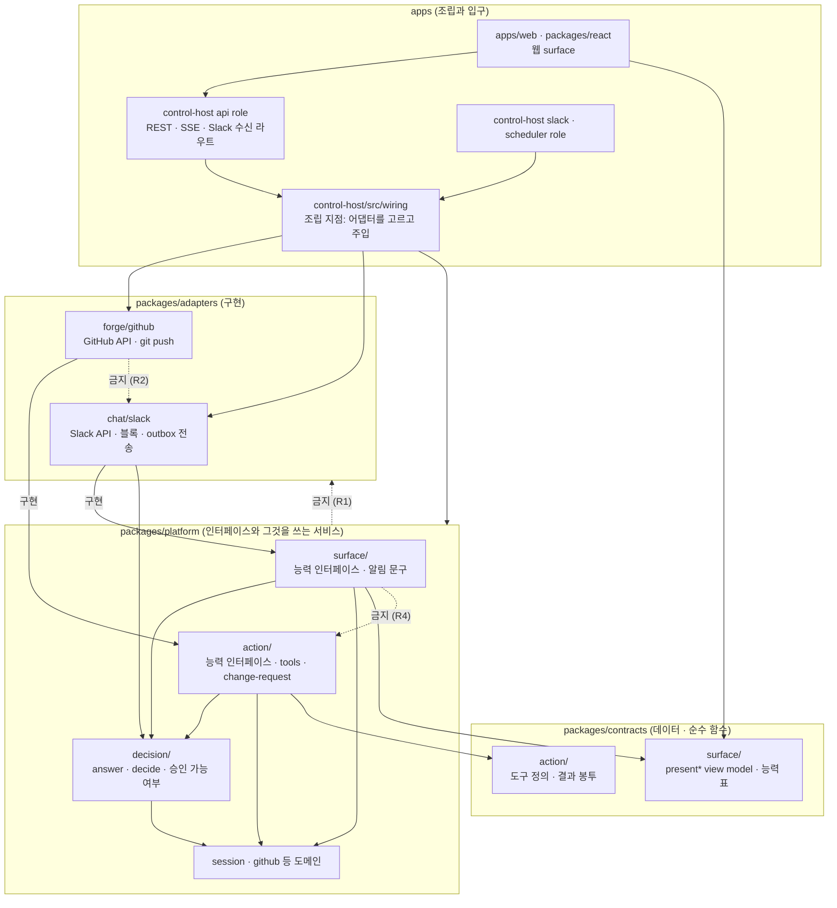
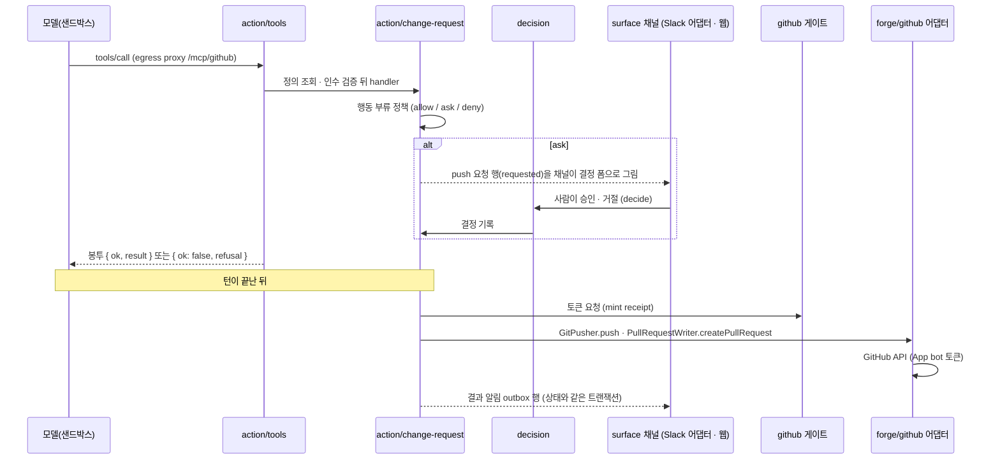
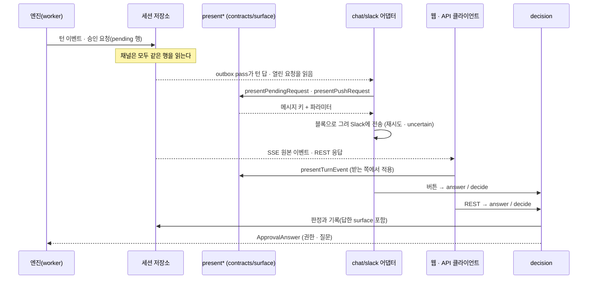

# 결정(설계): surface·action 모듈, 어댑터, 시험 피라미드

- 상태: 설계. 이 문서가 머지된 뒤 이행 단계 U1~U9([10절](#10-이행-순서))를 단계마다 별도 카드와 PR로 진행한다. 이 PR은 코드를 옮기지 않고 시험을 지우지 않는다.
- 기준 커밋: `origin/main` `1ad2a092a`. `파일:줄`과 파일 수는 이 커밋에서 직접 읽고 센 값이다. 시험 수와 시간은 `d8b318c6f`의 CI 실행 `42781937238`의 job 로그에서 읽었다([9.1절](#91-지금-수치)).
- 선행 문서: [에이전트 행동 도구 카탈로그](action-broker.md), [Musterrolle 모듈 경계](musterrolle-boundary.md), [패키지 구조화 설계](package-structure.md)(아래에서 **구조화 설계**). 포트의 도메인 디렉터리, 의존 규칙 A1~A5, 이행 단계 S0~S8은 구조화 설계가 정했고 여기서 다시 정하지 않는다. 이 문서가 그 설계와 다르게 정하는 것은 [11절](#11-구조화-설계와-달라지는-것)에 모았다.
- 오너 원문(2026-11-10): "Slack, web, github, api, sse 등 잘 구조화, (oop 를 고려하는게 낫나? ) 해서 surface 를 별도로 나눠서 코드를 배치해줘", "코드에서 딱 봤을대도 action layer, surface layer (layer 라는 명칭이 맞나?) 로 딱 나눠져있고 거기에 어떤게 있는지도 잘 정리되어잇는게 좋을거 같아", "github, slack 등등 각 외부 시스템 연계되는건 ~able이나 ~ible 같은 인터페이스로써 github 에서 가능한것 slack 에서 가능한것 같은 느낌으로 정리", "테스트 피라미드 관점에서 unit test 등도 지울거 지우고 다시 구성", "oop, solid, 의존성 역전같은 기본 설계원칙에 벗어나지 않고 잘 구조화해서 만들어줘", "미리 추상화 해둘수 있다면 해두고 싶네 그래야 나중에 이상한 코드가 안늘어날거 아니야".

## 요약

| 항목 | 결론 |
|---|---|
| 세 묶음 | **모듈**(surface, action)이 능력 인터페이스를 정의한다. **어댑터**(GitHub, Slack)가 자기가 할 수 있는 능력만 구현한다. 사람의 답은 채널이 무엇이든 **결정 서비스** 두 입구로 들어간다 |
| 이름 | "layer"가 아니라 **모듈**이다. surface와 action은 서로를 쓰지 않고 같은 층에 나란히 있다([1절](#1-용어)) |
| 코드 배치 | `packages/contracts/src/{surface,action}/`(view model, 능력 표, 도구 정의), `packages/platform/src/{surface,action,decision}/`(능력 인터페이스와 그것을 쓰는 서비스), `packages/adapters/{forge/github,chat/slack}/`(구현), `apps/control-host/src/wiring/`(조립 지점 한 곳). 웹은 `apps/web`·`packages/react`에 남는다 |
| 채널 판정 | Slack은 surface이자 action 출구, 웹과 API·SSE는 surface, GitHub는 action이다([2절](#2-surface와-action의-경계)) |
| 원칙 | 의존성 역전, 인터페이스 분리, 단일 책임, 개방·폐쇄, 리스코프를 원칙마다 지금 코드의 예와 강제 방법으로 적었다([5절](#5-설계-원칙)). 상속 계층은 만들지 않는다 |
| 미리 정하는 것 | 능력 인터페이스, 계약 시험, 어댑터 폴더 골격, 조립 지점, 의존 방향 규칙은 채널 수와 상관없이 지금 정한다. 구현이 없는 어댑터와 쓰는 곳이 없는 능력은 만들지 않고 [예정 능력 표](#63-예정-능력)에만 둔다 |
| 받은 방향에서 바꾼 것 | 다섯 가지를 코드 근거로 바꿨다: 인터페이스 위치, 이름 관례, API·SSE 어댑터 패키지, "platform은 어댑터 이름을 모른다"의 강제 방식, Slack 저장소 포트의 자리([12절](#12-받은-방향에서-바꾼-것과-이유)) |
| 시험 | 지울 후보는 적다(4건). 문제는 이름과 층이 어긋난 것이다. 층을 "무엇을 여는가"로 정하고, 어댑터 계약 시험 층을 더한다([9절](#9-시험-피라미드)) |

## 1. 용어

| 말 | 뜻 | 이미 쓰는 곳 |
|---|---|---|
| surface | 에이전트 이벤트를 사람에게 보여 주고 사람의 답을 결정 서비스로 돌려보내는 채널 | 계약의 `SURFACE_KIND_VALUES = ["web", "slack", "api"]`(`packages/contracts/src/kollegium/surfaces.ts:20`), 답을 기록하는 `answerSurface`(`packages/db/src/pending-requests.ts:1036`) |
| action | 모델의 도구 호출 하나가 바깥 시스템에 내는 효과와 그 실행 경로 | [행동 도구 카탈로그](action-broker.md) 1절의 모듈 이름 action-broker |
| 결정 서비스 | 사람의 답(허용·거절·선택, push 승인·거절)을 받아 판정하고 기록하는 서비스 | `PendingRequestService.answer`, `PushRequestService.decide` |
| 능력(capability) | 바깥 시스템 하나가 할 수 있는 일 한 가지를 나타내는 작은 인터페이스 | `GitPusher`(`packages/platform/src/ports/git-push.ts:66`) |
| 어댑터 | 능력 인터페이스를 바깥 시스템의 API로 구현한 패키지 | `packages/adapters/execution/{local-docker,kubernetes}` |
| view model | 채널이 그리기 전에 이벤트·요청을 채널과 무관한 모양(메시지 키와 파라미터)으로 바꾼 값 | `presentTurnEvent`(`packages/contracts/src/api/present-turn-event.ts:315`) |

**"layer"라는 이름은 맞지 않는다.** 이 저장소에서 층은 패키지 사이의 의존 순서다(`contracts` → `platform` → 어댑터·`db` → `apps`). surface와 action은 같은 층 안에 나란히 있고 서로를 import하지 않는다. 위아래가 없는 둘을 층이라 부르면 "surface가 action 위에 있다"는 틀린 그림이 생긴다. [행동 도구 카탈로그](action-broker.md)도 action-broker를 "모듈 이름이고 레이어 이름이 아니다"라고 적었다.

| 후보 | 판단 |
|---|---|
| layer | 버린다. 의존 순서를 뜻하는 말인데 둘 사이에 순서가 없다 |
| boundary(경계) | 버린다. 이 저장소에서 경계는 "누가 무엇을 import할 수 있는가"의 규칙 묶음이다([Musterrolle 모듈 경계](musterrolle-boundary.md)). 모듈마다 경계가 하나씩 있다 |
| **module(모듈)** | **쓴다.** [구조](../architecture.md)가 Musterrolle·Kollegium·Lotse·Kiel을 모듈이라 부르고 action-broker도 모듈이다. surface 모듈은 그 문서가 Kollegium에 둔 "에이전트를 부르는 웹·Slack·API 채널"의 코드 위치다 |

문서에서는 "surface 모듈", "action 모듈"이라 쓰고, 디렉터리 이름은 `surface/`, `action/`이다.

## 2. surface와 action의 경계

판정 질문은 둘이다. ① 사람에게 보여 줄 문구·모양을 만드는 코드가 있는가. ② 사람의 답이 결정 서비스로 돌아오는 길이 있는가. 둘 다 있으면 surface다. 모델의 도구 호출이 바깥에 효과를 내는 길이면 action이다.

| 채널·연동 | ① 보여 주는 코드 | ② 답이 돌아오는 길 | 판정 |
|---|---|---|---|
| Slack 스레드 | 턴 답 `enqueueSlackTurnAnswers`(`packages/platform/src/musterrolle/slack-outbox.ts:328`), 결정 카드 `slackPromptMessage`(`slack-prompts.ts:556`), 스레드 상태 `writeSlackThreadStatuses`(`slack-session-status.ts:160`), 결과 알림 `actionNoticeText`(`action-notice.ts:111`) | 버튼·모달이 `deps.pending.answer`(`slack-interactions.ts:396`)와 `deps.pushes.decide`(`:485`)를 부른다. 지시는 `slack-session-handler.ts`가 세션으로 잇는다 | **surface IN.** 동시에 action의 출구다(카탈로그 T1 메시지, T3 결정 폼) |
| 웹 콘솔 | `presentTurnEvent`를 그리는 타임라인(`packages/react/src/blocks/session-timeline.tsx:226`), `ApprovalCard`·`QuestionCard`(`packages/react/src/components/session/`), push 승인 화면(`apps/web/src/routes/session-github-work.tsx`) | REST `service.answer`(`apps/control-host/src/api/routes/pending.ts:36`), `service.decide`(`routes/push-requests.ts:68`) | **surface IN.** 코드는 옮기지 않는다 |
| 공개 API·SSE | SSE는 이벤트를 가공하지 않고 그대로 쓴다(`apps/control-host/src/api/routes/events.ts:300-306`). view model은 받는 쪽이 적용한다. pending·push 응답에는 표시용 필드가 붙는다(JeongJaeSoon/werft#1496의 `summary`, `approvability`) | 웹과 같은 REST 라우트. SDK 예제가 이 길로 승인한다(`examples/sdk-approver`) | **surface IN.** `api`는 이미 surface 종류다. 서버에서 문구를 만들지 않는 지금 모양을 유지한다 |
| GitHub: push·PR 생성·닫기·리뷰·workflow | 해당 없음 | 해당 없음 | **action.** 모델의 도구 호출이 `packages/platform/src/sessions/github-mcp-server.ts:501-731`의 분기를 지나 서비스와 게이트로 간다 |
| GitHub: PR 본문·코멘트 표시 | `renderPullRequestBody`(`packages/platform/src/sessions/pull-request-body.ts:249`)가 사람이 읽을 본문을 만든다 | **없다.** GitHub App은 webhook 없이 만든다(`packages/platform/src/musterrolle/github-app-service.ts:141`). PR 리뷰 코멘트가 세션으로 돌아오는 코드가 없다 | **OUT(action에 남긴다).** 본문은 `open_pull_request`라는 action의 내용물이다. **LATER**: PR 코멘트·리뷰가 세션 입력이 되는 경로(webhook 수신)가 생기면 GitHub 어댑터가 surface 능력도 구현한다 |
| GitHub: check run | 코드 없음(`check_run`·`check-runs` 검색 0건) | 없음 | **OUT.** [예정 능력 표](#63-예정-능력)에 둔다 |
| CLI | key 발급 CLI(`apps/control-host/src/api/keys.ts`)는 운영 도구다. 세션 이벤트를 그리지 않는다 | 없음 | **OUT** |
| 이메일·다른 메신저 알림 | 코드와 계약이 없다 | 없음 | **LATER.** [예정 능력 표](#63-예정-능력)에 둔다 |
| 작업 기록(receipt) 화면 | 웹이 receipt 행을 읽어 그린다(`packages/react/src/components/receipt/`, `routes/receipts.ts`) | 없음(읽기 전용) | **surface IN(웹의 일부).** 별도 채널이 아니다 |

읽을 점:

- **사람의 답이 들어가는 곳은 이미 두 함수다.** `.answer(`와 `.decide(`를 부르는 곳은 위 네 줄뿐이다(Slack 둘, REST 둘). 이 문서는 이 모양을 규칙으로 고정한다([8절](#8-의존-방향-규칙) R5).
- **action이 사람에게 알릴 때 Slack 코드를 부르지 않는다.** push·PR의 결과 알림은 상태를 쓰는 같은 트랜잭션에서 outbox 행으로 들어간다(`packages/db/src/action-notices.ts:30`, `packages/db/src/pull-request-drain.ts:72`). 상태와 알림이 함께 commit되거나 함께 버려지므로, 이 이음매는 함수 호출로 바꾸지 않는다.
- **surface는 승인 가능 여부를 스스로 판정하지 않는다.** Slack 카드와 스레드 상태는 `pushApprovability`를 읽는다(`slack-outbox.ts:22`, `slack-session-status.ts:5`). JeongJaeSoon/werft#1496이 웹에도 같은 답을 싣는다.

## 3. 전체 그림

의존 방향 규칙의 정본은 `tests/architecture.test.ts`다. 아래 그림과 시험이 다르면 시험이 맞고, 그림을 고친다.



실선은 허용된 import, 점선은 금지다. `db`는 구조화 설계 5절 그대로 platform의 저장소 포트를 구현한다. 이 그림에서는 뺐다.

다이어그램은 Mermaid 코드 블록으로 문서 안에 둔다. 저장소에 Mermaid를 쓴 문서가 없어 이 문서가 첫 관례다. `docs/contributing/decisions/`는 문서 사이트의 페이지가 아니라 저장소 문서라서 GitHub가 그리는 것으로 충분하다. 그림만 바꾸는 PR은 없다. 규칙이 바뀌면 시험과 그림을 같은 PR에서 고친다.

## 4. 목표 트리

### 4.1 트리와 색인

```text
packages/contracts/src/
  surface/                    # 순수 코드만
    present-turn-event.ts     # 턴 이벤트 → 메시지 키
    present-action.ts         # 도구 요청 요약, push 승인 가능 여부 (#1496)
    capabilities.ts           # 시스템별 능력 표 (데이터, 새 파일)
  action/
    action-broker.ts          # 결과 봉투 ActionResult · ActionRefusal (지금 api/action-broker.ts)
    github-mcp.ts             # 내장 서버 github의 도구 정의 표 (지금 api/github-mcp.ts)

packages/platform/src/
  surface/
    ports/                    # surface 능력 인터페이스 (새 파일) + Slack 저장소 포트(4.4절)
    action-notice.ts  model-cut-notice.ts  model-move-notice.ts   # 채널과 무관한 알림 문구
  action/
    ports/                    # action 능력 인터페이스: git-push.ts, forge.ts, GitHubApi와 능력 별칭
    refusal.ts                # 서비스 오류 → 봉투 (지금 action-broker/refusal.ts)
    tools/                    # 공통 dispatch: 정의 조회 → 인수 검증 → handler → 봉투
    github/                   # 내장 서버 github의 handler: github-mcp-server.ts, github-work-service.ts
    change-request/           # push-* · pull-request-* (요청, 실행, PR 본문과 템플릿)
  decision/
    pending-service.ts        # answer: 권한 · 질문의 답
    push-approvability.ts     # 지금 이 push를 사람이 승인할 수 있는가
    index.ts                  # 채널이 부를 수 있는 두 입구의 타입

packages/adapters/
  execution/  runtimes/       # 그대로
  forge/github/               # @werft-ai/forge-github
    src/index.ts              # 이 어댑터가 구현한 능력을 export
    src/forge-github.ts  src/git-push.ts
  chat/slack/                 # @werft-ai/chat-slack
    src/index.ts              # 이 어댑터가 구현한 능력을 export
    src/slack-*.ts            # 지금 platform/src/musterrolle/slack-*.ts 27개

apps/control-host/src/
  wiring/                     # 조립 지점. 어댑터 패키지를 import하는 유일한 곳
  api/routes/surface/         # events · pending · push-requests · slack-events · slack-interactions
```

| 디렉터리 | 무엇이 있나 | 무엇이 없나 |
|---|---|---|
| `contracts/src/surface/` | view model 함수와 타입, 능력 표 | zod 스키마(REST 계약은 `api/`), 문구, 시각, I/O, 인터페이스의 메서드 타입([12절](#12-받은-방향에서-바꾼-것과-이유)) |
| `contracts/src/action/` | 도구 정의(이름·입력·출력·행동 부류·거절 코드), 결과 봉투 | 실행 코드. REST 계약 `push-request.ts`·`pull-request.ts`는 사람도 쓰므로 `api/`에 남는다 |
| `platform/src/surface/` | surface 능력 인터페이스, 채널과 무관한 알림 문구 | 블록·mrkdwn 같은 채널 모양, 바깥 API 호출 |
| `platform/src/action/` | action 능력 인터페이스, 도구 호출 경로, push·PR 서비스 | Octokit, git 실행. 인가·토큰 발급·receipt는 구조화 설계대로 `github/` 도메인의 게이트가 소유한다 |
| `platform/src/decision/` | 사람의 답을 판정하는 입구와 그 판정에 쓰는 순수 함수 | 채널별 코드 |
| `adapters/forge/github/` | `GitHubApi`와 `GitPusher`의 구현 | 정책, receipt, 서비스 로직 |
| `adapters/chat/slack/` | Slack Web API 클라이언트, 블록·mrkdwn 렌더, 버튼·이벤트 해석, outbox 전송과 재시도 분류, 스레드 상태, 앱 설치·시크릿·설정 | 결정 판정(`decision/`을 부른다), 저장소 구현(`db`) |
| `control-host/src/wiring/` | 환경에서 어댑터를 만들고 platform 서비스에 주입하는 코드 | 서비스 로직, 라우트 |

### 4.2 현재 경로 → 목표 경로

| 현재 | 목표 | 메모 |
|---|---|---|
| `contracts/src/api/present-turn-event.ts`, `present-action.ts` | `contracts/src/surface/` | `present-action.ts`는 JeongJaeSoon/werft#1496 머지 뒤 |
| `contracts/src/api/action-broker.ts`, `github-mcp.ts` | `contracts/src/action/` | 도구 표 `GITHUB_MCP_TOOLS`(`github-mcp.ts:431`)가 여기 있다 |
| `platform/src/musterrolle/slack-*.ts`(27개)와 시험 | `adapters/chat/slack/src/` 같은 이름 | [Musterrolle 모듈 경계](musterrolle-boundary.md)가 "어디에 둘지는 나중에 정한다"고 미룬 Slack 파일의 자리다. musterrolle에는 신원·권한만 남는다 |
| `platform/src/testing/slack-fakes.ts` | `adapters/chat/slack/src/testing/` | 패키지의 `./testing/*` export |
| `platform/src/musterrolle/action-notice.ts`, `model-cut-notice.ts`, `model-move-notice.ts` | `platform/src/surface/` | 블록이 아닌 평문 문구이고 `db`가 트랜잭션 안에서 부른다(`packages/db/src/action-notices.ts:3-8`). 어댑터로 보내면 `db`가 어댑터를 import하게 된다 |
| `platform/src/ports/slack-*.ts`(6개), `surface-binding-store.ts` | `platform/src/surface/ports/` | [4.4절](#44-slack-저장소-포트는-platform에-남는다) |
| `platform/src/ports/git-push.ts`, `forge.ts`, `ports/github-gate.ts`의 `GitHubApi` | `platform/src/action/ports/` | `github-gate.ts`의 나머지(게이트, grant, receipt 타입)는 구조화 설계의 `github/ports/` |
| `platform/src/action-broker/refusal.ts` | `platform/src/action/refusal.ts` | [7.2절](#72-약속과-실제의-차이-그리고-정정) |
| `platform/src/sessions/github-mcp-server.ts`, `github-work-service.ts` | `platform/src/action/github/` | 구조화 설계의 `github/tools/` |
| `platform/src/sessions/push-*.ts`, `pull-request-*.ts` | `platform/src/action/change-request/` | 구조화 설계의 `change-request/`. `push-approvability.ts`만 `decision/` |
| `platform/src/sessions/pending-service.ts` | `platform/src/decision/` | |
| `apps/control-host/src/api/forge-github.ts`, `git-push.ts`와 시험 | `adapters/forge/github/src/` | `@octokit/*` 의존성이 control-host에서 이 패키지로 옮겨 간다 |
| `apps/control-host/src/api/server.ts`의 어댑터 생성(`:508`, `:903`, `:1043`), `slack/main.ts`의 `:230`, `:347` | `apps/control-host/src/wiring/` | 지금은 role마다 따로 만든다. `createSlackBotApi`를 세 곳에서 부른다 |

파일 이름은 바꾸지 않는다(구조화 설계 7절). `packages/db/src/`는 구조화 설계 4.4절대로 platform과 같은 디렉터리 이름을 따라간다.

### 4.3 옮기지 않는 것

- **웹.** `packages/react`는 패키지 전체가 웹 surface이고 `apps/web`은 그것을 조합한다. `tests/architecture.test.ts:1651`이 웹의 import를 이미 고정한다.
- **API·SSE.** 어댑터 패키지로 만들지 않고 `apps/control-host/src/api/routes/surface/`로 묶는다([12절](#12-받은-방향에서-바꾼-것과-이유)).
- **`contracts/src/kollegium/surfaces.ts`.** 채널 연결(binding)의 저장 계약이다. view model이 아니다.
- **GitHub 연동 서비스와 게이트.** `github-gate.ts`, `github-{app,packages,repository,settings}-service.ts`는 구조화 설계의 `platform/src/github/`로 간다. 이 가운데 바깥 HTTP를 직접 부르는 곳(`musterrolle/github-packages-service.ts:217`)은 [8절](#8-의존-방향-규칙) R7의 기준선에 남는다.

### 4.4 Slack 저장소 포트는 platform에 남는다

`SlackOutboxStore`를 비롯한 Slack 저장소 포트 일곱 개는 `db`가 구현한다. `db`가 의존하는 워크스페이스 패키지는 `contracts`·`observability`·`platform`·`system`뿐이다(`packages/db/package.json:25-28`). 포트를 Slack 어댑터로 옮기면 `db`가 어댑터 패키지를 import해야 하고, 어댑터끼리 의존하게 된다. 그래서 포트는 `platform/src/surface/ports/`에 둔다. platform에 Slack이라는 이름이 남는 곳은 이 포트 파일들뿐이고, [8절](#8-의존-방향-규칙) R8의 기준선이 그 목록을 고정한다.

포트를 채널 중립 이름(`OutboxStore`)으로 일반화하는 것은 하지 않는다. 열 구성이 Slack 고유이고(팀, 채널, 스레드 ts, 블록), 테이블 `slack_outbox`를 바꾸는 일은 스키마 변경이다. 두 번째 push 채널이 실제로 생길 때 그 채널의 열을 보고 정한다.

## 5. 설계 원칙

원칙마다 **지금 코드에서 이미 지키는 예**, **어기는 곳**, **이 설계가 강제하는 방법**을 적는다.

### 5.1 의존성 역전(DIP)

인터페이스는 쓰는 쪽이 소유하고, 어댑터가 구현하고, 조립 지점이 넣는다.

- **이미 지키는 예.** `GitPusher`는 platform이 선언하고(`packages/platform/src/ports/git-push.ts:66`), control-host가 구현하고(`apps/control-host/src/api/git-push.ts:34`), 조립할 때 넣는다(`apps/control-host/src/api/server.ts:1043`). push 실행기는 git을 모른다.
- **어기는 곳.** ① `agents/agent-service.ts:51`이 Slack 파일의 `SlackWelcome` 타입을 import한다. ② platform 포트 두 개가 Slack 클라이언트 파일의 타입을 import한다(`ports/slack-app-store.ts:10`, `ports/slack-config-token-store.ts:1`). ③ Slack Web API 클라이언트 `createSlackBotApi`가 platform 안에 있다(`musterrolle/slack-config-api.ts:573`).
- **강제.** platform은 어댑터 패키지를 import할 수 없다. 이미 `tests/architecture.test.ts:1057`("platform depends on contracts, runtime-core and zod only")이 막는다. ①은 surface 능력 인터페이스 `WelcomeSender`로, ②는 타입을 포트 파일로 옮겨서, ③은 클라이언트를 어댑터로 옮겨서 푼다. 규칙 목록은 [8절](#8-의존-방향-규칙)이다.

```ts
// packages/platform/src/action/ports/git-push.ts — owned by the action module (exists today)
export interface GitPusher {
  push(input: GitPushInput): Promise<GitPushResult>;
}

// packages/adapters/forge/github/src/index.ts — the adapter implements it
export function createGitPusher(options: GitPusherOptions): GitPusher { /* git over storage */ }

// apps/control-host/src/wiring/adapters.ts — the one place that names the adapter
import { createGitPusher } from "@werft-ai/forge-github";
export const pushExecutor = createPushExecutor({ pusher: createGitPusher(options), /* stores */ });
```

### 5.2 인터페이스 분리(ISP)

큰 채널 인터페이스 하나가 아니라 능력 하나에 인터페이스 하나다.

- **이미 지키는 예.** Slack을 쓰는 코드는 `Pick<SlackBotApi, "setStatus">`처럼 필요한 메서드만 받는다(`slack-session-status.ts:162` 등 11곳).
- **어기는 곳.** `GitHubApi`는 메서드 17개짜리 인터페이스 하나다(`packages/platform/src/ports/github-gate.ts:91`). PR 서비스도, workflow 서비스도, 저장소를 읽는 코드도 17개 전부를 받는다. 시험용 가짜도 17개를 채워야 한다.
- **강제.** `GitHubApi`를 능력별 타입으로 나누고([6.2절](#62-능력-인터페이스)), 서비스는 자기가 쓰는 능력 타입만 받는다. **빈 구현과 "지원하지 않음" 예외를 금지한다.** 어댑터가 못 하는 능력은 구현하지 않고 export하지 않는다. 능력 인터페이스에는 선택 메서드(`method?:`)를 두지 않는다. 필요한 능력이 없는 조립은 컴파일 오류이거나, 그 기능을 켜지 않는 분기다(Slack 설치가 없으면 slack role이 뜨지 않는 지금 모양).

### 5.3 단일 책임(SRP)

렌더, 전송, 결정, 정책은 서로 다른 모듈이다.

| 책임 | 모듈 | 지금 파일 |
|---|---|---|
| 무엇을 보여 줄지(채널 중립) | `contracts/src/surface/` | `present-turn-event.ts`, `present-action.ts` |
| 어떤 모양으로 그릴지 | 어댑터의 렌더 파일 | `slack-prompts.ts`, `slack-mrkdwn.ts`, `slack-presentation.ts` |
| 보내고 다시 보낼지 | 어댑터의 전송 파일 | `slack-outbox.ts`의 `drainSlackOutbox`(`:848`), `slack-send-result.ts` |
| 답을 판정하고 기록 | `platform/src/decision/` | `pending-service.ts`, `push-request-service.ts`의 `decide` |
| 해도 되는가 | 정책 함수와 게이트 | `push-approvability.ts`, `github-gate.ts` |

- **어기는 곳.** `slack-outbox.ts`(1,159줄)에 넣기(`:328`), 그리기(`slackOutboxText` `:263`, `slackReplyBlocks` `:232`), 카드 정리(`:614`), 전송(`:848`)이 함께 있다. `push-request-service.ts`에는 요청 생성과 결정이 함께 있다.
- **강제.** 이동 단계에서는 파일을 쪼개지 않는다(구조화 설계의 "이동과 책임 분리는 별개"). 쪼개는 일은 이동이 끝난 뒤 파일마다 별도 PR이고, 이 문서는 그 순서만 정한다: `slack-outbox.ts`를 넣기·그리기·전송으로, `push-request-service.ts`에서 `decide`를 `decision/`으로.

### 5.4 개방·폐쇄(OCP)

채널이나 forge를 더할 때 고치는 곳은 **어댑터 폴더와 조립 지점**이다. 예: 두 번째 메신저를 더한다.

- [ ] `packages/adapters/chat/<이름>/`을 만들고 루트 `package.json`의 workspace 목록에 `packages/adapters/chat/*`가 있는지 본다
- [ ] 그 어댑터가 할 수 있는 능력만 구현해 `src/index.ts`에서 export한다(`satisfies`로 능력 타입에 맞춘다)
- [ ] 능력마다 계약 시험을 그 어댑터에 대고 돌린다([5.5절](#55-리스코프-치환lsp))
- [ ] `contracts/src/surface/capabilities.ts`의 표에 한 행, `SURFACE_KIND_VALUES`에 한 값
- [ ] `apps/control-host/src/wiring/`에서 어댑터를 만들어 넣는다
- [ ] 저장소가 필요하면 그 채널의 포트와 `db` 구현, 마이그레이션

고치지 않는 곳: `platform/src/decision/`, `platform/src/action/`, view model, 다른 어댑터, 웹. 여기를 고쳐야 한다면 능력 인터페이스가 그 채널을 담지 못한다는 뜻이고, 인터페이스를 먼저 고치는 별도 PR이 된다.

### 5.5 리스코프 치환(LSP)

같은 능력을 구현한 어댑터는 같은 계약 시험을 통과한다.

- 능력마다 계약 시험 함수 하나를 platform의 `./testing/*` export에 둔다. 인자는 "그 능력을 구현한 것을 만드는 함수"다.

```ts
// packages/platform/src/testing/pull-request-writer-contract.ts (sketch)
export function describePullRequestWriterContract(make: () => Promise<PullRequestWriter>) {
  test("opening twice for one branch answers the same pull request", async () => { /* ... */ });
  test("a body past the limit is refused, never cut silently", async () => { /* ... */ });
}

// packages/adapters/forge/github/src/pull-request-writer.contract.test.ts
describePullRequestWriterContract(() => githubAgainst(fakeGitHub()));
```

- 계약 시험이 담는 것은 인터페이스의 타입이 말하지 못하는 약속이다: 멱등성, 거절을 예외가 아닌 값으로 돌려주는가, 결과를 모를 때 `uncertain`으로 답하는가, 다시 보내지 않는가.
- 지금 그 약속을 고정하는 시험은 구현에 붙어 있다(`apps/control-host/src/api/forge-github.test.ts` 28건, `forge-github-pulls.test.ts` 29건). 이 가운데 인터페이스 약속에 해당하는 사례를 계약 시험으로 올리고, GitHub 응답 모양에 묶인 사례는 어댑터 시험으로 남긴다. 이것이 [9절](#9-시험-피라미드)의 어댑터 층이다.
- 시험용 가짜(`packages/testkit/src/fake-github`)도 같은 계약 시험을 통과해야 한다. 가짜가 실제와 다르게 굴면 그 위의 시험이 거짓으로 통과한다.

### 5.6 OOP: 상속 없이 구조적 인터페이스와 합성

**상속 계층을 만들지 않는다.** 계약은 구조적 타입, 조립은 합성, 상태는 팩토리의 클로저에 둔다. class는 지금처럼 오류 타입과 식별성이 있는 값에만 쓴다.

- platform의 비테스트 `export class`는 27개이고 그중 25개가 `Error` 하위 클래스다. 나머지는 `SecretKey`, `ProfileFeatureGate` 둘이다. 서비스는 `createX(deps)` 팩토리 90개로 만든다. contracts의 `export class`는 0개이고 구조화 설계 A4가 그것을 규칙으로 둔다.
- 채널들이 공유하는 구현이 없다. Slack은 서버가 outbox 행을 lease로 집어 밀어 보내고, 웹과 API는 클라이언트가 SSE로 끌어간다. 공통 부모 class에 둘 메서드 본문이 없다.
- 채널이 공유하는 것은 값의 모양이다. `presentPendingRequest`의 결과를 Slack은 블록으로, 웹은 React 요소로 그린다. 서버와 브라우저에 걸친 두 구현을 묶을 수 있는 것은 class가 아니라 타입이다.

| 반대안 | 버린 이유 |
|---|---|
| `abstract class Channel`과 채널별 하위 class | 공유할 구현이 없고, 큰 인터페이스 하나가 되어 5.2절을 어긴다. 브라우저의 웹 채널은 이 계층에 들어올 수 없다 |
| 어댑터마다 `class SlackAdapter implements Notifier, DecisionPrompter` | 상속은 없지만 저장소 관례(팩토리와 클로저)와 다르고, 지금 함수들이 이미 의존을 인자로 받아 얻는 것이 없다. 상태와 수명이 있는 객체(연결 풀, 토큰 캐시)가 생기면 그 객체만 class로 둘 수 있다 |
| 인터페이스 없이 구체 함수만 import | 채널이 하나인 지금은 가능하다. 그러나 platform이 Slack 파일을 직접 부르는 곳이 생기고(5.1절의 ①) 다음 채널을 더할 때 분기가 는다. 오너의 결정은 인터페이스를 먼저 두는 쪽이다([6.4절](#64-미리-정하는-것과-만들지-않는-것)) |

## 6. 능력

### 6.1 능력 표

행은 시스템, 열은 "그 시스템으로 할 수 있는 일"이다. ✓ 옆은 지금 그 일을 하는 코드다.

**surface 능력(사람 쪽).** 서버가 밀어 보내는 능력만 어댑터가 구현한다. 웹과 API·SSE는 클라이언트가 같은 행을 끌어가므로 서버에 구현할 능력이 없다.

| 시스템 | 지시 받기 | 턴 답 전달 | 결정 요청 표시 | 결정 답 받기 | 진행 상태 | 결과 알림 | 결정 뒤 정리 |
|---|---|---|---|---|---|---|---|
| Slack(어댑터) | ✓ `slack-session-handler.ts` | ✓ `slack-outbox.ts:328` | ✓ `slack-prompts.ts:556` | ✓ `slack-interactions.ts:396`, `:485` | ✓ `slack-session-status.ts:160` | ✓ `action-notice.ts:111` | ✓ `slack-outbox.ts:614` |
| 웹(끌어감) | ✓ `composer.tsx` | ✓ `session-timeline.tsx:226` | ✓ `approval-card.tsx`, `question-card.tsx` | ✓ `routes/pending.ts:36`, `routes/push-requests.ts:68` | ✓ `stage-indicator.tsx` | 없음(화면이 행을 다시 읽는다) | 없음 |
| API·SSE(끌어감) | ✓ REST | ✓ `routes/events.ts:300` | ✓ pending·push 응답 | ✓ 웹과 같은 라우트 | ✓ 이벤트 | 없음 | 없음 |
| GitHub | 없음 | 없음 | 없음 | 없음 | 없음 | 없음 | 없음 |

**action 능력(바깥 시스템 쪽).** 도구 번호는 [행동 도구 카탈로그](action-broker.md) 5절이다.

| 시스템 | push | PR 쓰기 | PR 코멘트 | 리뷰 | workflow | 저장소 읽기 | 메시지 | 결정 폼 |
|---|---|---|---|---|---|---|---|---|
| GitHub | ✓ T5 `GitPusher` | ✓ T6·T9 `createPullRequest`·`updatePullRequestBody`·`setPullRequestState` | ✓ `upsertComment` | ✓ `submitReview` | ✓ `dispatchWorkflow`·`rerunWorkflow` | ✓ `getRepository`·`readTree`·`readBlob` | 없음 | 없음 |
| Slack | 없음 | 없음 | 없음 | 없음 | 없음 | 없음 | ✓ T1 | ✓ T3 |

### 6.2 능력 인터페이스

인터페이스는 platform의 두 모듈이 소유한다. 이름은 [6.5절](#65-이름-관례)의 역할 명사다.

```ts
// packages/platform/src/action/ports/capabilities.ts
// GitHubApi keeps one implementation; services take only the capability they use.
export type RepositoryReader = Pick<GitHubApi, "getRepository" | "getBranchHead" | "readTree" | "readBlob" | "isAncestor">;
export type PullRequestWriter = Pick<GitHubApi, "createPullRequest" | "getPullRequest" | "updatePullRequestBody" | "setPullRequestState" | "findPullRequestForBranch" | "findPullRequestsForBranch">;
export type PullRequestCommenter = Pick<GitHubApi, "upsertComment">;
export type ReviewSubmitter = Pick<GitHubApi, "submitReview">;
export type WorkflowRunner = Pick<GitHubApi, "dispatchWorkflow" | "getWorkflowRun" | "rerunWorkflow">;
export type { GitPusher } from "./git-push.ts";
```

```ts
// packages/platform/src/surface/ports/capabilities.ts (sketch; U3 fixes the exact
// signatures from the functions that exist today)
export interface ReplySender {
  /** Sends the turn's answer once; an unknown outcome is `uncertain`, never resent. */
  sendReply(reply: TurnReply): Promise<SendOutcome>;
}
export interface DecisionPrompter {
  /** Shows one open request; the person's answer goes to the decision service. */
  prompt(request: ToolRequestPresentation | PushRequestPresentation): Promise<SendOutcome>;
  settle(decision: SettledDecision): Promise<SendOutcome>;
}
export interface StatusWriter {
  writeStatus(status: SessionStage): Promise<void>;
}
export interface WelcomeSender {
  sendWelcome(agent: AgentWelcome): Promise<SendOutcome>;
}
```

```ts
// packages/adapters/chat/slack/src/index.ts
export const slack = {
  sendReply, prompt, settle, writeStatus, sendWelcome,
} satisfies ReplySender & DecisionPrompter & StatusWriter & WelcomeSender;
```

`satisfies`는 값을 바꾸지 않고 모양만 검사한다. 능력 하나를 잘못 구현하면 그 줄에서 컴파일이 실패한다.

**결과 알림은 인터페이스가 아니라 outbox 행이다.** 알림은 상태 변경과 같은 트랜잭션에서 써야 하므로([2절](#2-surface와-action의-경계)) 이음매가 함수 호출이 될 수 없다. action은 `ActionNotice` 값(`action-notice.ts:38`)을 저장소에 넘기고, 어댑터는 그 행을 전송한다. 이 경로의 계약은 `ActionNotice` 타입과 dedupe key다.

능력 표 자체는 contracts의 데이터다. 문서 표와 코드가 어긋나지 않게 하려는 것이다.

```ts
// packages/contracts/src/surface/capabilities.ts
export const SURFACE_CAPABILITY_VALUES = [
  "instruction", "reply", "decision_prompt", "decision_answer", "status", "notice", "settle",
] as const;
export type SurfaceCapability = (typeof SURFACE_CAPABILITY_VALUES)[number];

export const SURFACE_CAPABILITIES = {
  slack: ["instruction", "reply", "decision_prompt", "decision_answer", "status", "notice", "settle"],
  web: ["instruction", "reply", "decision_prompt", "decision_answer", "status"],
  api: ["instruction", "reply", "decision_prompt", "decision_answer", "status"],
} as const satisfies Record<SurfaceKind, readonly SurfaceCapability[]>;
```

action 쪽 표는 새로 만들지 않는다. 도구 정의 표 `GITHUB_MCP_TOOLS`(`packages/contracts/src/api/github-mcp.ts:431`)의 행동 부류 칸이 이미 그 표다.

### 6.3 예정 능력

코드가 없고 쓰는 곳도 없다. 인터페이스도, 폴더도 만들지 않는다. 만들 때 이 표의 행을 [6.1절](#61-능력-표)로 옮긴다.

| 능력 | 시스템 | 만드는 조건 |
|---|---|---|
| check run 쓰기 | GitHub | 세션 결과를 check로 보여 달라는 요구가 정해질 때. action 도구로 먼저 판단한다 |
| PR 코멘트·리뷰를 세션 입력으로 받기 | GitHub | GitHub App에 webhook을 켜기로 할 때. 이때 GitHub 어댑터가 surface 능력 "지시 받기"를 구현한다 |
| 결과 알림 전달 | 이메일, 다른 메신저 | 두 번째 push 채널이 정해질 때 |
| 턴 중간 메시지 `send_message` | Slack | 카탈로그의 2단계(L11) |
| `gh` 입구, `werft-commit` | GitHub, worker | 카탈로그의 L14, L10. 코드가 아직 없다 |
| 두 번째 forge | — | 실제로 붙일 forge가 정해질 때 |

### 6.4 미리 정하는 것과 만들지 않는 것

오너의 방향은 "미리 추상화해 두어 나중에 이상한 코드가 늘지 않게"다. 그 선을 이렇게 긋는다.

| 지금 정한다(채널 수와 무관) | 만들지 않는다 |
|---|---|
| 지금 쓰이는 능력의 인터페이스([6.2절](#62-능력-인터페이스)) | 쓰는 곳이 없는 능력의 인터페이스([6.3절](#63-예정-능력)) |
| 능력마다 계약 시험([5.5절](#55-리스코프-치환lsp)) | 구현이 없는 어댑터의 패키지나 빈 폴더(`adapters/chat/<다른 것>`, `adapters/stream/*`) |
| 어댑터 폴더 골격 `packages/adapters/<kind>/<provider>/src/index.ts`와 workspace 등록 | 채널 레지스트리, 플러그인 로더, 설정으로 어댑터를 고르는 장치. 조립 지점의 코드 몇 줄이 그 일을 한다 |
| 조립 지점 한 곳과 그 밖에서 어댑터를 import하지 못하게 하는 규칙 | 저장소 포트의 채널 중립 일반화([4.4절](#44-slack-저장소-포트는-platform에-남는다)) |
| 의존 방향 규칙과 기준선([8절](#8-의존-방향-규칙)) | 상속 계층 |

판정 기준은 하나다. **인터페이스를 쓰는 코드와 구현하는 코드가 지금 둘 다 있으면 정한다. 한쪽이라도 없으면 표로만 둔다.** 구현이 하나뿐이라는 것은 미루는 이유가 아니다. 인터페이스가 없으면 platform이 그 구현을 직접 부르게 되고, 그것이 5.1절의 ①~③이다.

### 6.5 이름 관례

받은 방향의 이름은 `PullRequestable`·`Pushable`·`Commentable`·`Notifiable`·`Approvable`이다. **능력 단위로 나누는 것은 그대로 따르고, 이름만 역할 명사로 바꾼다.**

| 받은 이름 | 이 문서의 이름 | 이유 |
|---|---|---|
| `Pushable` | `GitPusher` | 이미 있는 포트다(`ports/git-push.ts:66`). 이름을 바꾸면 쓰는 곳 전부를 고친다 |
| `PullRequestable` | `PullRequestWriter` | 영어로 어색하고, 읽기와 쓰기를 가르지 못한다 |
| `Commentable` | `PullRequestCommenter` | `-able`은 "코멘트를 받을 수 있는 것"으로 읽힌다 |
| `Notifiable` | 알림은 outbox 행([6.2절](#62-능력-인터페이스)), 밀어 보내는 능력은 `ReplySender`·`WelcomeSender` | 같은 이유. "알림을 받을 수 있는 것"은 사람이다 |
| `Approvable` | `DecisionPrompter` | **이 저장소에서 approvable은 이미 push 요청을 가리킨다**: `pushApprovability`, `PushApprovabilityVerdict`(`sessions/push-approvability.ts:22`, `:55`), 응답 필드 `approvability`. 채널에 `Approvable`을 붙이면 같은 말이 "승인될 수 있는 요청"과 "승인을 물을 수 있는 채널"을 함께 뜻한다 |

| 관례 | 판단 |
|---|---|
| `-able` 형용사 | 버린다. TypeScript와 표준 라이브러리에서 `-able`은 그 일을 **당하는** 값에 붙는다(`Iterable`은 순회되는 것, `Disposable`은 치워지는 것). 시스템이 **하는** 일에는 맞지 않고, 위 표의 충돌이 있다 |
| `CanX`, `XCapability` | 버린다. 저장소에 선례가 없고, `XCapability`는 능력 표의 키(값)와 섞인다 |
| **역할 명사** | **쓴다.** 저장소의 포트가 이미 이렇게 짓는다: `GitPusher`, `SlackNoticeSink`, `CheckpointVerifier`, `ExecutionBackend` |

이름은 오너가 정할 수 있는 항목이다. `-able`로 정하면 바꾸는 곳은 [6.2절](#62-능력-인터페이스)의 타입 이름뿐이고 구조는 같다. 그 경우에도 `Approvable`만은 위 충돌 때문에 다른 말이 필요하다.

## 7. action 모듈

### 7.1 무엇이 어디에

트리는 [4.1절](#41-트리와-색인)이다. action 모듈은 [행동 도구 카탈로그](action-broker.md)의 action-broker를 키운 것이다.

| 일 | 자리 |
|---|---|
| 도구 정의(이름, 입력, 출력, 행동 부류, 거절 코드) | `contracts/src/action/` |
| 도구 호출 공통 경로(정의 조회, 인수 검증, 봉투) | `platform/src/action/tools/` |
| GitHub 도구의 handler | `platform/src/action/github/` |
| push 요청·의도·실행, PR 서비스·본문·템플릿 | `platform/src/action/change-request/` |
| 행동 부류 정책 판정 | 각 서비스(카탈로그 6절). 옮기지 않는다 |
| 인가, 토큰 발급, receipt | `platform/src/github/`의 게이트(구조화 설계). 옮기지 않는다 |
| GitHub REST 호출, git push 실행 | `adapters/forge/github/` |

### 7.2 약속과 실제의 차이, 그리고 정정

[행동 도구 카탈로그](action-broker.md) 1절은 코드 모듈을 `packages/platform/src/action-broker/`로 약속했다. 실제 그 폴더에는 `refusal.ts`와 시험 하나뿐이고, dispatcher와 handler는 `sessions/github-mcp-server.ts`에 있다(카탈로그 1절이 지금 상태를 그렇게 적는다). 구조화 설계는 handler를 `github/tools/`, 공통 dispatch를 `platform/src/tools/`에 두고 `action-broker/`와 합칠지를 열린 질문으로 남겼다.

이 문서가 그 질문에 답한다. **셋을 `action/` 아래로 모은다.** action-broker는 카탈로그의 모듈 이름으로 남고, 디렉터리 이름은 `action/`이다. 이 PR이 카탈로그 1절의 그 줄을 이 문서로 잇는다.

### 7.3 결정 서비스로 모이는 흐름



- **채널은 action을 부르지 않고 `decision`만 부른다.** push 결정이 실행으로 이어지는 것은 `decision`과 `change-request` 사이의 일이다.
- **결정 서비스는 하나의 입구 타입, 두 구현이다.** `decision/index.ts`가 `answer`(권한·질문)와 `decide`(push)의 타입을 내보내고 채널은 이 타입만 받는다. `decide`의 구현을 `decision/`으로 떼어 오는 것은 5.3절의 분리 PR이다.

surface 쪽 흐름:



## 8. 의존 방향 규칙

정본은 `tests/architecture.test.ts`다. U1이 아래를 구조화 설계 A1~A5 옆에 더한다. 지금 어기는 곳은 A2와 같은 방식으로 (소스 파일 → 대상) 쌍 기준선에 박고, 쌍은 늘 수 없다.

| # | 규칙 | 지금 |
|---|---|---|
| R1 | platform은 어댑터 패키지를 import하지 않는다 | 이미 막혀 있다(`tests/architecture.test.ts:1057`) |
| R2 | 어댑터 패키지는 다른 어댑터, `db`, 앱을 import하지 않는다. `platform`, `contracts`, `observability`, `storage`와 자기 SDK만 | 새 규칙. `execution` 어댑터는 이미 `contracts`·`platform`만 의존한다(`packages/adapters/execution/local-docker/package.json:18-19`) |
| R3 | 앱에서 `@werft-ai/forge-github`, `@werft-ai/chat-slack`을 import하는 파일은 `apps/control-host/src/wiring/` 아래뿐이다. 라우트와 role은 조립된 서비스를 인자로 받는다 | 새 규칙. 기준선은 U4·U5가 만든다 |
| R4 | platform에서 `surface/`와 `action/`은 서로를 import하지 않는다 | 기준선 쌍: `agents/agent-service.ts` → `SlackWelcome`(`:51`). Slack 파일이 어댑터로 나가면 `slack-interactions.ts` → `push-request-service.ts`(`:31`) 같은 쌍은 R5로 넘어간다 |
| R5 | 채널(어댑터, 라우트)이 사람의 답을 넘기는 곳은 `decision/index.ts`가 내보내는 두 입구뿐이다. pending·push 저장소 포트의 쓰기 메서드를 직접 부르지 않는다 | 지킨다(호출 네 곳, [2절](#2-surface와-action의-경계)). U1이 TS AST로 호출 대상을 세어 고정한다 |
| R6 | `contracts/src/surface/`는 zod·시각·문구·I/O 없이 메시지 키와 파라미터만 돌려준다 | `present-turn-event.ts`가 지킨다. U1이 import 목록으로 고정한다 |
| R7 | platform은 바깥 HTTP를 직접 부르지 않는다. 바깥 호출은 능력 인터페이스 뒤에 있다 | 어긴다: `musterrolle/slack-config-api.ts:573`(U5에서 어댑터로), `musterrolle/github-packages-service.ts:217`. U1이 나머지를 세어 기준선으로 둔다 |
| R8 | platform 파일 이름과 export 이름에 어댑터 이름(`slack`)이 새로 생기지 않는다 | 기준선: [4.4절](#44-slack-저장소-포트는-platform에-남는다)의 포트 일곱 파일. `github`은 내장 서버 이름이자 도메인이라 이 규칙에서 뺀다([12절](#12-받은-방향에서-바꾼-것과-이유)) |
| R9 | 능력 인터페이스에 선택 메서드가 없고, 어댑터의 `index.ts`는 능력 타입에 `satisfies`로 맞춘 값만 export한다 | 새 규칙. TS AST로 `?:` 메서드와 `satisfies`를 본다 |

## 9. 시험 피라미드

### 9.1 지금 수치

CI 실행 `42781937238`(`d8b318c6f`, main push)의 `integration (<도메인>)` job 일곱 개가 `bun run test`의 모든 파일을 나눠 돌린다(`.github/workflows/ci.yml:229-355`). 파일별 시간은 job 로그의 파일 머리 줄 사이 간격이다.

| 묶음 | 파일 | 시간 | 메모 |
|---|---|---|---|
| 전체 | 879 | 1,648초 | 14,033건 실행 |
| 이름이 `*.integration.test.ts` | 185 | 793초 | db 105개 267초, adapters 17개 237초, control-host 48개 198초 |
| 이름이 `*.test.tsx`(DOM) | 121 | 196초 | `apps/web` 53개 181초, `packages/react` 25개 8초, `packages/ui` 43개 7초 |
| 이름이 `*.test.ts`("unit") | 573 | 660초 | control-host 102개 203초, db 57개 134초, `tests/` 54개 131초, worker 43개 90초, **platform 141개 17초**, contracts 39개 0.4초 |
| e2e(`tests/e2e`, 별도 job) | — | 399초 | compose 스택의 alpha path. quickstart 426초, k8s-smoke 457초는 따로 |

surface·action 범위만 보면:

| 디렉터리 | 파일 | 시간 |
|---|---|---|
| `packages/platform/src/musterrolle`(Slack 포함) | 45 | 8.0초 |
| `packages/platform/src/sessions`(action 포함) | 46 | 6.4초 |
| `apps/control-host/src/slack` | 4 | 113.1초 |
| `packages/react/src`(웹 surface) | 31 | 8.5초 |

가장 느린 파일은 `packages/adapters/execution/local-docker/src/egress.integration.test.ts` 90초, `apps/control-host/src/slack/outbox.test.ts` 73초, `apps/web/src/routes/teams.test.tsx` 55초, `tests/lease-clock.integration.test.ts` 53초다.

### 9.2 읽을 점

1. **이름과 층이 어긋났다.** `*.test.ts` 573개 중 121개가 PGlite·PostgreSQL을 열거나 프로세스를 띄운다(db 43, `tests/` 34, control-host 18, worker 11, 그 밖 15). `outbox.test.ts`는 이름이 unit이지만 95건이 모두 DB 위에서 돈다.
2. **순수 계산 시험은 이미 빠르다.** platform 141개 파일이 17초, contracts 39개가 0.4초다. 여기서 지워 얻을 시간은 없다.
3. **구현 세부를 고정하는 시험은 드물다.** 소스 파일을 읽어 단언하는 시험은 platform·react·contracts에 2개, mock 호출 단언은 Slack·세션 시험에 없고 react에 21곳이다. 시험 제목이 대부분 동작 문장이다. **그래서 재구성의 중심은 삭제가 아니라 층 표시, 중복 축소, 계약 시험 층이다.**
4. **중복이 있는 곳은 "응답 분류"다.** Slack 전송 결과 분류는 순수 함수 시험(`slack-outbox-policy.test.ts:55-157`)이 표로 고정하는데, DB 통합 시험이 같은 분류를 입력만 바꿔 다시 확인한다.
5. **인터페이스의 약속을 고정하는 시험이 구현에 붙어 있다.** `forge-github.test.ts`는 `GitHubApi`의 약속과 Octokit 응답 처리를 한 파일에서 확인한다. 두 번째 구현이나 가짜가 같은 약속을 지키는지 볼 방법이 없다.

### 9.3 층과 기준

층은 파일 이름이 아니라 **무엇을 여는가**로 정한다.

| 층 | 여는 것 | 이름 | 여기에 두는 것 |
|---|---|---|---|
| L1 unit | 없음(메모리 안의 가짜만) | `*.test.ts` | 판정·분류·변환·view model·렌더 함수. 입력 변형은 전부 여기 |
| L2 component | DOM, 가짜 서비스를 꽂은 라우트 | `*.test.tsx`, `routes/*.test.ts` | 화면 부품의 동작, HTTP 상태와 코드 매핑 |
| **L2 계약** | 가짜 바깥 서버(fake GitHub, mock Slack) | `*.contract.test.ts` | 능력 인터페이스의 약속. 구현마다 같은 시험 함수를 돌린다([5.5절](#55-리스코프-치환lsp)) |
| L3 integration | DB, LocalStack, Docker, 자식 프로세스 | `*.integration.test.ts` | 트랜잭션·동시성·lease·중복 방지처럼 저장소가 있어야 보이는 결과. **결과 하나에 사례 하나** |
| L4 e2e | compose 스택 | `tests/e2e/` | 채널마다 끝에서 끝까지 한 길 |

**지울 기준**(하나라도 맞으면 후보):

1. 구현 세부를 고정한다: 제품 코드가 아닌 것(시험용 가짜, 내부 호출 순서, 파일 배치)을 단언한다.
2. 아래 층이 같은 동작을 이미 고정했고, 위 층의 사례가 입력만 다르고 그 층에서만 보이는 결과를 더하지 않는다.
3. 이동 뒤에 의미가 없다: 로직이 다른 파일로 옮겨져 같은 단언이 두 곳에 있다.

**지우기 전에 확인한다.** 후보가 지키던 동작을 일부러 깨뜨려, "대신 지키는 시험"이 실제로 실패하는지 본다. 실패하지 않으면 지우지 않는다.

### 9.4 지울 후보

| # | 시험 | 기준 | 대신 지키는 시험 |
|---|---|---|---|
| D1 | `packages/platform/src/musterrolle/slack-notice-log.test.ts:43` "the fake keeps one notice per person and thread" | 1. 시험용 가짜 `createMemorySlackNoticeSink`만 단언한다 | 제품의 "스레드당 한 번"은 `apps/control-host/src/slack/outbox.test.ts:1616` "a refusal reaches only the person who typed, once per thread". 가짜의 동작은 계약 시험이 생기면 그쪽이 고정한다 |
| D2 | `apps/control-host/src/slack/outbox.test.ts:1700` "ok without a ts fails and is never sent again" | 2. `missing_ts → failed` 분류의 반복 | 분류는 `slack-outbox-policy.test.ts:133-136`. "실패한 행을 다시 보내지 않는다"는 `:1758`에 두 번째 pass 단언 한 줄을 옮겨 지킨다 |
| D3 | `apps/control-host/src/slack/outbox.test.ts:1639`의 대기 시간 범위 단언(`:1656-1661`) | 2. Retry-After 상한의 반복. 사례는 남기고 범위 단언만 지운다 | 상한 표는 `slack-outbox-policy.test.ts:56-75`, 대기 뒤 한 번 전송은 같은 사례의 `:1662-1667`과 `slack-outbox-policy.test.ts:418` |
| D4 | `packages/platform/src/musterrolle/slack-prompt-summary.test.ts:28` "a file tool's excerpt is the first lines of what it writes…" | 3. JeongJaeSoon/werft#1496 뒤 요약 로직은 contracts에 있고 같은 입력·같은 단언의 시험이 생긴다 | 그 PR의 `packages/contracts/src/api/present-action.test.ts` "shows the first lines of what a file tool writes". 머지 뒤 사례 이름까지 대조한다 |
| D5 | `apps/control-host/src/api/events.integration.test.ts:496`, `:543`, `:584` (키 폐기 시 스트림 종료, 연결 해제 시 핸들 반환, 남의 세션 404·잘못된 커서 400) | 2. 라우트 시험이 같은 단언을 한다 | `apps/control-host/src/api/routes/events.test.ts:523`, `:1064`, `:1080`·`:1090`. **조건부**: 통합 시험이 실제 PostgreSQL의 소유자 조건이나 LISTEN 핸들 해제를 증명하고 있으면 층이 다른 증명이므로 남긴다. U8이 단언을 읽고 정한다 |

surface·action 범위 밖의 시험은 이 문서가 후보를 고르지 않는다. 각 이동 카드가 자기 디렉터리에 위 기준을 적용한다.

### 9.5 옮길 시험

| # | 시험 | 옮기는 곳 | 이유 |
|---|---|---|---|
| M1 | `apps/control-host/src/slack/outbox.test.ts`, `session-handler.test.ts`, `welcome.test.ts` | `*.integration.test.ts`로 이름 변경 | 세 파일 모두 `describe.each(ENGINES)`로 PGlite나 PostgreSQL 위에서 돈다(`outbox.test.ts:160`). L3다. PGlite 경로는 사례마다 전체 migration을 다시 돌린다(`outbox.test.ts:164-169`). 한 번 migrate한 데이터를 복사해 주는 `migratedPGlite`(`packages/testkit/src/pglite.ts:17`)가 있는데 세 파일 모두 쓰지 않는다. 이름을 바꾸는 PR이 함께 바꾼다 |
| M2 | `slack-prompt-summary.test.ts:76`(발췌 길이), `:105`(내장 도구 전부), `:256`(다른 도구·원격 MCP 서버), `:278`(빠지거나 이상한 입력) | `packages/contracts/src/surface/present-action.test.ts` | 판정이 있는 곳으로 간다. platform 쪽 사례가 contracts 쪽보다 넓게 덮으므로 지우지 않고 옮긴다. 기대값을 Slack 문구에서 view model(메시지 키, 대상, 발췌)로 바꾸고, 옮긴 뒤 입력이 같아진 것은 하나로 합친다. `:152`·`:216`·`:228`(push 행과 카탈로그 읽기), `:286`(언어별 문구)은 Slack 쪽에 남는다 |
| M3 | `forge-github.test.ts`(28건), `forge-github-pulls.test.ts`(29건)에서 인터페이스 약속에 해당하는 사례 | platform `./testing/*`의 계약 시험 함수 | L2 계약 층. 나머지는 어댑터 패키지의 시험으로 파일과 함께 간다 |
| M4 | Slack 시험 전부(`musterrolle/slack-*.test.ts`), `action-broker/refusal.test.ts`, `sessions/`의 push·PR·MCP 시험 | 소스 파일과 같은 디렉터리로 함께 | 시험은 소스 옆에 둔다. 내용은 import 경로만 바뀐다 |
| M5 | 나머지 `*.test.ts` 가운데 DB·프로세스를 여는 118개 | 이름만 `*.integration.test.ts` | **LATER.** 다시 볼 조건: unit job(`check (part)`)을 PR마다 돌리기로 할 때. 새로 쓰는 파일은 지금부터 [9.3절](#93-층과-기준)의 이름을 따른다 |

이름을 바꾸거나 패키지를 옮기는 PR은 `.github/workflows/ci.yml`의 도메인 소유 목록과 `tests/integration-jobs.test.ts`가 정확한 경로로 단언하는 파일을 함께 고친다. `packages/adapters/chat/`과 `packages/adapters/forge/`는 지금 어느 도메인의 경로에도 없으므로 U4·U5가 더한다(`chat`은 `surface` 도메인, `forge`는 `api` 도메인이 가깝다).

### 9.6 남길 시험

- **계약 스냅샷**: `sessions/__snapshots__/github-mcp-envelope.test.ts.snap`(2,951줄). 모든 도구의 출력 스키마와 거절 코드를 고정한다. action 이동의 동작 불변 증거다.
- **결정 경로**: `slack-decision.test.ts`(26건), `slack-interactions.test.ts`(40건), `push-request-service.test.ts`, `routes/pending.test.ts`·`routes/push-requests.test.ts`. 누가 답할 수 있는가는 보안 동작이다.
- **데이터 손실·중복 전송**: `outbox.test.ts`의 `uncertain`·lease·동시 pass 사례(`:1592`, `:1670`, `:1771`~`:1931`). 분류가 아니라 "다시 보내지 않는다"를 DB 상태로 확인한다.
- **view model**: `present-turn-event.test.ts`, `present-action.test.ts`. 모든 채널이 여기에 기댄다.
- **화면 구조**: `approval-card.test.tsx:40`. DOM 위치를 단언하지만 사람이 본 배치 결함의 회귀 시험이다.
- **구조 규칙**: `tests/architecture.test.ts`.

### 9.7 목표

| 지표 | 지금 | 목표 |
|---|---|---|
| 순수 unit 파일 비율(L1) | 452 / 879 = 51% | 새 surface·action 로직 시험은 모두 L1. 비율은 내려가지 않는다 |
| DB·프로세스를 여는 파일 비율(L3) | (185 + 121) / 879 = 35% | 늘지 않는다. 새 L3 사례는 "저장소가 있어야 보이는 결과"를 제목에 쓴다 |
| 능력 인터페이스 가운데 계약 시험이 있는 것 | 0 | [6.2절](#62-능력-인터페이스)의 능력 전부. 구현과 가짜가 같은 시험을 통과한다 |
| 이름이 층과 다른 파일 | 121 | surface·action 범위에서 0(M1), 나머지는 M5 |
| 일곱 job의 시험 시간 합 | 1,648초 | 이 시리즈로 늘지 않는다. 이동 PR마다 같은 방법으로 다시 잰다 |
| e2e | API 한 길(alpha path) | 그대로. Slack 채널 e2e는 mock Slack이 스택에 들어갈 때 다시 본다 |

## 10. 이행 순서

U3·U7·U8을 뺀 단계는 동작 불변 이동이다. 한 단계가 한 PR 이상이고, 구조화 설계의 단계와 겹치는 것은 같은 카드로 한다.

| 단계 | 내용 | 먼저 있어야 하는 것 | 구조화 설계와의 관계 |
|---|---|---|---|
| **U1** | `tests/architecture.test.ts`에 R2~R9 기준선. 코드 이동 없음 | 이 문서 머지 | S1과 같은 PR이거나 바로 뒤 |
| **U2** | contracts: `present-*` → `surface/`, `action-broker.ts`·`github-mcp.ts` → `action/` | JeongJaeSoon/werft#1496 머지 | 새 단계 |
| **U3** | 능력 인터페이스와 능력 표(타입과 데이터만): `platform/src/action/ports/`, `surface/ports/`, `contracts/src/surface/capabilities.ts`. 서비스의 인자 타입을 `GitHubApi`에서 능력 별칭으로 좁힌다. `decision/` 이동과 입구 타입 | U1, #1496 머지 | 새 단계 |
| **U4** | `packages/adapters/forge/github/`: workspace 등록, `forge-github.ts`·`git-push.ts` 이동, `apps/control-host/src/wiring/` 신설 | U3 | 구조화 설계가 미룬 일을 앞당긴다([11절](#11-구조화-설계와-달라지는-것)) |
| **U5** | `packages/adapters/chat/slack/`: Slack 파일 27개와 시험·가짜 이동. 세 PR로 나눈다: ① Web API 클라이언트와 설정·설치, ② 렌더(블록, mrkdwn, 요약), ③ 수신·outbox·상태·버튼 | U3, U4(조립 지점), #1493·#1496 머지 | S3을 대체한다 |
| **U6** | platform `action/`: `refusal.ts`, `action/github/`, `action/change-request/`, `action/tools/` | U1, S0, 게이트·MCP 서버를 건드리는 열린 PR 없음 | S2의 handler, S4의 push·PR, S5. 위치만 `action/` 아래 |
| **U7** | 계약 시험: 능력마다 시험 함수, 어댑터와 가짜에 적용(M3) | U4, U5 | 새 단계 |
| **U8** | 시험 정리: D1~D4, M1, M2 | U2, U5 | 새 단계 |
| **U9** | `db/src/`와 `control-host/routes/`가 같은 이름을 따라간다. 5.3절의 책임 분리 PR | U5, U6 | S7 |

### 10.1 재수출 shim

- `@werft-ai/platform`의 index가 내보내던 Slack 이름들은 U5에서 `@werft-ai/chat-slack`으로 옮겨 간다. 쓰는 곳은 control-host와 `db`다. control-host는 같은 PR에서 조립 지점으로 모으고, `db`가 쓰는 이름(저장소 포트 타입, 알림 문구)은 platform에 남으므로 `db`는 바뀌지 않는다.
- platform index에 한 PR 주기 동안 재수출을 둘 수는 **없다.** platform이 어댑터를 import하게 되어 R1을 어긴다. 그래서 U5의 각 PR은 옮기는 이름을 쓰는 곳을 같은 PR에서 함께 고친다. 세 PR로 나누는 이유가 이것이다.
- 패키지 **안**에서 옮긴 파일을 20곳 넘게 import하면 옛 경로에 `export * from "<새 경로>"` 한 줄을 두고 다음 PR이 지운다(구조화 설계 6.2절).

### 10.2 단계별 검증

구조화 설계 6.3절의 여섯 가지(전체 타입체크, 시험, 공개 표면 이름 목록 동일, 이동 순도, 생성물 바이트 비교, 번들)를 그대로 낸다. 더하는 것:

1. **공개 이름의 합이 같다.** U4·U5는 이동 전 `@werft-ai/platform`(과 control-host의 해당 파일)의 export 이름 목록이, 이동 뒤 `platform` + 새 어댑터 패키지의 합과 같아야 한다.
2. **Slack payload 동일.** U5 ②를 시작하기 전에 payload 전체를 고정하는 시험을 먼저 넣는다: 권한 카드, 질문 카드, push 카드(승인 가능·거절 전용), 처리 뒤 한 줄, 턴 답(표 포함), 결과 알림 문구(언어별)를 고정 입력으로 그려 저장소의 fixture와 통째로 견준다. 이동 PR은 이 fixture를 고치지 않고 통과해야 한다. 지금은 payload 전체를 견주는 시험이 없다. 그리고 U5는 `slack-prompts.test.ts`(36건), `slack-outbox.test.ts`, `slack-outbox-policy.test.ts`, `slack-mrkdwn.test.ts`, `slack-prompt-summary.test.ts`를 import 줄만 고친 채 통과시킨다. `git diff -M90%`에서 이 시험 파일들의 변경이 import 줄뿐인지 확인한다.
3. **도구 응답 동일.** U6은 `github-mcp-envelope.test.ts`의 스냅샷 파일이 바이트 단위로 같아야 한다.
4. **웹 화면 동일.** U2는 `packages/react`의 갤러리 스냅샷과 Storybook 빌드가 그대로여야 한다.
5. **시험 수 보존.** 이동 PR 전후로 `bun test`가 보고하는 실행 건수가 같아야 한다. U8만 줄어들고, 줄어든 건수를 PR 본문에 D 번호로 적는다.
6. **이미지와 번들.** U4·U5는 새 패키지가 control-host 이미지에 들어가는지 이미지 빌드와 `verify-werft`의 Slack·GitHub 흐름으로 확인한다. 의존성(`@octokit/*`)이 옮겨 가므로 lockfile과 `THIRD_PARTY_NOTICES`를 다시 만든다.
7. **CI 소유.** `.github/scripts/integration-jobs.ts`가 빠진 파일이나 중복을 거절하므로, 새 패키지 경로를 `ci.yml` 도메인에 더한다.

### 10.3 열린 PR과의 충돌

| PR | 건드리는 곳 | 피하는 법 |
|---|---|---|
| JeongJaeSoon/werft#1496 view model | `contracts/api/present-action.ts`, `slack-prompt-summary.ts`, `push-approvability.ts`, `push-request-service.ts`, `packages/react` | U2·U3·U5는 머지 뒤에 시작한다. 이 PR이 첫 view model이고 그 파일을 `surface/`로 옮기는 것이 U2다 |
| 프로필 제거 계열(최근 JeongJaeSoon/werft#1495가 `server.ts`와 라우트를 고쳤다) | control-host 라우트·`server.ts`, 엔진 규칙 | 구조화 설계 6.1절대로 그 계열 PR의 실제 변경 파일 목록을 이동에서 뺀다. `server.ts`를 고치는 U4의 조립 지점 PR은 이 계열의 열린 PR이 `server.ts`를 건드리지 않는 틈에 낸다 |
| JeongJaeSoon/werft#1493 Slack 매니페스트 | `slack-manifest.ts` 등 Slack 설정 파일 | U5 ①은 머지 뒤 |

단계를 시작할 때마다 `gh pr list`로 이동 대상 파일을 건드리는 열린 PR을 다시 확인한다.

## 11. 구조화 설계와 달라지는 것

구조화 설계의 나머지 결정은 그대로다. 오너의 추가 방향 때문에 아래 다섯 가지가 달라지고, 이 다섯에서는 이 문서가 맞다. 이 PR이 구조화 설계의 머리에 이 절로 가는 링크를 단다.

| # | 구조화 설계 | 이 문서 | 이유 |
|---|---|---|---|
| 1 | "새 워크스페이스 패키지를 만들지 않는다. 이 시리즈에는 예외가 없다"(8절) | `@werft-ai/forge-github`, `@werft-ai/chat-slack` 두 패키지를 만든다 | 오너가 어댑터를 패키지로 두라고 했다. 구조화 설계가 든 비용(workspace 등록, lockfile, 의존성 이동)은 그대로 있고 U4·U5의 검증에 넣었다 |
| 2 | `GitHubApi` 구현은 "지금은 옮기지 않는다. 두 번째 forge가 생길 때"(4.3절) | U4에서 옮긴다 | 위와 같다. `ForgeKind`는 여전히 일반화하지 않는다 |
| 3 | S3: `musterrolle/slack-*`와 Slack 포트를 `platform/src/slack/`로 | Slack 파일은 어댑터 패키지로, 포트는 `platform/src/surface/ports/`로 | [4.4절](#44-slack-저장소-포트는-platform에-남는다) |
| 4 | `change-request/`, `github/tools/`, `platform/src/tools/`가 platform 직속 | 셋 다 `platform/src/action/` 아래 | 오너가 action을 최상위 디렉터리로 보이게 하라고 했다 |
| 5 | 열린 질문 "`tools/`와 `action-broker/`를 합칠지" | 합쳐서 `action/`이다 | [7.2절](#72-약속과-실제의-차이-그리고-정정) |

## 12. 받은 방향에서 바꾼 것과 이유

오너가 확인한 방향을 출발점으로 삼았고, 코드와 맞지 않는 다섯 곳을 바꿨다.

| 받은 방향 | 이 문서 | 코드 근거 |
|---|---|---|
| 능력 인터페이스를 `contracts/src/{action,surface}/`에 둔다 | 인터페이스는 `platform/src/{action,surface}/ports/`, contracts에는 view model과 능력 **표**(데이터) | 인터페이스의 메서드 타입이 platform의 타입이다(`GitPushInput`·`GitPushResult`는 `ports/git-push.ts`, `ForgePullRequest`는 `ports/forge.ts`). contracts로 올리면 서버 전용 타입이 웹과 공유하는 패키지에 들어간다. 의존성 역전의 "쓰는 쪽이 소유한다"에서 쓰는 쪽은 platform의 서비스다 |
| 이름 `PullRequestable`·`Pushable`·`Commentable`·`Notifiable`·`Approvable` | 역할 명사([6.5절](#65-이름-관례)) | `Approvable`이 `pushApprovability`와 뜻이 부딪힌다. `GitPusher`가 이미 있다 |
| `packages/adapters/stream/api-sse` | 패키지를 만들지 않는다. `apps/control-host/src/api/routes/surface/` | SSE 라우트는 앱의 라우터·인증·알림 대기에 묶여 있다(`routes/events.ts:8-10`이 `../app.ts`, `../session-notifier.ts`, `./errors.ts`를 import). 패키지는 앱을 import할 수 없다. 그리고 API·SSE는 끌어가는 채널이라 서버가 구현할 능력이 없다. 빈 어댑터가 된다 |
| platform은 어댑터 이름을 모른다 | import와 바깥 호출로 강제한다(R1, R7). 이름은 `slack`만 기준선으로 막는다(R8) | `github`은 어댑터 이름이기 전에 내장 MCP 서버의 계약 이름(`mcp__github__<tool>`)이고 게이트·설정·App 등록이라는 도메인이다. 이름으로 막으면 platform의 GitHub 도메인 전체가 걸린다 |
| Slack 코드는 모두 `adapters/chat/slack`으로 | Slack 파일 27개는 간다. 저장소 포트 일곱 개와 알림 문구 세 파일은 platform에 남는다 | `db`가 그것들을 import하고(`packages/db/src/action-notices.ts:3-8`) `db`는 어댑터를 import할 수 없다([4.4절](#44-slack-저장소-포트는-platform에-남는다)) |

## 13. 하지 않을 것

- **이 PR에서 코드를 옮기거나 시험을 지우지 않는다.**
- **구현이 없는 어댑터의 폴더와 쓰는 곳이 없는 능력의 인터페이스를 만들지 않는다**([6.4절](#64-미리-정하는-것과-만들지-않는-것)).
- **상속 계층, 채널 레지스트리, 플러그인 로더를 만들지 않는다.**
- **이동 PR에서 파일을 쪼개지 않는다.** `slack-outbox.ts`와 `push-request-service.ts`의 책임 분리는 이동이 끝난 뒤의 별도 PR이다.
- **결과 알림의 트랜잭션 경계를 바꾸지 않는다.** 알림은 상태와 같은 트랜잭션의 outbox 행으로 남는다.
- **SSE에 서버 쪽 view model을 넣지 않는다.** 이벤트는 원본으로 나가고 받는 쪽이 `presentTurnEvent`를 적용한다. 저장된 이벤트와 SDK 소비자의 계약을 바꾸지 않으려는 것이다.
- **보안 경계를 옮기지 않는다.** 게이트의 발급·판정·receipt는 platform에 한 모듈로 남는다. 어댑터는 받은 토큰으로 호출만 한다.
- **파일 이름, `musterrolle`이라는 이름, 스키마와 마이그레이션을 바꾸지 않는다**(구조화 설계 8절).

## 14. 열린 질문

- Slack 파일 27개가 platform 안쪽을 얼마나 깊이 쓰는지는 U5 ①이 센다. `@werft-ai/platform`의 index가 내보내지 않는 이름을 쓰는 곳이 있으면 그 이름을 index에 더할지, 로직을 platform에 남길지를 그 PR이 정한다.
- 조립 지점이 role 다섯 개(api, metrics, scheduler, reconciler, slack)에 어댑터를 어떻게 나눠 주는지는 U4가 `server.ts`와 `slack/main.ts`를 읽고 정한다. 이 문서는 "어댑터 import는 `wiring/`에서만"까지만 정했다.
- 능력 인터페이스 이름을 `-able`로 할지는 오너가 정할 수 있다([6.5절](#65-이름-관례)).
- M5(118개 파일 이름 변경)의 시점은 unit job을 PR마다 돌릴지에 달려 있다.
