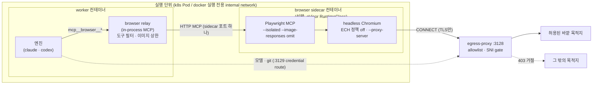

# 결정(조사·설계): worker 브라우저·computer-use 도구

- 상태: 조사와 설계. 이 PR은 도구를 구현하지 않고 worker 이미지도 바꾸지 않는다. 구현은 [6절](#6-구현-순서)의 단계마다 별도 카드와 PR로 한다.
- 받는 쪽: Kiel 도구·MCP 리드. 같은 성격의 빌드 도구 조사와 겹치는 부분은 [7절](#7-빌드-도구-조사와-겹치는-부분)에 모았다.
- 기준 커밋: `origin/main` `3edfe7f`. 요청서가 든 `e9ae2a683`의 바로 다음 커밋이고, 브라우저·데스크톱 도구는 두 커밋 모두 0건이다. `파일:줄`은 `3edfe7f` 기준이다.
- 측정일: 2026-11-10. 바깥 사실(라이선스, 버전, 기동 시간)은 같은 날 공식 저장소·문서에서 확인했다. 직접 확인하지 못한 값에는 "(2차)"를 붙였다.
- 오너 의견(2026-11-10)을 반영했다.
  - 후보에 (e) microVM 격리와 (f) ego-lite 같은 에이전트용 오픈소스 브라우저를 더했다.
  - **특정 클라우드 관리형 서비스에 기대지 않는 것**을 평가 기준 1순위로 둔다.
  - 최근 공개된 "컨테이너 안 GUI 데스크톱·브라우저" 프로젝트를 후보에 넣었다.
  - 결론에 "일반 k8s·일반 서버만으로 충분한가"의 답을 적는다.

## 요약

| 항목 | 결론 |
|---|---|
| 일반 k8s·일반 서버로 충분한가 | **충분하다.** 아래 조건의 일반 Docker 컨테이너에서 headless Chromium과 Playwright MCP를 werft egress-proxy 뒤에서 돌려 보았다. 허용 목적지는 열리고 그 밖은 proxy가 막았다([5절](#5-실측)).<br>조건: KVM 없음, root 아님, rootfs 읽기 전용, capability 전부 drop, `no-new-privileges`, Chromium 샌드박스 끔(`--no-sandbox`).<br>microVM(Kata·Firecracker)은 KVM이 있는 노드에서만 켜는 **선택 강화**다. KVM 없는 노드에서도 쓸 수 있는 강화는 gVisor뿐이다 |
| 추천 | **(b) 브라우저 sidecar.** 구성은 다음과 같다.<br>- 브라우저와 Playwright MCP는 worker와 다른 컨테이너에서 돈다. k8s는 같은 Pod, 로컬 docker는 그 실행 전용 internal network에 둔다.<br>- 엔진은 worker 프로세스 안의 MCP relay를 통해서만 브라우저를 부른다.<br>- 브라우저의 모든 트래픽은 egress-proxy `:3128`로만 나간다.<br>- 운영자가 KVM 없는 노드에서 강화를 원하면 sidecar에 gVisor RuntimeClass를 건다(4단계) |
| 버린 후보 | (a) worker 이미지에 넣기: 브라우저를 안 쓰는 세션도 이미지가 81 MB에서 410 MB(압축)로 커진다. (c) werft 밖 remote 브라우저: 페이지 트래픽이 werft의 egress 정책을 벗어난다. (d) 엔진 내장 computer use: Linux CLI에는 두 엔진 모두 없다. (f) ego-lite: Linux를 지원하지 않는다 |
| 꼭 알아야 할 함정 | **Chromium 158은 TLS ClientHello에 GREASE ECH를 싣는다.** werft egress-proxy는 ECH가 실린 hello를 무조건 끊는다(`apps/egress-proxy/src/tls.ts:32-38`). 그래서 허용 목적지도 `ERR_CONNECTION_CLOSED`로 실패한다.<br>`--disable-features=EncryptedClientHello` 실행 인자로는 꺼지지 않았다. 관리 정책 `/etc/opt/chrome_for_testing/policies/managed/*.json`에 `{"EncryptedClientHelloEnabled": false}`를 두어야 통과했다([5.3절](#53-ech-gate)) |
| 인터페이스 | runtime 쪽에 `BrowserCapable`, 실행 backend 쪽에 `BrowserSidecarCapable`을 둔다. 둘 다 구현하는 어댑터만 갖는 능력이다. 빈 구현과 상속 계층은 두지 않는다. release의 `capabilities.browser`로 켜고 끈다([4절](#4-추천과-능력-인터페이스)) |

## 1. 현황

worker가 쓸 수 있는 도구는 엔진의 코딩 도구, git workspace, 그리고 release가 고정한 remote MCP 하나다. 브라우저·가상 디스플레이·CDP 관련 코드는 `apps/worker`, `packages/adapters`, `packages/runtime-core`에 없다.

브라우저 설계가 기대야 할 기존 경계는 다음과 같다.

| 경계 | 지금 동작 | 위치 |
|---|---|---|
| 네트워크 | 로컬 docker는 실행마다 internal network를 하나씩 만들고, 그 network는 egress-proxy와만 공유한다. host도 그 network에 주소가 없다(isolation contract 7) | `packages/adapters/execution/local-docker/src/backend.ts:140-175` |
| 〃 | k8s는 worker NetworkPolicy가 egress-proxy만 연다 | `deploy/helm/werft/templates/networkpolicies.yaml` |
| egress | `:3128` forward proxy는 `CONNECT`(TLS만)와 gateway용 평문 HTTP만 받는다. 이름을 먼저 해석해 주소를 판정하고, ClientHello의 SNI가 CONNECT authority와 같아야 한다. ECH가 실린 hello는 거절한다 | `apps/egress-proxy/src/proxy.ts:24-39`, `tls.ts:32-38` |
| 자격 증명 | worker는 key가 없다. 공급자·저장소·MCP 자격은 `:3129` credential route에서 proxy가 붙인다. 그 route는 attempt token이 있어야 쓸 수 있다 | `docs/operator/api-server.md:61,205` |
| remote MCP | 엔진은 worker 프로세스 안의 relay와 통신하고, relay가 proxy의 `/mcp/<name>`을 부른다. token은 엔진의 argv·env에 없고, release가 `allow`로 고정한 도구만 보인다 | `packages/adapters/runtimes/claude/src/remote-mcp.ts:36-60` |
| 컨테이너 | non-root(1000), rootfs 읽기 전용, `/tmp`·home은 tmpfs, seccomp `RuntimeDefault`, 기본 메모리 4608 MiB, pids 512 | `packages/adapters/execution/kubernetes/src/specs.ts:247-318`, `apps/control-host/src/scheduler/config.ts:113-127` |
| 능력 협상 | 엔진 능력은 `RuntimeDescriptor.capabilities`와 `extraFeatures`(`FeatureKey`)로, worker 이미지 능력은 `WORKER_CAPABILITIES`로 알린다 | `packages/runtime-core/src/descriptor.ts`, `features.ts`, `apps/worker/src/capabilities.ts` |
| 비밀 가림 | worker가 쥔 비밀값을 이벤트 스트림의 **텍스트**에서 지운다. 이미지는 가리지 않는다 | `apps/worker/src/secret-scrubber.ts` |

## 2. 방식 비교

### 2.1 후보

- **(a)** worker 이미지 안에 headless Chromium과 Playwright MCP를 넣는다(stdio).
- **(b)** 브라우저 sidecar 컨테이너. k8s는 같은 Pod, 로컬 docker는 같은 실행 전용 network에 둔다. Playwright MCP는 HTTP로 열고, 엔진은 worker의 relay를 거쳐 부른다.
- **(c)** werft 밖의 remote MCP 서버가 브라우저를 제공한다. 지금의 `mcp_servers` 카탈로그와 MCP egress를 그대로 쓴다.
- **(d)** 엔진 내장 computer use(Claude `computer_toolset_20260801`, OpenAI Responses `computer`)와 가상 디스플레이(Xvfb와 VNC)를 쓴다.
- **(e)** microVM·샌드박스 런타임(Firecracker, Kata Containers, gVisor) 위에서 브라우저나 가상 데스크톱을 띄운다. 이것은 (a)·(b)와 **직교**한다. 무엇을 띄우느냐가 아니라 무엇으로 감싸느냐의 문제다.
- **(f)** 에이전트용 오픈소스 브라우저·데스크톱(ego-lite, AIO Sandbox, Steel 등)을 참고하거나 그대로 쓴다.

### 2.2 비교 표

평가 기준의 순서는 오너 지시를 따른다. 1순위는 관리형 서비스에 기대지 않는 것이다. 크기·메모리 중 굵은 값은 [5절](#5-실측)에서 직접 잰 값이다.

| | (a) worker 안 | (b) sidecar | (c) remote MCP | (d) 엔진 내장 computer use | (e) microVM·gVisor | (f) 에이전트용 OSS |
|---|---|---|---|---|---|---|
| **관리형 서비스 의존** | 없음 | 없음 | 서버를 werft 밖에 둔다. 자체 운영이면 없고, Browserbase 같은 SaaS면 있다 | 엔진 API 자체 외에는 없음 | 없음. Firecracker·Kata·gVisor는 모두 Apache-2.0이고 자체 운영할 수 있다. 관리형(GKE Sandbox, AKS Pod Sandboxing)은 쓰지 않아도 된다 | 대부분 없음. e2b-dev/desktop은 E2B API key가 필요하고, Browserbase·Hyperbrowser·Cloudflare는 SaaS뿐이다 |
| **격리 수준** | 가장 약하다. 브라우저가 worker와 같은 파일시스템·프로세스 공간을 쓰고 workspace와 엔진 env를 읽을 수 있다. 크래시·OOM이 worker를 같이 죽인다 | 컨테이너 경계가 하나 더 생긴다. workspace는 마운트하지 않고 전달용 디렉터리만 공유한다. 메모리 한도는 따로 둔다. k8s에서는 network namespace를 worker와 공유한다(localhost가 보인다) | 브라우저가 werft 밖에 있다. werft가 보는 것은 MCP 메시지뿐이다 | 엔진은 행동만 정한다. 실행과 격리는 werft가 직접 만든 Xvfb 데스크톱 컨테이너에 달려 있다 | gVisor는 user-space 커널로 syscall을 가로챈다. Kata·Firecracker는 Pod마다 VM을 띄운다. 이 중 가장 강하다 | 프로젝트마다 다르다. AIO Sandbox는 `seccomp=unconfined`를 요구한다 |
| **egress-proxy 경유** | 된다(`--proxy-server`). 실측함 | 된다. 실측함 | **안 된다.** 페이지 트래픽은 서버 쪽 네트워크로 나가고, werft proxy는 MCP 호출만 본다 | 된다. 데스크톱의 브라우저에 proxy를 준다 | 된다. 안쪽 컨테이너에 같은 proxy를 준다 | Steel은 세션마다 `proxyUrl`, AIO Sandbox는 `PROXY_SERVER` env, ego-lite는 문서가 없다 |
| **이미지 크기(압축, gzip -1)** | worker 베이스 **81 MB → 410 MB** | sidecar 이미지 **407 MB**. worker 이미지는 그대로다 | 0 | Xvfb, WM, 브라우저 데스크톱 이미지. anthropic computer-use-demo급이면 1 GB 안팎(2차) | (a)·(b)와 같다. runsc 바이너리는 19 MB | Steel 약 1.02 GB, AIO Sandbox 1 GB 이상(2차). chromedp/headless-shell은 **152 MB**(CDP만 있고 MCP는 없음) |
| **메모리** | MCP만 떠 있을 때 RSS **181~244 MB**. 탭 하나를 연 뒤 RSS **1.1~1.2 GB**, PSS **470~540 MB** | 대기 RSS **113 MB**. 탭 하나를 연 뒤 RSS **~990 MB**, PSS **~438 MB** | 0 | Xvfb와 데스크톱이 더해진다. 1~2 GB(2차) | gVisor는 Sentry 몫이 더해진다. Kata는 VM 메모리를 고정으로 잡는다 | (b)와 비슷하거나 더 크다 |
| **기동** | MCP 초기화 **~0.6 s**. 첫 `browser_navigate`(브라우저 실행 포함)는 **0.42 s** | 컨테이너 시작부터 MCP 응답까지 **< 2 s**. 첫 navigate **0.82 s** | 서버에 달렸다 | 데스크톱 기동이 몇 초 걸린다 | gVisor는 컨테이너급(1초 미만, 2차). Firecracker는 125 ms부터, Kata는 150~300 ms(2차). 이미지·게스트 준비 시간은 따로 든다 | (b)와 비슷하다 |
| **k8s** | 된다. Pod 스펙은 그대로다 | sidecar 컨테이너를 하나 더한다. `specs.ts`에 손을 대야 한다 | 이미 된다 | 데스크톱 컨테이너를 하나 더한다 | gVisor: 노드에 runsc와 RuntimeClass를 깔면 **KVM 없이** 된다(systrap). Kata·Firecracker: **노드에 `/dev/kvm`**이 있어야 한다(bare metal 또는 nested virt). EKS는 metal 인스턴스, AKS는 Pod Sandboxing(Kata와 Cloud Hypervisor) | 대부분 일반 Pod로 된다 |
| **로컬 docker** | 된다 | 된다. 실행 전용 network에 컨테이너를 하나 더 붙인다 | 된다 | 된다 | gVisor: `docker run --runtime=runsc`. Kata: docker 지원이 약해 containerd·nerdctl을 써야 한다. Docker Desktop·macOS에서는 VM 안의 VM이 된다 | 된다(ego-lite는 안 된다) |
| **엔진 중립(claude·codex)** | 된다. 두 CLI 모두 stdio MCP를 받는다 | 된다. relay가 MCP라서 엔진은 차이를 모른다 | 된다 | **Linux에서는 둘 다 없다.** Claude Code의 computer use는 macOS 대화형 미리보기이고, Codex의 computer use는 데스크톱 앱(macOS·Windows) 플러그인이다. API 도구를 쓰려면 werft가 행동 루프를 엔진마다 따로 구현해야 한다 | 감싸는 쪽이라 무관하다 | MCP나 CDP라면 된다 |
| **라이선스** | Playwright MCP Apache-2.0. Chromium BSD-3. Debian 의존 패키지는 기존 `DEBIAN_SOURCES.md` 절차를 탄다 | (a)와 같다 | 서버에 달렸다 | 도구 정의는 API 약관을 따른다. Xvfb는 MIT/X11 | gVisor·Kata·Firecracker 모두 Apache-2.0 | Steel·AIO Sandbox Apache-2.0, ego-lite 저장소 MIT(브라우저 바이너리는 따로 배포), Lightpanda AGPL-3.0, browserless SSPL 또는 상용(**쓸 수 없음**), webtop GPL-3.0 |
| **운영 부담** | 이미지 하나가 커지고 Chromium 보안 패치를 worker 릴리스 주기에 묶는다 | 이미지가 하나 늘고 backend 두 곳(docker·k8s)에 sidecar 조립이 생긴다 | 바깥 서버 운영과 SaaS 계약이 생긴다 | 행동 루프, 화면 전송, 엔진별 구현이 필요해 가장 무겁다 | 노드 준비(runsc·Kata 설치, KVM 확인)와 RuntimeClass 관리가 생긴다 | 바깥 프로젝트를 추종해야 한다. Daytona는 공개 저장소를 보관 처리했고(2026-10), Bytebot도 보관 처리했다(2026-03) |

### 2.3 (e) 런타임별 정리

| 런타임 | 격리 | 기동 | KVM 필요 | k8s 조건 | 로컬 docker 대안 |
|---|---|---|---|---|---|
| gVisor(runsc), release-20261102.0 | user-space 커널 | 컨테이너급 | **아니다**(systrap이 기본, 클라우드 VM 노드에서도 된다) | 노드에 runsc와 containerd shim, `RuntimeClass{handler: runsc}`. 관리형은 GKE Sandbox | `dockerd --add-runtime runsc=…`, `docker run --runtime=runsc` |
| Kata Containers 4.3.1 | Pod마다 경량 VM(QEMU, Cloud Hypervisor, Firecracker, Dragonball) | 150~300 ms(2차) | 그렇다 | 노드에 `containerd-shim-kata-v2`와 RuntimeClass. bare metal이나 nested virt가 필요하다 | nerdctl이나 containerd. docker 직접 지원은 약하다 |
| Firecracker 1.18 | KVM microVM. 장치는 virtio-net·block뿐이고 디스플레이가 없다 | 125 ms부터(2차) | 그렇다 | 단독으로는 k8s 런타임이 아니다. Kata-fc나 firecracker-containerd(devmapper)를 거친다 | 없다(전용 오케스트레이터가 필요) |
| libkrun / microsandbox | KVM microVM | 100~320 ms(2차) | 그렇다 | k8s 통합이 없고 베타다 | CLI |
| Edera | Xen PV | — | 아니다 | 상용이다(krata만 GPL-2.0) | — |

k8s에서 샌드박스 Pod를 묶어 관리할 때는 kubernetes-sigs/agent-sandbox(Apache-2.0, v1.0.2)를 참고할 수 있다. Sandbox, SandboxTemplate, SandboxWarmPool CRD를 제공하고, 격리는 RuntimeClass에 맡긴다. werft는 이미 scheduler가 Pod를 직접 만들기 때문에 이 CRD를 들일 필요는 없다.

Firecracker에는 디스플레이 장치가 없다. 데스크톱(d)을 띄우려면 VNC로 화면을 내보내야 한다. headless 브라우저(b)라면 상관없다.

### 2.4 (f) 에이전트용 브라우저·데스크톱 오픈소스

| 프로젝트 | 라이선스 | 유지 | 자동화 API | proxy | 판단 |
|---|---|---|---|---|---|
| citrolabs/ego-lite | 저장소는 MIT. 브라우저 본체는 따로 무료 배포한다 | 활발함(v2.2.0-beta.5, 2026-11-04) | CDP가 아니다. `ego-browser` skill이 페이지 안 JS 도구를 준다 | 문서 없음 | macOS·Windows 전용이고 Linux는 로드맵에 있다. **지금은 쓸 수 없다.** "사용자 탭 옆의 격리된 Space"라는 발상은 참고할 만하다 |
| agent-infra/sandbox(AIO Sandbox) v1.11.0 | Apache-2.0 | 활발함 | Chromium(VNC·**CDP**·MCP), shell, 파일, VSCode | `PROXY_SERVER` env | 한 컨테이너에 다 들었고 `seccomp=unconfined`와 shm 2 GB가 필요하다. werft의 컨테이너 경계와 맞지 않으므로 **참고만** 한다 |
| steel-dev/steel-browser | Apache-2.0 | 활발함 | CDP(:9223)와 REST(`/v1/sessions` 등) | 세션마다 `proxyUrl` | 쓸 수 있다. 포트에 인증이 없으므로 sidecar로 쓸 때는 localhost에만 묶어야 한다. MCP가 아니어서 relay가 CDP 클라이언트가 되어야 한다 |
| Lightpanda 1.0.3 | **AGPL-3.0** | 활발함 | CDP | 있음(2차) | 웹 호환성이 부분적이고 라이선스 부담이 있어 제외한다 |
| Obscura | Apache-2.0 | 신생 | CDP와 내장 MCP | — | 성능 주장이 검증되지 않아 지켜본다 |
| anthropics computer-use-demo | MIT | 유지 | X11, VNC 5900, noVNC 6080 | 브라우저 설정 | (d)의 참고 구현이다 |
| linuxserver/docker-webtop | GPL-3.0 | 활발함(Selkies v2) | 사람용 스트리밍만 있고 에이전트 API는 없다 | — | 제외한다 |
| trycua/cua | 대부분 MIT, 일부 FSL·AGPL | 활발함 | SDK, CLI, MCP | — | Lume은 Apple Silicon 전용이다. 선택 기능인 cua.ai relay가 있다. 혼합 라이선스라 제외한다 |
| E2B infra / e2b-dev/desktop | Apache-2.0 | 활발함 | SDK | — | 자체 운영하려면 Nomad·Consul·Firecracker가 필요하고 desktop SDK는 E2B key를 요구한다. 1순위 기준에 걸려 제외한다 |
| alibaba/OpenSandbox | Apache-2.0 | 활발함 | k8s 런타임, Desktop·Chrome·Playwright 예제 | 샌드박스마다 egress 정책 | werft의 scheduler와 역할이 겹친다. 참고만 한다 |
| Docker Sandboxes(`sbx`) | CLI는 독점 | 2026-09 출시 | 샌드박스마다 microVM과 docker daemon | 자격을 숨기는 proxy | 데스크톱 도구라 k8s에서 쓸 수 없다. 오너가 기억한 "리눅스 VM 공개"는 이것이나 Perplexity SPACE(Firecracker, Apache-2.0, 2026-10)일 가능성이 있다(2차) |
| Browserbase, Hyperbrowser, Cloudflare Browser Rendering | 상용 SaaS | — | — | — | **1순위 기준에 걸려 제외한다** |
| browserless | SSPL 또는 상용 | — | CDP | launch 인자 | **라이선스 때문에 제외한다** |

## 3. 보안 경계

### 3.1 브라우저 트래픽이 egress allowlist를 지키는가

지킨다. 다만 근거는 브라우저 설정이 아니라 **네트워크**여야 한다.

- 브라우저 컨테이너는 egress-proxy 말고는 경로가 없는 network에만 붙인다. 로컬 docker는 실행 전용 internal network, k8s는 worker NetworkPolicy가 그렇다. 실측에서 브라우저는 `blocked-site`에 직접 갈 수 없었다. proxy를 거치면 `Egress denied … destination is not allowlisted`가 났다([5.2절](#52-허용차단)).
- Playwright MCP의 `--allowed-origins`·`--blocked-origins`는 경계가 아니다. README는 "*does not* serve as a security boundary and *does not* affect redirects"라고 적고, 도구 자체에 대해서도 "Playwright MCP is **not** a security boundary"라고 한다. 이 플래그는 오조작을 줄이는 용도로만 쓴다.
- Chromium은 `--proxy-server`가 없으면 `http_proxy`·`https_proxy` env를 읽는다. Playwright는 `--proxy-server`를 명시적으로 넘긴다. QUIC은 HTTP proxy를 거치는 요청에 쓰이지 않는다. WebRTC UDP는 proxy를 타지 않으므로 다음 둘을 같이 쓴다.
  - 실행 인자 `--force-webrtc-ip-handling-policy=disable_non_proxied_udp`와 `--disable-quic`
  - network가 UDP 경로를 주지 않는 것
- Chromium은 백그라운드 요청을 보낸다. 실측에서 `clients2.google.com:80`, `www.google.com:443`으로 요청이 나갔고 proxy가 거절했다. 로그 소음일 뿐 우회는 아니다. 구현할 때 끌 수 있는 것은 정책 파일로 끈다.
- **ECH.** [5.3절](#53-ech-gate)을 본다. 정책 파일이 빠지면 허용 목적지도 열리지 않는다. 쉽게 지나칠 수 있으니 이미지 검증(`image:verify`류)에 넣는다.
- **allowlist의 폭.** 지금 allowlist는 설치 전체에 하나다(`EGRESS_ALLOWLIST`). 브라우저는 worker가 갈 수 있는 곳에 똑같이 갈 수 있다. 웹 조사용으로 allowlist를 넓히면 worker의 `curl`도 같이 넓어진다. 그래서 1~3단계는 **기존 allowlist를 그대로** 쓴다. release마다 브라우저가 갈 수 있는 목적지를 따로 두는 일은 5단계에서 proxy 쪽 판정으로 한다. 지금의 MCP egress authorizer처럼 요청마다 다시 판정한다.
- **credential route `:3129`.** 이 route는 attempt token이 있어야 쓸 수 있고, token은 worker 프로세스에만 있다. k8s sidecar는 Pod의 network namespace를 공유하므로 worker의 localhost 포트가 보인다. relay와 브라우저 사이 연결은 sidecar 쪽 포트 하나로만 둔다. worker 쪽에는 브라우저를 위해 새 listen 포트를 열지 않는다.

### 3.2 다운로드·업로드 파일이 workspace 밖으로 새는가

| 경로 | 위험 | 대응 |
|---|---|---|
| 다운로드 | 페이지가 파일을 떨어뜨린다 | sidecar에는 workspace를 **마운트하지 않는다**. 다운로드와 `--output-dir`은 sidecar의 tmpfs(`/tmp/pw-out`)에 둔다. workspace로 옮길 때는 relay가 정해진 도구(`browser_download_to_workspace`류)로 크기 상한을 걸어 복사한다. (a)에서는 브라우저가 workspace를 직접 쓸 수 있으므로 이 통제를 할 수 없다 |
| 업로드 | `browser_file_upload`로 workspace 파일을 허용된 사이트에 올린다. 프롬프트 주입에 따른 유출 경로다 | sidecar는 workspace를 보지 못한다. 올릴 파일은 relay가 staging 디렉터리로 복사해 준 것만 쓴다. 이 도구의 기본 정책은 `ask`다. Playwright MCP도 기본적으로 파일 접근을 workspace roots로 제한하고 `file://` 이동을 막는다(`--allow-unrestricted-file-access`는 쓰지 않는다) |
| 임의 코드 | `browser_evaluate`, `browser_run_code_unsafe` | release 기본 정책에서 `browser_run_code_unsafe`는 `deny`, `browser_evaluate`는 `ask`로 둔다 |
| 페이지 내용 | 웹 페이지의 지시가 엔진에게 프롬프트 주입이 된다 | 브라우저 도구의 결과는 바깥에서 온 데이터로 표시한다. 쓰기 성격의 도구(push, PR)는 기존 approval 경로를 그대로 탄다 |

### 3.3 쿠키·자격 증명

- 1~4단계에서는 **항상 `--isolated`**로 띄운다. 프로필은 메모리에만 있고 세션이 끝나면 사라진다. `--user-data-dir`을 안 주면 Playwright MCP는 영속 프로필(`~/.cache/ms-playwright/mcp-…`)을 쓰므로 반드시 명시한다.
- 쿠키는 checkpoint에 넣지 않는다. 재개하면 로그아웃된 브라우저로 돌아온다. 이것은 의도한 동작이다.
- 사이트 자격 증명을 브라우저에 주지 않는다. `--storage-state`나 `--secrets`로 넣으면 그 값이 브라우저 프로세스와 페이지 JS 쪽에 놓인다. 로그인이 필요한 내부 도구는 5단계에서 별도로 설계한다. 지금의 원칙인 "proxy가 자격을 붙이고 worker는 값을 모른다"를 브라우저로 넓히는 방향이다(헤더 주입은 host 단위로 이미 있다).
- 브라우저가 proxy 자격(`user:pass@`)을 가질 필요는 없다. `:3128`에는 인증이 없다.

### 3.4 화면 캡처와 transcript·checkpoint

- `browser_take_screenshot`과 `--image-responses allow`(기본값)의 결과는 엔진 transcript에 base64 이미지로 들어간다. 그 transcript가 checkpoint에도 들어간다.
- `secret-scrubber.ts`는 worker가 쥔 비밀값을 텍스트에서만 지운다. **픽셀 안의 비밀은 가리지 못한다.** 페이지에 표시된 토큰, 다른 사용자의 데이터 등이 그 예다.
- 기본값은 다음과 같이 둔다.
  - `--image-responses omit`으로 엔진에 이미지를 주지 않는다.
  - 기본 조작은 텍스트 접근성 스냅숏(`browser_snapshot`)으로 한다. 이 텍스트는 기존 scrubber를 지난다.
  - 스크린샷은 release가 `capabilities.browser.screenshots: true`로 켠 경우에만 엔진에 준다.
  - 켠 release의 세션 상세에는 "이 세션의 transcript에 화면 이미지가 있다"는 표시를 남긴다.
- 크기: 작은 페이지의 스크린샷이 PNG 31 KB였다(실측). 실제 페이지는 수백 KB까지 간다. `MAX_TRANSCRIPT_BYTES`(512 MiB)와 checkpoint 크기 예산에 들어가므로, relay가 이미지 수와 크기에 상한을 둔다.
- 가림(redaction): 픽셀 단위 자동 가림은 1~4단계에 넣지 않는다. 정확도를 보장할 수 없어서다. 대신 위처럼 기본으로 끄고, 켠 세션임을 표시한다. Playwright MCP의 `--redact-url-params`는 URL 쿼리를 가리는 데 쓸 수 있다.

## 4. 추천과 능력 인터페이스

### 4.1 추천: (b) sidecar와 worker relay. 강화는 (e) gVisor를 선택으로

이유:

1. **관리형 서비스에 기대지 않는다.** 필요한 것은 오픈소스 이미지 둘과 이미 있는 egress-proxy뿐이다.
2. **일반 k8s·일반 서버에서 된다.** KVM도 특권도 필요 없다. 실측한 컨테이너 조건은 werft worker의 격리 조건(isolation contract 7)과 같은 축이다.
3. **worker 이미지가 그대로다.** (a)는 브라우저를 안 쓰는 모든 세션의 pull 크기를 81 MB에서 410 MB로 키운다. Chromium 보안 패치 주기도 worker 릴리스와 분리된다.
4. **경계가 하나 더 생긴다.** 브라우저는 workspace를 마운트하지 않고 메모리 한도도 따로 갖는다. 페이지가 브라우저를 무너뜨려도 worker는 남는다.
5. **엔진 중립이다.** 엔진은 MCP relay만 본다. claude와 codex 어댑터가 같은 relay를 쓴다. 지금 remote MCP relay와 같은 모양이다.
6. **(e)를 나중에 끼울 수 있다.** sidecar 컨테이너 하나에만 `runtimeClassName: gvisor`를 걸면 된다. Kubernetes의 RuntimeClass는 Pod 단위라서, 실제로는 브라우저를 별도 Pod로 빼는 선택지와 함께 4단계에서 다시 잰다.

데스크톱 computer use(d)는 추천하지 않는다. 두 엔진 모두 Linux CLI에 내장 도구가 없고, 접근성 스냅숏 기반 브라우저 조작으로 웹 작업의 대부분을 덮는다. 좌표 클릭이 필요하면 Playwright MCP의 `--caps vision`을 쓴다. 데스크톱 앱 조작이 실제 요구로 나오면 그때 (b)의 sidecar를 Xvfb 데스크톱 이미지로 바꾸는 별도 카드로 다룬다.

### 4.2 구성도



### 4.3 능력 인터페이스

규칙:

- 능력은 **그것을 구현하는 어댑터만** 갖는다.
- 공통 부모 클래스나 "지원 안 함"을 던지는 빈 메서드는 두지 않는다.
- 호출하는 쪽은 type guard로 능력을 확인하고, 없으면 claim 단계에서 거절한다.

```ts
// packages/runtime-core/src/browser.ts (sketch, not part of this PR)

/** Where the browser sidecar's MCP endpoint is, as the worker sees it. */
export type BrowserEndpoint = {
  url: string; // e.g. http://127.0.0.1:8931/mcp in a Pod, http://browser:8931/mcp on docker
  allowedTools: readonly string[]; // pinned by the release
  screenshots: boolean;
};

/** An engine adapter that can mount the browser relay as one of its MCP servers. */
export interface BrowserCapable {
  attachBrowser(endpoint: BrowserEndpoint): { serverName: "browser" };
}

export function isBrowserCapable<T extends object>(
  runtime: T,
): runtime is T & BrowserCapable {
  return typeof (runtime as Partial<BrowserCapable>).attachBrowser === "function";
}
```

```ts
// packages/platform/src/ports/execution-backend.ts (sketch)

/** An execution backend that can start a browser beside a worker. */
export interface BrowserSidecarCapable {
  browserSidecar(intent: LaunchIntent): BrowserSidecarSpec; // image, limits, network attachment
}
```

연결 지점:

| 층 | 바꾸는 곳 | 내용 |
|---|---|---|
| 계약 | `packages/contracts/src/kollegium/agents.ts` `agentCapabilitiesSchema` | `browser: {screenshots: boolean} \| null`을 optional로 더한다. 옛 card의 content hash가 그대로 남게 하려고 default는 두지 않는다 |
| 〃 | `effectiveToolsSchema` | `browser: string[]`(release가 고정한 `mcp__browser__*`)를 더한다 |
| 〃 | `packages/contracts/src/worker-protocol` `workerCapabilitiesSchema` | `browser: true`를 더한다. 옛 worker 이미지가 브라우저 claim을 받지 않게 한다. 배포 순서는 MCP 때와 같다(worker 먼저) |
| runtime | `packages/runtime-core/src/descriptor.ts` `FeatureKey` | `"browser"`를 더한다. `runtimeRequirementsOf`는 `runtime_config.browser`가 있으면 요구하고, 어댑터는 `extraFeatures.browser = "native"`로 알린다. `unmetFeatures`가 기존처럼 claim 전에 거절한다 |
| 어댑터 | `packages/adapters/runtimes/claude`(뒤에 codex) | `BrowserCapable`을 구현한다. `remote-mcp.ts`의 relay와 같은 모양으로, 대상만 proxy route가 아니라 sidecar다 |
| 실행 | `packages/adapters/execution/{kubernetes,local-docker}` | `BrowserSidecarCapable`을 구현한다. k8s는 Pod에 컨테이너를 더하고, docker는 실행 전용 network에 컨테이너를 더한다. isolation contract 버전을 올린다 |
| 정책 | release 생성 | `capabilities.browser`가 있으면 기본 도구 정책을 고정한다. `browser_run_code_unsafe`는 deny, `browser_evaluate`와 `browser_file_upload`는 ask, 나머지는 allow다 |

## 5. 실측

환경: 이 조사용 클라우드 컨테이너(4 vCPU, 16 GB, Docker 29.9.2, KVM 없음, amd64). 측정한 이미지는 `apps/worker/Dockerfile`과 같은 베이스(`oven/bun:1.3.14@sha256:e10577f0…`) 위에 쌓았다. **worker 이미지를 바꾸거나 머지하지 않았다.** 측정용 이미지와 컨테이너는 이 컨테이너 안에서만 만들었고, 잰 뒤 바로 멈췄다.

이 세션의 네트워크에서는 Playwright 브라우저 CDN이 막혀 있었다. 그래서 브라우저 바이너리는 공식 `mcr.microsoft.com/playwright/mcp:latest`(@playwright/mcp 0.0.85, Chrome for Testing 158.0.8127.18)에서 복사했다.

### 5.1 이미지 크기

측정용 (a) 이미지(요지):

```dockerfile
FROM mcr.microsoft.com/playwright/mcp:latest AS mcp
FROM oven/bun:1.3.14@sha256:e10577f0db68676a7024391c6e5cb4b879ebd17188ab750cf10024a6d700e5c4 AS a
ENV PLAYWRIGHT_BROWSERS_PATH=/ms-playwright
COPY --from=mcp /app /opt/pw
RUN cd /opt/pw && bun ./node_modules/playwright/cli.js install-deps chromium   # Debian deps
COPY --from=mcp /ms-playwright /ms-playwright
```

```text
$ docker history --format '{{.Size}}\t{{.CreatedBy}}' werft-measure-a:local | head -3
438MB	COPY /ms-playwright /ms-playwright # buildkit
369MB	RUN /bin/sh -c sed -i 's#http://deb.debian.o…        # install-deps chromium
19.7MB	COPY /app /opt/pw # buildkit                           # Playwright MCP + node_modules

$ docker run --rm --entrypoint sh werft-measure-a:ech-off -c 'du -sh /ms-playwright/* /opt/pw'
413M	/ms-playwright/chromium-1254
5.1M	/ms-playwright/ffmpeg-1013
19M	/opt/pw

$ for i in <bun base> werft-measure-a:ech-off werft-measure-b:local chromedp/headless-shell:latest; do
    echo "$i compressed_gzip1_mb=$(( $(docker save $i | gzip -1 | wc -c) / 1048576 ))"; done
e10577f0db68 compressed_gzip1_mb=81
werft-measure-a:ech-off compressed_gzip1_mb=410
werft-measure-b:local compressed_gzip1_mb=407
chromedp/headless-shell:latest compressed_gzip1_mb=152

$ docker image ls --format '{{.Repository}}:{{.Tag}} {{.Size}}'
werft-measure-a:ech-off 1.49GB
werft-measure-b:local 1.53GB
chromedp/headless-shell:latest 546MB
oven/bun:<none> 312MB
```

정리:

- (a)는 worker 베이스에 **압축 +329 MB, 풀었을 때 약 +1.18 GB**를 더한다.
- 이 값은 full Chrome for Testing(413 MB)과, `install-deps`가 같이 까는 Xvfb·폰트(369 MB)를 포함한다. chrome-headless-shell(283 MB)만 쓰고 의존 패키지를 headless에 필요한 것으로 줄이면 더 작아진다. 다만 그 값은 재지 않았다(CDN 차단).
- 비교용 (a)와 (b)는 모두 worker 베이스 81 MB가 아니라 브라우저 쪽만 따진 값이다.

### 5.2 허용·차단

구성: werft egress-proxy(`apps/egress-proxy/Dockerfile` 그대로 빌드)를 두 internal network에 붙였다. 브라우저는 worker network에만, 목적지 둘(자체 서명 TLS 서버)은 바깥 network에만 둔다. 허용은 `EGRESS_PRIVATE_ALLOWLIST=allowed-site:8443` 하나다.

```bash
docker network create --internal wb-worker
docker network create --internal wb-outside
docker create --name wb-egress --network wb-worker --network-alias egress \
  -e EGRESS_PRIVATE_ALLOWLIST=allowed-site:8443 werft-egress-proxy:measure
docker network connect wb-outside wb-egress
```

(a)는 werft worker와 같은 축의 제약으로 띄웠다. 이 컨테이너 안에서 측정 스크립트가 Playwright MCP를 stdio로 몰았다.

```bash
docker run -d --name wb-a --network wb-worker --user 1000:1000 --read-only \
  --tmpfs /tmp:size=512m --tmpfs /home/bun:size=256m,uid=1000,gid=1000 --cap-drop ALL --security-opt no-new-privileges \
  --memory 4608m -w /tmp --pids-limit 512 -e HOME=/home/bun \
  -e MCP_ARGS="--headless --browser chromium --no-sandbox --isolated --ignore-https-errors --proxy-server http://egress:3128 --output-dir /tmp/pw-out --config /s/pw-config.json" \
  … werft-measure-a:ech-off bun /s/drive.ts
```

```text
{"step":"initialized","ms":664}
{"step":"tools","count":25,"names":"browser_close,browser_resize,…,browser_file_upload,…,browser_run_code_unsafe,browser_take_screenshot,browser_snapshot,…"}
{"step":"navigate","url":"https://allowed-site:8443/","ms":420,"since_start_ms":999,"isError":false,"excerpt":"… Page URL: https://allowed-site:8443/ - Page Title: allowed-site …"}
{"step":"navigate","url":"https://blocked-site:8443/","ms":14,"since_start_ms":1013,"isError":true,"excerpt":"### Error Error: net::ERR_TUNNEL_CONNECTION_FAILED at https://blocked-site:8443/ …"}
{"step":"screenshot","parts":["text::380","image:image/png:31152"]}
```

proxy 로그:

```text
{"level":"info","message":"Egress allowed",…"host":"allowed-site","method":"connect","port":8443,"scope":"private"}
{"level":"warn","message":"Egress denied",…"host":"blocked-site","method":"connect","port":8443,"reason":"destination is not allowlisted"}
{"level":"warn","message":"Egress denied",…"host":"clients2.google.com","method":"forward","port":80,"reason":"destination is not allowlisted"}
{"level":"warn","message":"Egress denied",…"host":"www.google.com","method":"connect","port":443,"reason":"destination is not allowlisted"}
```

(b)는 공식 MCP 이미지에 ECH 정책 파일만 더해 같은 제약으로 띄웠다. 다른 컨테이너가 streamable HTTP로 몰았다.

```bash
docker run -d --name wb-b --network wb-worker --network-alias browser --user 1000:1000 --read-only \
  --tmpfs /tmp:size=512m --tmpfs /home/node:size=256m,uid=1000,gid=1000 --cap-drop ALL --security-opt no-new-privileges \
  --memory 2g --pids-limit 512 werft-measure-b:local \
  --headless --browser chromium --no-sandbox --isolated --ignore-https-errors \
  --proxy-server http://egress:3128 --output-dir /tmp/pw-out --port 8931 --host 0.0.0.0 --allowed-hosts '*'
```

```text
{"step":"initialized","ms":43}
{"step":"navigate","url":"https://allowed-site:8443/","ms":816,"isError":false,"excerpt":"… Page URL: https://allowed-site:8443/ - Page Title: allowed-site …"}
{"step":"navigate","url":"https://blocked-site:8443/","ms":14…21,"isError":true,"excerpt":"### Error Error: browserBackend.callTool: net::ERR_TUNNEL_CONNECTION_FAILED at https://blocked-site:8443/ …"}
```

### 5.3 ECH gate

정책 파일 없이 (a)를 띄우면 허용 목적지도 실패한다.

```text
{"step":"navigate","url":"https://allowed-site:8443/","ms":362,"isError":true,"excerpt":"### Error Error: net::ERR_CONNECTION_CLOSED at https://allowed-site:8443/ …"}
proxy: {"level":"warn","message":"Dropping a tunnel whose ClientHello failed the gate",…"host":"allowed-site","reason":"encrypted_client_hello is not accepted: the server name it protects cannot be judged"}
```

`launchOptions.args`로 `--disable-features=EncryptedClientHello`를 넘겨도 결과는 같았다. 인자는 Playwright 기본 `--disable-features` 뒤에 들어가 실제로 전달됐는데도 같았다.

```text
15:--disable-features=AvoidUnnecessaryBeforeUnload…   # Playwright 기본값
43:--proxy-server=http://egress:3128
45:--disable-features=EncryptedClientHello           # 우리가 더한 것, 효과 없음
```

관리 정책 경로 셋을 하나씩 넣어 본 결과, Chrome for Testing 경로만 효과가 있었다.

```text
/etc/opt/chrome/policies/managed -> "isError":true
/etc/chromium/policies/managed -> "isError":true
/etc/opt/chrome_for_testing/policies/managed -> "isError":false
```

결론:

- 이미지 빌드에서 `/etc/opt/chrome_for_testing/policies/managed/werft-egress.json`에 `{"EncryptedClientHelloEnabled": false}`를 둔다.
- 다른 Chromium 배포판(Debian `chromium` 패키지 등)으로 바꾸면 경로가 `/etc/chromium/policies/managed`로 바뀌므로 다시 확인한다.
- proxy의 ECH 거절은 그대로 둔다. GREASE ECH는 진짜 ECH와 구분할 수 없게 설계되어 있어서다(`tls.ts:33-36`).

### 5.4 메모리·기동

host에서 컨테이너 프로세스의 `VmRSS`와 `smaps_rollup`의 `Pss`를 더해 쟀다. 이 환경에서는 `docker stats`가 0을 돌려줬다.

```text
# (a) 브라우저 실행 전(MCP + 측정 스크립트, 프로세스 2개)
t=2160ms procs=2 rss_mb=244 pss_mb=191
t=12388ms procs=2 rss_mb=181 pss_mb=128
# (a) 탭 하나를 연 뒤(프로세스 13개)
t=4268ms procs=13 rss_mb=1190 pss_mb=537
t=12600ms procs=13 rss_mb=1126 pss_mb=472
# (b) 대기, 탭 하나를 연 뒤
idle(after 2s): procs=2 rss_mb=113 pss_mb=112
t=3355ms after nav: procs=13 rss_mb=989 pss_mb=437
+5s: procs=13 rss_mb=991 pss_mb=438
```

- 작은 정적 페이지 하나로 잰 값이다. 실제 사이트는 렌더러 하나에 수백 MB가 더 든다.
- (a)는 worker의 4608 MiB 한도를 엔진과 나눠 쓴다. (b)는 sidecar에 따로 한도(예: 2 GiB)를 준다.
- `--disable-dev-shm-usage`는 Playwright가 기본으로 넘긴다. 그래서 shm 64 MB에서도 문제가 없었다.

### 5.5 재지 못한 것

- **gVisor 아래 실행.** gVisor 릴리스(`release-20261102.0`, sha512 검증 완료)는 받았다. 그러나 dockerd에 runsc를 등록하려면 데몬을 다시 띄워야 했고, 이 세션의 자동 권한 판정이 그 동작을 거절했다. 규칙대로 다른 방법으로 다시 시도하지 않았다. 4단계에서 KVM 없는 노드로 잰다.
- headless shell만 쓰는 최소 이미지, 실제 웹사이트의 메모리, arm64.

## 6. 구현 순서

각 단계는 별도 카드와 PR이다. 앞 단계가 머지되기 전에는 다음 단계의 동작이 켜지지 않는다.

1. **계약과 능력 협상.** 동작 변경은 없다.
   - `agentCapabilitiesSchema.browser`(optional), `effectiveToolsSchema.browser`, `workerCapabilitiesSchema.browser`, `FeatureKey "browser"`를 더한다.
   - `BrowserCapable` 인터페이스와 type guard를 더한다.
   - 브라우저를 요구하는 release는 아직 어떤 worker도 `browser: true`를 알리지 않으므로 claim 전에 거절된다.
2. **browser sidecar 이미지.**
   - `apps/browser`(또는 `images/browser`)를 만든다. 같은 베이스 digest 규칙, `apt-get upgrade`, `THIRD_PARTY_NOTICES`·`DEBIAN_SOURCES` 절차, ECH 정책 파일, 실행 인자 기본값(`--isolated --no-sandbox --image-responses omit --disable-quic --force-webrtc-ip-handling-policy=disable_non_proxied_udp`)을 넣는다.
   - `image:verify`에 "정책 파일이 있고 ECH가 꺼진다"를 넣는다.
   - 이미지 스캔(images.yml)에 넣는다.
3. **실행 backend와 relay.**
   - local-docker와 k8s가 `BrowserSidecarCapable`을 구현한다. isolation contract 버전을 올린다.
   - claude 어댑터가 `BrowserCapable`을 구현한다. 도구 필터, 이미지 상한, 다운로드·업로드 staging을 넣는다.
   - worker가 `browser: true`를 알린다.
   - egress 통합 시험(`packages/adapters/execution/local-docker/src/egress.integration.test.ts` 계열)에 브라우저의 허용·차단·ECH 사례를 더한다.
4. **codex 어댑터와 gVisor 선택지.**
   - codex 어댑터가 `BrowserCapable`을 구현한다.
   - helm 값 `browser.runtimeClassName`을 더한다. Pod 단위 RuntimeClass라 브라우저를 별도 Pod로 빼는 안과 비교해 결정한다.
   - KVM 없는 노드에서 gVisor 측정(5.5)을 한다.
5. **release별 목적지와 로그인.**
   - 브라우저 전용 목적지 목록을 proxy 판정으로 구현한다(MCP egress authorizer 모양).
   - 로그인이 필요한 사이트의 자격 주입을 설계한다.
   - 스크린샷 표시를 화면에 반영한다.

## 7. 빌드 도구 조사와 겹치는 부분

- **이미지 크기 정책.** 무거운 도구(브라우저, 언어 툴체인)를 worker 이미지에 다 넣지 말고, 필요한 release만 sidecar나 추가 이미지로 받게 하자는 판단은 두 조사에 똑같이 적용된다. 위 실측이 한 예다. 브라우저 하나로 압축 크기가 5배가 된다.
- **egress.** 빌드 도구의 패키지 레지스트리는 `EGRESS_PACKAGES_REDIRECT_ALLOWLIST`와 packages route를 쓴다. 브라우저와 같은 proxy를 지나므로 allowlist를 설치 전체에 두느냐 release별로 두느냐는 질문이 같다(5단계).
- **TLS 클라이언트 호환.** ECH gate는 브라우저뿐 아니라 새 런타임과 도구 모두에 걸린다. Bun 1.3.10~1.3.13도 GREASE ECH를 실어 같은 문제가 있었다(`egress.integration.test.ts:782`). 빌드 도구에도 "proxy 뒤에서 허용 목적지에 실제로 붙는가"를 시험으로 둔다.
- **능력 협상.** `FeatureKey`, `WorkerCapabilities`, release 정책으로 켜고 끄는 모양을 빌드 도구에도 그대로 쓸 수 있다(`BuildToolCapable`류).

## 8. 하지 않을 것

- 이 PR에서 도구를 구현하거나 worker 이미지를 바꾸지 않는다.
- 브라우저를 위해 설치 전체의 egress allowlist를 넓히지 않는다.
- 엔진의 computer use를 werft가 직접 구현하지 않는다(4.1).
- 관리형 브라우저·샌드박스 SaaS에 기대지 않는다.

## 참고

- Playwright MCP: https://github.com/microsoft/playwright-mcp, https://www.npmjs.com/package/@playwright/mcp
- Chromium proxy: https://chromium.googlesource.com/chromium/src/+/HEAD/net/docs/proxy.md, https://chromium.googlesource.com/chromium/src/+/HEAD/docs/linux/proxy_config.md
- Claude computer use: https://platform.claude.com/docs/en/agents-and-tools/tool-use/computer-use-tool, https://code.claude.com/docs/en/computer-use
- OpenAI computer use: https://developers.openai.com/api/docs/guides/tools-computer-use, https://openai.com/index/codex-for-almost-everything/
- gVisor: https://github.com/google/gvisor/releases, https://gvisor.dev/blog/2023/04/28/systrap-release/
- Kata: https://github.com/kata-containers/kata-containers/releases, https://docs.azure.cn/en-us/aks/concepts-pod-sandboxing
- Firecracker: https://github.com/firecracker-microvm/firecracker/releases
- agent-sandbox: https://github.com/kubernetes-sigs/agent-sandbox
- ego-lite: https://github.com/citrolabs/ego-lite
- AIO Sandbox: https://github.com/agent-infra/sandbox
- Steel: https://github.com/steel-dev/steel-browser
- OpenSandbox: https://github.com/alibaba/OpenSandbox
- Lightpanda: https://github.com/lightpanda-io/browser
- browserless: https://github.com/browserless/browserless
- Docker Sandboxes: https://www.docker.com/blog/introducing-cloud-sandboxes-start-on-your-laptop-finish-in-the-cloud/
- Perplexity SPACE(2차): https://www.marktechpost.com/2026/10/16/perplexity-open-sources-space-firecracker-microvm-sandbox-ai-agents/
